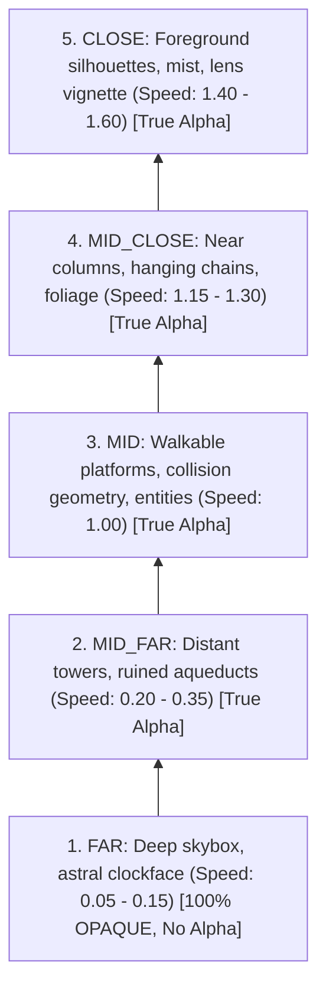

# Content Pipeline & Asset Standards

Rules for declarative game content schemas (`src/data/`), level blueprints, parallax environments, and 2D pixel art textures in `src/assets/`.

---

## 0. PURPOSE & BOUNDARIES

1. Governs declarative game content schemas in `src/data/` and visual sprite assets in `src/assets/`.
2. Static game content is strictly decoupled from the game engine:
   $$\text{SCENARIO} \longrightarrow \text{src/data/ (JSON)} \longrightarrow \text{src/assets/ (PNG)} \longrightarrow \text{ENGINE / UI}$$
3. The engine acts as an **interpreter** of data, never a hardcoded store of level coordinates, dialogues, or weapon statistics.

---

## 1. HARD INVARIANTS: DATA PURITY (`src/data/`)

- ❌ **FORBIDDEN: Binary or Image Assets in `src/data/`**: Images, sounds, and binary atlas files belong strictly in `src/assets/`. Every file in `src/data/` must be a `.json` file, with the sole exception of `src/data/index.ts`. *(enforced: `dataPurity.test.ts`)*
- ❌ **FORBIDDEN: Procedural Logic in `src/data/index.ts`**: The `index.ts` facade file must contain ONLY re-exports of static JSON blueprints and schema types. Zero procedural calculations, loops, or game functions are permitted. *(enforced: `dataPurity.test.ts`)*
- ❌ **FORBIDDEN: Dangling Room Portals**: Every portal defined in a location blueprint MUST route to a valid destination room in the world progression graph. *(enforced: `locationBlueprints.test.ts`)*
- ❌ **FORBIDDEN: Redundant Local Monster Dictionaries**: Location blueprints must never declare ad-hoc monster stats or inline templates. Every placed enemy must reference a canonical monster ID registered in the master bestiary. *(enforced: `locationBlueprints.test.ts`)*
- ✅ **REQUIRED: Positive Bounds & Verified Spawns**: All location blueprints must declare positive dimensions, with player and enemy spawn coordinates placed strictly within valid room boundaries.
- ✅ **REQUIRED: Lore Consistency**: Every level blueprint, item, and dialogue node must reflect the world state of the Citadel of Aether as documented in `docs/lore/`.

---

## 2. HARD INVARIANTS: ASSET & PARALLAX RULES (`src/assets/`)

- ❌ **FORBIDDEN: Non-PNG Formats**: All in-game textures, atlas sheets, and parallax backdrops must be saved exclusively as PNG.
- ❌ **FORBIDDEN: Fake Transparency or Muddy Backgrounds**: True alpha transparency is strictly mandatory for all sprites, entities, and foreground layers. No solid black or color perimeter pixels that mimic alpha.
- ❌ **FORBIDDEN: Transparency in the FAR Parallax Layer**: The `FAR` background layer MUST cover 100% of the viewport and MUST be completely opaque (`opaque: true` in the location JSON). All other parallax layers (`MID_FAR`, `MID`, `MID_CLOSE`, `CLOSE`) must use true transparency. *(enforced: `locationBlueprints.test.ts`)*
- ❌ **FORBIDDEN: Burned-in Text or UI in Textures**: Sprite textures and background layers must never contain burned-in typography or user interface elements. All labels are rendered dynamically via `@i18n`.
- ✅ **REQUIRED: Grid Alignment & Baseline Consistency**: Sprites must align to pixel grids with a consistent ground baseline. Wide animation frames (e.g. rapier lunges or arcane slashes) must occupy 2–3 standard cell spans without breaking cell metrics.

---

## 3. PARALLAX LAYER HIERARCHY

All level environments must implement depth separation across 5 standard tiers:



| Tier | Layer Key | Alpha Rule | Relative Scroll Speed | Visual Role |
| :--- | :--- | :--- | :--- | :--- |
| `FAR` | `layer_far` | **100% Opaque (`opaque: true`)** | 0.05 – 0.15 | Skybox, temporal rift, astral horizon. |
| `MID_FAR` | `layer_mid_far` | True Transparency | 0.20 – 0.35 | Distant Citadel spires, floating clockwork gears. |
| `MID` | `layer_mid` | True Transparency | 1.00 (Anchor) | Collision geometry, gameplay platforms, duelists. |
| `MID_CLOSE` | `layer_mid_close`| True Transparency | 1.15 – 1.30 | Archways, chandeliers, foreground pillars. |
| `CLOSE` | `layer_close` | True Transparency | 1.40 – 1.60 | Atmospheric fog, floating ember particles. |

---

## 4. ANTI-PATTERNS VS PATTERNS (CONTRASTIVE EXAMPLES)

### 4.1. Static JSON vs Binary Assets in `src/data/`
❌ **BAD:**
```text
src/data/
├── locations/
│   ├── courtyard.json
│   └── courtyard_background.png  <-- FORBIDDEN in src/data/!
```
✅ **GOOD:**
```text
src/data/locations/courtyard.json   <-- Declarative JSON schema
src/assets/locations/courtyard/far.png <-- Physical graphic texture
```

### 4.2. Ad-hoc Monster Template vs Canonical ID Reference
❌ **BAD:**
```json
// Inside location blueprint courtyard.json
"enemies": [
  {
    "id": "enemy_1",
    "name": "Corrupted Clockwork Automaton",
    "maxHp": 250,
    "damage": 35
  }
]
```
✅ **GOOD:**
```json
// References canonical template from master monster registry
"enemies": [
  {
    "templateId": "clockwork_automaton_scout",
    "spawnX": 450,
    "spawnY": 300,
    "facing": "left"
  }
]
```

### 4.3. Transparent FAR Layer
❌ **BAD:**
```json
{
  "layerId": "sky_far",
  "tier": "FAR",
  "opaque": false // Visual hole bug: transparent background shows black canvas void!
}
```
✅ **GOOD:**
```json
{
  "layerId": "sky_far",
  "tier": "FAR",
  "opaque": true // 100% covers scene with solid astral horizon
}
```

---

## 5. ENFORCEMENT & VERIFICATION

- `bun test src/tests/arch/dataPurity.test.ts` — Guarantees only JSON and `index.ts` exist in `src/data/`.
- `bun test src/tests/arch/dataIntegrity.test.ts` — Enforces spell, item, and dialogue graph schema integrity.
- `bun test src/tests/arch/locationBlueprints.test.ts` — Verifies room dimensions, portal graphs, and FAR layer opacity.
- `bun test src/tests/arch/assetIntegrity.test.ts` — Proves all referenced textures exist on disk and parse via `MetaParser`.
