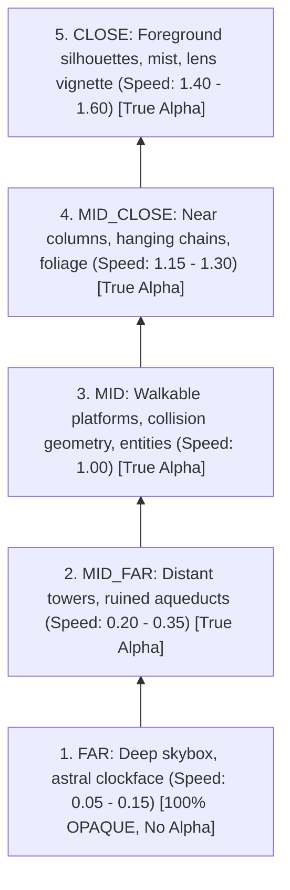

# Content Pipeline & Asset Standards

Rules for declarative game content schemas (`src/data/`), level blueprints, parallax environments, and 2D pixel art textures in `src/assets/`.

---

## 0. PURPOSE & BOUNDARIES

1. Governs declarative game content schemas in `src/data/` and visual sprite assets in `src/assets/`.
2. Static game content is strictly decoupled from the game engine:
   $$\text{SCENARIO} \longrightarrow \text{src/data/ (JSON)} \longrightarrow \text{src/assets/ (PNG / enemy SVG tiers)} \longrightarrow \text{ENGINE / UI}$$
3. The engine acts as an **interpreter** of data, never a hardcoded store of level coordinates, dialogues, or weapon statistics.

---

## 1. HARD INVARIANTS: DATA PURITY (`src/data/`)

- ❌ **FORBIDDEN: Binary or Image Assets in `src/data/`**: Images, sounds, and binary atlas files belong strictly in `src/assets/`. Every file in `src/data/` must be a `.json` file, with the sole exception of `src/data/index.ts`. *(enforced: `dataPurity.test.ts`)*
- ❌ **FORBIDDEN: Procedural Logic in `src/data/index.ts`**: The `index.ts` facade file must contain ONLY re-exports of static JSON blueprints and schema types. Zero procedural calculations, loops, or game functions are permitted. *(enforced: `dataPurity.test.ts`)*
- ❌ **FORBIDDEN: Dangling Room Portals**: Every portal defined in a location blueprint MUST route to a valid destination room in the world progression graph. *(enforced: `locationBlueprints.test.ts`)*
- ❌ **FORBIDDEN: Redundant Local Monster Dictionaries**: Location blueprints must never declare ad-hoc monster stats or inline templates. Every placed enemy must reference a canonical monster ID registered in the master bestiary. *(enforced: `locationBlueprints.test.ts`)*
- ✅ **REQUIRED: Positive Bounds & Verified Spawns**: All location blueprints must declare positive dimensions, with player and enemy spawn coordinates placed strictly within valid room boundaries.
- ✅ **REQUIRED: Lore Consistency**: Every level blueprint, item, and dialogue node must reflect the world state of the Citadel of Aether as documented in `docs/lore/`.

---

## 2. HARD INVARIANTS: ASSET & PARALLAX RULES (`src/assets/`)

- ❌ **FORBIDDEN: Non-PNG Formats**: All in-game textures, atlas sheets, parallax backdrops, hero sheets, structures and enemy `high` quality tier sheets must be saved as PNG. The ONLY exception: enemy sprite sheets for the `low` and `mid` quality tiers are SVG files generated by the sprite compiler (see §6). Hand-edited SVG is forbidden.
- ❌ **FORBIDDEN: Fake Transparency or Muddy Backgrounds**: True alpha transparency is strictly mandatory for all sprites, entities, and foreground layers. No solid black or color perimeter pixels that mimic alpha.
- ❌ **FORBIDDEN: Transparency in the FAR Parallax Layer**: The `FAR` background layer MUST cover 100% of the viewport and MUST be completely opaque (`opaque: true` in the location JSON). All other parallax layers (`MID_FAR`, `MID`, `MID_CLOSE`, `CLOSE`) must use true transparency. *(enforced: `locationBlueprints.test.ts`)*
- ❌ **FORBIDDEN: Burned-in Text or UI in Textures**: Sprite textures and background layers must never contain burned-in typography or user interface elements. All labels are rendered dynamically via `@i18n`.
- ✅ **REQUIRED: Grid Alignment & Baseline Consistency**: Sprites must align to pixel grids with a consistent ground baseline. Wide animation frames (e.g. rapier lunges or arcane slashes) must occupy 2–3 standard cell spans without breaking cell metrics.

---

## 3. PARALLAX LAYER HIERARCHY

All level environments must implement depth separation across 5 standard tiers:



| Tier | Layer Key | Alpha Rule | Relative Scroll Speed | Visual Role |
| :--- | :--- | :--- | :--- | :--- |
| `FAR` | `layer_far` | **100% Opaque (`opaque: true`)** | 0.05 – 0.15 | Skybox, temporal rift, astral horizon. |
| `MID_FAR` | `layer_mid_far` | True Transparency | 0.20 – 0.35 | Distant Citadel spires, floating clockwork gears. |
| `MID` | `layer_mid` | True Transparency | 1.00 (Anchor) | Collision geometry, gameplay platforms, duelists. |
| `MID_CLOSE` | `layer_mid_close`| True Transparency | 1.15 – 1.30 | Archways, chandeliers, foreground pillars. |
| `CLOSE` | `layer_close` | True Transparency | 1.40 – 1.60 | Atmospheric fog, floating ember particles. |

---

## 4. ANTI-PATTERNS VS PATTERNS (CONTRASTIVE EXAMPLES)

### 4.1. Static JSON vs Binary Assets in `src/data/`
❌ **BAD:**
```text
src/data/
├── locations/
│   ├── courtyard.json
│   └── courtyard_background.png  <-- FORBIDDEN in src/data/!
```
✅ **GOOD:**
```text
src/data/locations/courtyard.json   <-- Declarative JSON schema
src/assets/locations/courtyard/far.png <-- Physical graphic texture
```

### 4.2. Ad-hoc Monster Template vs Canonical ID Reference
❌ **BAD:**
```json
// Inside location blueprint courtyard.json
"enemies": [
  {
    "id": "enemy_1",
    "name": "Corrupted Clockwork Automaton",
    "maxHp": 250,
    "damage": 35
  }
]
```
✅ **GOOD:**
```json
// References canonical template from master monster registry
"enemies": [
  {
    "templateId": "clockwork_automaton_scout",
    "spawnX": 450,
    "spawnY": 300,
    "facing": "left"
  }
]
```

### 4.3. Transparent FAR Layer
❌ **BAD:**
```json
{
  "layerId": "sky_far",
  "tier": "FAR",
  "opaque": false // Visual hole bug: transparent background shows black canvas void!
}
```
✅ **GOOD:**
```json
{
  "layerId": "sky_far",
  "tier": "FAR",
  "opaque": true // 100% covers scene with solid astral horizon
}
```

---

## 5. ENFORCEMENT & VERIFICATION

- `bun test src/tests/arch/dataPurity.test.ts` — Guarantees only JSON and `index.ts` exist in `src/data/`.
- `bun test src/tests/arch/dataIntegrity.test.ts` — Enforces spell, item, and dialogue graph schema integrity.
- `bun test src/tests/arch/locationBlueprints.test.ts` — Verifies room dimensions, portal graphs, and FAR layer opacity.
- `bun test src/tests/arch/assetIntegrity.test.ts` — Proves all referenced textures exist on disk and parse via `MetaParser`.
- `bun test:scripts` — Enforces the SVG enemy sheet contract (§6): compiler contract and generated files in sync with their draw scripts. It also checks frame geometry of every packed sheet.
- `bun test src/tests/arch/levelLogic.test.ts` — Enforces the level design grammar (§7). Check a single map with `bun scripts/validate-level.ts <locationId>`.

---

## 6. SVG ENEMY SHEET CONTRACT

### 6.1. Quality tiers (canonical definition)

- **`low` = hi-8bit.** The look of the 8-bit era: a small palette per sprite (the shipped enemy sheets use 10–16 colours each), flat fills, hard 1 px outlines, no gradients, no anti-aliasing, chunky silhouettes. It is drawn at a modern pixel density, not at the density of the original hardware: the base cell is 48 px, so it stays crisp on today's screens. Colours are snapped to 12-bit (`#rgb`, 4,096 colours). Cheapest tier to load and render.
- **`mid` = hi-16bit.** The look of the 16-bit era: a richer palette (16–23 colours per enemy sheet), simple shading ramps and highlights, selective outlines, still hard pixel edges and no anti-aliasing. Base cell 96 px. Colours are snapped to RGB565 (65,536 colours).
- **`high`.** Painted, full-colour PNG animation sheets: AI-made originals repacked onto a clean grid (`<id>_packed_high.png`, e.g. `training_dummy` cells 308 × 284 px).
- `hi-8bit` and `hi-16bit` are generated as SVG by the pixel sprite compiler and are never edited by hand. Both are written as one `<path>` per colour, so the files stay small.
- Fallback chain when a tier is missing: a requested `low` tries low, mid, high; a requested `mid` tries mid, high, low; a requested `high` tries high, mid, low. An enemy with no usable tier is drawn procedurally.

### 6.2. Sheet contract

- Source of truth is a draw script `scripts/sprites/enemies/<id>.ts`. `bun scripts/sprites/compile.ts <id>` generates `src/assets/enemies/<id>/<id>_hi8bit.svg`, `<id>_hi16bit.svg` and `<id>_meta.json`. Generated files are committed and never edited by hand.
- Both tiers use the same grid: one row per animation in the order idle, move, hit, attack (optional), death (optional); columns = the longest animation. Cell size: hi-8bit 48 px, hi-16bit 96 px. A draw script may opt into `cellScale: 1.5` (72 / 144 px cells); only `aether_archon` does.
- Colour depth is the only per-tier colour limit: hi-8bit 12-bit, hi-16bit RGB565. There is no cap on the number of colours per sprite; the compiler snaps colours to the tier depth.
- SVG root carries `width`, `height`, `viewBox` and `shape-rendering="crispEdges"`; the body is one `<path>` per colour. No gradients, filters, opacity, text, images, scripts or styles.
- Every frame stays inside its own cell with at least 1 px of empty margin on the left, right and top. Ground and static enemies stand on the bottom pixel row of the cell. Natural facing is right.
- The meta JSON uses the same format as PNG atlas metas plus `layout.bodyBox` (normalized bounding box of the body inside one cell), which the renderer uses for scale and anchoring.
- The `high` tier PNG of an enemy or structure must be a grid-clean sheet named `<id>_packed_high.png` with `<id>_packed_meta.json`, produced by `bun scripts/repack-atlas.ts <id>` from the original AI sheet (`<id>_high.png`, kept on disk as the repack input and never bundled); hero sheets are repacked the same way as `<hero>_level_1_<tier>_packed.png`.
- Enforced by `bun test:scripts` (compiler contract + generated files in sync with their draw scripts).

---

## 7. LEVEL DESIGN GRAMMAR

- Zone sequence per map: intro -> teach -> test -> twist -> reward.
- Vertical layers in 96 px steps; a secret layer 192 px up must be reached through an intermediate platform. No single required rise above 96 px (jump apex is 109 px).
- Gaps on the main path are at most 170 px (maximum flat jump is 216 px). Dash-only routes are allowed only for secrets and optional content.
- One lever and one gate per zone; the lever must be reachable while the gate is closed; every gate must block something; levers name their gate with `targetGateId`.
- Every spawn point stands on a surface (drop of at most 64 px) and every named entry is targeted by a portal.
- Ground enemies patrol entirely on one platform with feet on its top (tolerance 8 px); aerial enemies fly at least 100 px above the reachable surface.
- Enforced by `bun test src/tests/arch/levelLogic.test.ts`; check a single map with `bun scripts/validate-level.ts <locationId>`.
