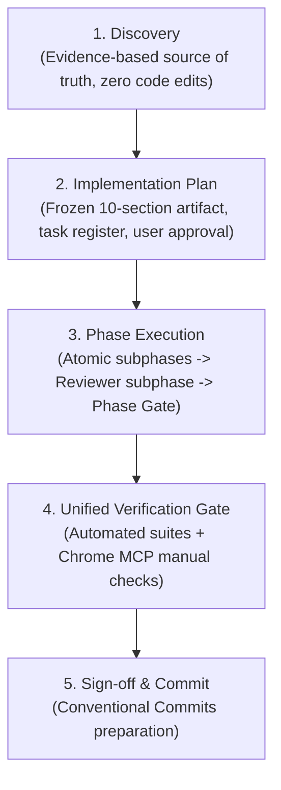

# Development Workflow Standards

How AI assistants plan, execute, verify, and hand over work in **Vibrant Castle**.

---

## 0. PURPOSE & BOUNDARIES

1. This document defines the mandatory, executable engineering process for AI-assisted development, refactoring, and multi-phase roadmap features in Vibrant Castle.
2. It governs the lifecycle from initial discovery through phased implementation, quality review gates, and final verification.
3. This process applies to all architectural changes, multi-system features, and complex refactors. Small, single-file bugfixes follow the same quality principles with minimal ceremony.

---

## 1. NON-NEGOTIABLE INVARIANTS

- ❌ **FORBIDDEN: Modifying code during Discovery or Planning**: Never edit, create, or delete production code, tests, or configurations during the Discovery or Planning stages. Analysis documents and plans gather facts; they do not apply changes.
- ❌ **FORBIDDEN: Reversing the 5-Layer Implementation Order (Change Protocol 1.6)**: Multi-system work MUST strictly follow this chronological order:
  $$\text{1. Data Structures (JSON/TS)} \longrightarrow \text{2. Core Engine Logic} \longrightarrow \text{3. Canvas Rendering} \longrightarrow \text{4. UI Integration (React)} \longrightarrow \text{5. Content Integration}$$
  Never build UI components before the underlying Engine state and Data schemas exist.
- ❌ **FORBIDDEN: Automatic phase advancement**: Never advance to the next phase without explicit, written confirmation from the user (e.g. "approved", "proceed", "następna faza"). A completed review fix never constitutes permission to start the next phase.
- ❌ **FORBIDDEN: Mutating approved plans during execution**: An approved implementation plan is a frozen contract. Do not edit its text, reorder phases, or tick/untick checkboxes during phase execution.
- ❌ **FORBIDDEN: Bypassing the Reviewer Subphase**: Every implementation phase MUST conclude with a formal `Subphase X.Review` before reaching the Phase Gate.
- ❌ **FORBIDDEN: Skipping Agent Manual Browser Testing in Stage 4**: Completing Stage 4 or declaring a feature verified based solely on automated unit/integration test results without executing manual browser testing via Chrome MCP / `preview_*` is strictly forbidden. Real DOM interaction, visual inspection, and browser console validation are mandatory.
- ✅ **REQUIRED: Clean code on every subphase**: Every atomic subphase must leave the codebase in a compilable state with its targeted automated tests passing.
- ✅ **REQUIRED: Tooling discipline**: All tooling runs on **Bun** (`bun dev`, `bun test`, `bun test:arch`, `bun lint`, `bun run build`). Node.js and npm are prohibited.

---

## 2. THE PHASE-GATE LIFECYCLE

### 2.1. Stage 1: Discovery
- Inspect relevant source files in `src/game/`, `src/context/`, `src/components/`, `src/data/`, and `src/tests/arch/`.
- Gather empirical evidence: exact file paths, line numbers, and existing data flow patterns.
- Produce an analytical artifact documenting root causes and structural constraints. Resolve ambiguities with the user via multiple-choice questions before planning.

### 2.2. Stage 2: Implementation Plan
- Formulate a 10-section plan artifact adhering to the mandatory structure:
  1. *Goal & Scope* (explicitly defining what is in and out of scope).
  2. *Baseline Findings Summary* (direct references to confirmed issues).
  3. *Target State* (concrete architectural topology and contracts).
  4. *Architectural Decisions* (explicit trade-offs, constraints, trigger choices).
  5. *Implementation Phases* (logical vertical slices, dependencies, review gates).
  6. *Task Register* (granular task cards with IDs, scope, solution, risks, tests, acceptance criteria).
  7. *Testing Strategy* (AAA unit, BDT integration, AST architecture tests, performance).
  8. *Risks & Mitigation*.
  9. *Decision Points* (blockers requiring user feedback).
  10. *Definition of Done* (quantifiable completion criteria).
- Request user feedback and obtain formal approval before writing any code.

### 2.3. Stage 3: Phase Execution
1. **Subphases (`Subphase X.Y`)**:
   - Move between atomic subphases within an approved phase automatically without pausing.
   - Maintain engine integrity, deterministic 60 Hz simulation, and compiler cleanliness at each step.
2. **Reviewer Subphase (`Subphase X.Review`)**:
   - Conduct an exhaustive self-audit before the Phase Gate:
     - **WHY & Rationale**: Document why changes were made.
     - **SOLID Principles**: Single responsibility, open-closed, interface segregation, dependency inversion.
     - **KISS & DRY**: Simplest working solution, zero duplication.
     - **Clean Code**: Max nested if depth $\le 2$ (Rule of 3 Ifs), zero `new Error(...)`, zero `any`.
     - **Clean Architecture**: Pure TS in `src/game/`, zero UI imports in engine, zero game state in React.
     - **Boy Scout Rule**: Proactively decompose any touched or expanded file exceeding ~300 LOC.
     - **Zero Allocations in Render Loop**: Confirm no object allocations (`new Vector`, lambdas, arrays) inside `render()`.
3. **Phase Gate**:
   - STOP completely after the reviewer subphase.
   - Present a concise report: summary of work done, audit findings, test results, and a prepared Conventional Commit message.
   - Wait for explicit user review and approval.
4. **Review Fixes**:
   - Fixes requested during review belong to the current phase. Apply them, re-run tests, and present the delta. Never advance automatically after a fix.

### 2.4. Stage 4: Unified Verification Gate
Automated suites and agent manual runtime inspections form a mandatory collaborative gate:
1. **Automated Verification**:
   - `bun run typecheck` (`tsc --noEmit`): 0 TypeScript errors.
   - `bun test:arch`: 100% boundary, data purity, and design system contracts pass.
   - `bun test`: All unit and integration suites pass.
2. **Agent Manual Testing via Chrome MCP (`preview_*`)**:
   - Launch Vite development server with `bun dev` on `http://localhost:3000`.
   - Access the live instance using Chrome MCP / browser preview tools (`preview_status`, `preview_open`, `preview_act`, `preview_evaluate`, `preview_snapshot`).
   - Manually exercise the modified feature flows end-to-end:
     - Open modified modals, tabs, or panels.
     - Trigger UI state changes (buttons, toggles, selectors).
     - Verify visual correctness, responsiveness, and proper asset rendering.
     - Check browser console logs via `preview_evaluate` to guarantee zero unhandled errors or React warnings.
   - Take preview snapshots as tangible proof of manual verification.
3. **Defect Remediation**:
   - Remediate defects discovered during automated or manual verification in place cleanly without breaking layer boundaries.

---

## 3. SCOPE CONTROL & REFACTORING

1. **Boy Scout Rule**: Always leave code cleaner than you found it. Clean up unclear names, dead code, magic numbers, and rule violations within touched lines.
2. **Proactive Modularization**: If any file you touch or expand exceeds ~300 lines of code or accumulates multiple domain responsibilities, decompose it into focused submodules (e.g. `systems/`, `controllers/`, `renderers/`, `stores/`) within the current phase before the review gate.
3. **Boundary Isolation**: Unrelated structural refactors (e.g. moving unrelated modules across distant layers) must never be mixed into feature work. Keep them in a dedicated phase or separate task.

---

## 4. TOOLING COMMANDS

| Command | Purpose | Expected Outcome |
| :--- | :--- | :--- |
| `bun dev` | Local development server (Vite, port 3000) | Server starts cleanly |
| `bun test` | Full test suite execution | All unit and integration tests pass |
| `bun test:arch` | AST Architecture and boundary tests | 83/83 architecture tests pass |
| `bun lint` | Static TypeScript typecheck (`tsc --noEmit`) | Exit code 0, zero type errors |
| `bun run build` | Production bundle build | Clean asset bundling |
