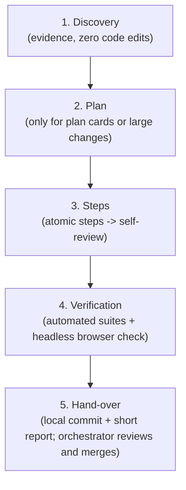

# Development Workflow Standards

How AI assistants plan, execute, verify, and hand over work in **Vibrant Castle**. Delegation, review, merge, roadmap phases and releases are governed by [`orchestration_and_phases.md`](./orchestration_and_phases.md). Read it first.

---

## 0. PURPOSE & BOUNDARIES

1. This document defines the engineering process for one task card: discovery, plan, implementation steps, review and verification.
2. "Phase" in this repo means a **roadmap phase** tied to a version (see `docs/tasks/ROADMAP.md`). Inside one card, work is split into **steps**.
3. Architectural changes, multi-system features and complex refactors follow the full process. Small single-file fixes follow the same quality principles with minimal ceremony.

---

## 1. NON-NEGOTIABLE INVARIANTS

- ❌ **FORBIDDEN: Modifying code during Discovery or Planning**: never edit production code, tests or configuration while gathering facts or writing a plan.
- ❌ **FORBIDDEN: Reversing the 5-Layer Implementation Order**: multi-system work MUST follow this order:
  $$\text{1. Data Structures (JSON/TS)} \longrightarrow \text{2. Core Engine Logic} \longrightarrow \text{3. Canvas Rendering} \longrightarrow \text{4. UI Integration (React)} \longrightarrow \text{5. Content Integration}$$
  Never build UI components before the underlying engine state and data schemas exist. Split the layers into separate cards when one PR would grow too large.
- ❌ **FORBIDDEN: Widening scope beyond the card**: a delegate implements its card only. New findings become new cards for the orchestrator.
- ❌ **FORBIDDEN: Mutating an approved plan during execution**: an approved plan (`plan` card output) is a frozen contract. Changes go through a new review.
- ❌ **FORBIDDEN: Skipping review**: every card ends with a self-review by the delegate (§2.3) and a review by the orchestrator before merge.
- ❌ **FORBIDDEN: Declaring UI or rendering work verified from automated tests alone**: visual changes need a manual browser check (§2.4).
- ✅ **REQUIRED: Clean code after every step**: every step leaves the codebase compiling, with its targeted tests passing.
- ✅ **REQUIRED: Tooling discipline**: all tooling runs on **Bun** (`bun dev`, `bun test`, `bun test:arch`, `bun run lint`, `bun run build`). Node.js and npm are not used.

---

## 2. CARD LIFECYCLE

### 2.1. Discovery
- Read the relevant sources in `src/game/`, `src/context/`, `src/game-menu/`, `src/hud/`, `src/ui/`, `src/data/` and `src/tests/arch/`.
- Gather evidence: exact file paths, line numbers and existing data flow.
- Raise real ambiguities to the orchestrator. The orchestrator escalates to the owner only for direction-shaping decisions.

### 2.2. Plan (plan cards and large changes)
A plan covers:

1. *Goal & Scope*: what is in and what is out.
2. *Baseline Findings*.
3. *Target State*: contracts and topology.
4. *Decisions*: trade-offs and constraints.
5. *Steps and resulting task cards*.
6. *Testing Strategy*: AAA unit, BDT integration, AST architecture, performance.
7. *Risks*.
8. *Open Decisions* for the owner.
9. *Definition of Done*.

Plans that live in the repo go to `docs/design/`. `docs/plan/` is git-ignored scratch space.

### 2.3. Steps and self-review
1. Move through atomic steps without pausing. Keep the engine deterministic and the compiler clean after each one.
2. Before hand-over, self-review the diff:
   - **WHY**: every change has a reason.
   - **SOLID, KISS, DRY**: single responsibility, simplest working solution, no duplication.
   - **Clean Code**: max nested if depth $\le 2$, zero `new Error(...)`, zero `any`.
   - **Clean Architecture**: pure TS in `src/game/`, no UI imports in the engine, no game state in React.
   - **Boy Scout Rule**: decompose any touched or expanded file over ~300 LOC.
   - **Zero allocations in the render loop**: no `new Vector`, lambdas or arrays inside `render()`.
3. Review fixes requested by the orchestrator belong to the same card and the same PR.

### 2.4. Verification
1. **Automated**:
   - `bun run typecheck`: 0 TypeScript errors.
   - `bun test src/tests/arch`: all architecture contracts pass.
   - `bun test` (or the suites the card touches). Only the E2E dist smoke tests may fail locally, because they need `bun run build:pages`.
2. **Manual browser check** for UI, rendering and asset changes:
   - Start `bun dev` (`http://localhost:3000`).
   - Drive the page with a headless browser (Playwright with a local Chromium) or the preview tools, if they work in your session.
   - Exercise the changed flow. Capture screenshots as proof, and check the console for errors and React warnings.
3. Fix defects in place without breaking layer boundaries.

### 2.5. Hand-over
- Commit locally on the card's branch with a Conventional Commit message ending in the `Co-Authored-By:` trailer.
- Report briefly: the branch, the commit, the files changed, the test results and any open decisions.
- Do not push or merge. The orchestrator does both after review and CI.

---

## 3. SCOPE CONTROL & REFACTORING

1. **Boy Scout Rule**: leave touched code cleaner. Clean up unclear names, dead code and magic numbers in the lines you touch.
2. **Proactive Modularization**: decompose files over ~300 lines, or files with several domain responsibilities, into focused submodules within the same card.
3. **Boundary Isolation**: unrelated structural refactors never ride along with feature work. They get their own card.

---

## 4. TOOLING COMMANDS

| Command | Purpose | Expected Outcome |
| :--- | :--- | :--- |
| `bun dev` | Local development server (Vite, port 3000) | Server starts cleanly |
| `bun test` | Full test suite | All suites pass (E2E needs `build:pages`) |
| `bun test:arch` | AST architecture and boundary tests | All architecture tests pass |
| `bun run lint` | Static TypeScript check (`tsc --noEmit`) | Exit code 0 |
| `bun run build` | Production bundle build | Clean bundle |
