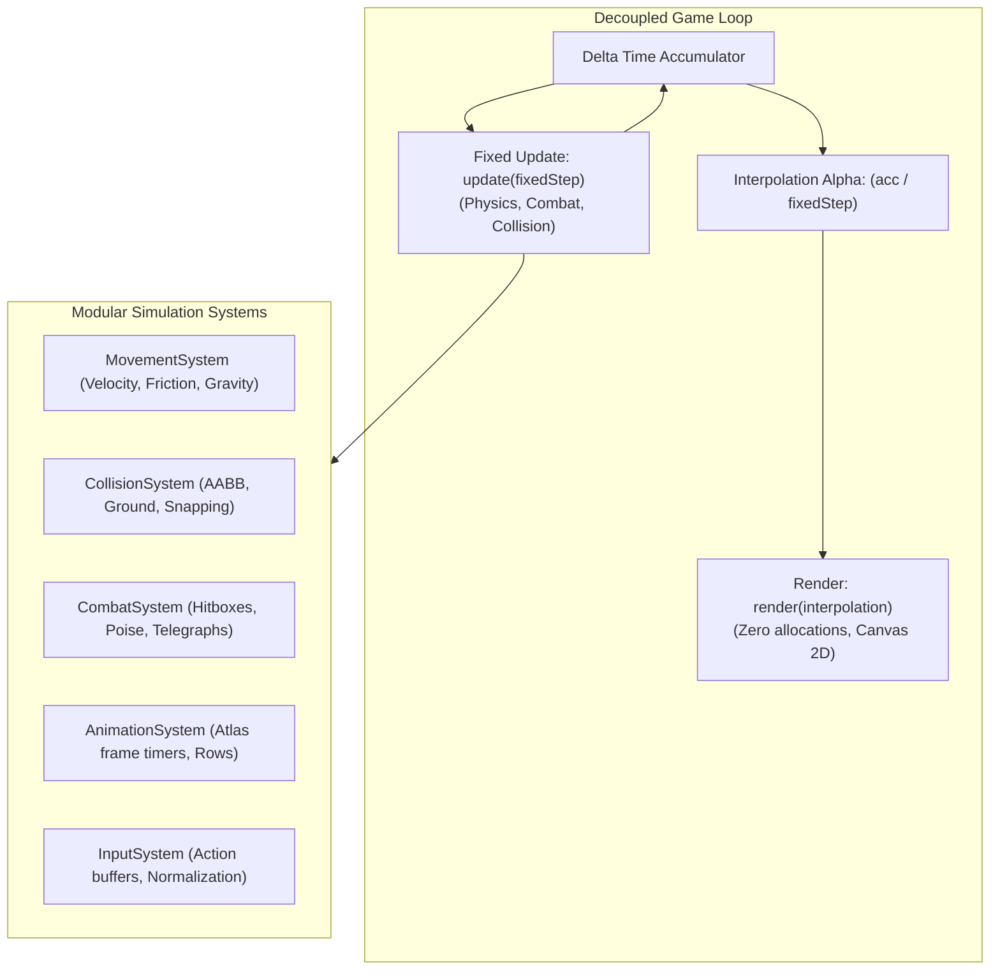

# Engine & Canvas 2D Architecture Standards

Rules for deterministic game simulation, physics, combat, rendering pipeline, and the game loop in `src/game/`.

---

## 0. PURPOSE & BOUNDARIES

1. `src/game/` (ENGINE) is the deterministic simulation core and Canvas 2D rendering pipeline of Vibrant Castle.
2. It is written in pure, strict TypeScript. It has **zero dependencies on UI frameworks, React, or the DOM**.
3. The Engine is an **interpreter** of declarative content (`src/data/`), never a container for hardcoded level blueprints or stats.

---

## 1. HARD INVARIANTS

- ❌ **FORBIDDEN: Importing UI, Context, or Developer tools**: `src/game/` must NEVER import from `src/components/`, `src/context/`, or `src/developer/`. *(enforced: `architectureBoundaries.test.ts`, `layerLeakage.test.ts`)*
- ❌ **FORBIDDEN: Storing Gameplay State in React**: The engine is the Single Source of Truth for all entity positions, health, inventory, timers, and combat states. React state must never duplicate or drive simulation logic.
- ❌ **FORBIDDEN: Allocations in the Render Loop**: Creating new object instances (`new Vector()`, `new Box()`), inline arrow functions `() => {}`, or dynamic array literals `[...]` inside `render()` or `draw()` is strictly prohibited. Allocations trigger Garbage Collection (GC) pauses that drop framerates below the 60 FPS target. Preallocate reusable scratch vectors and frame pools.
- ❌ **FORBIDDEN: Variable Timestep Simulation**: Gameplay physics and combat MUST run on a deterministic fixed timestep: `update(fixedStep)` (60 Hz baseline, 16.666ms per tick). Variable frame delta is used ONLY for sub-pixel rendering interpolation: `render(interpolation)`.
- ❌ **FORBIDDEN: Monolithic Update Loops**: All simulation updates must be decomposed into dedicated systems (`MovementSystem`, `CombatSystem`, `CollisionSystem`, `AnimationSystem`, `InputSystem`).
- ❌ **FORBIDDEN: Raw Key Strings in Logic**: Raw keyboard and gamepad inputs must pass through `Raw Input -> Normalize -> Action -> Engine`. Never branch on `event.key === 'ArrowRight'` in domain or entity logic.
- ✅ **REQUIRED: Event-Driven Communication via GameEventBus**: All discrete domain occurrences (`PLAYER_DAMAGED`, `PLAYER_HEALED`, `ITEM_CONSUMED`, `NARRATION_TRIGGERED`, `LOCATION_CHANGED`) must be dispatched via the zero-dependency `GameEventBus` (`src/game/engine/eventBus.ts`).
- ✅ **REQUIRED: AABB Collision & Layer Filtering**: Collision checks must use Axis-Aligned Bounding Box (AABB) intersection with explicit spatial and layer masks.

---

## 2. ARCHITECTURAL CONTRACTS & SYSTEMS



### 2.1. System Responsibilities
| System | File Location | Responsibility |
| :--- | :--- | :--- |
| `MovementSystem` | `src/game/systems/MovementSystem.ts` | Integrates velocity, applies gravity and friction, updates spatial position. |
| `CollisionSystem` | `src/game/systems/CollisionSystem.ts` | Computes AABB intersections, ground snapping, and platform pass-through. |
| `CombatSystem` | `src/game/systems/CombatSystem.ts` | Resolves attack hitboxes, hurtboxes, damage mitigation, and invulnerability frames. |
| `AnimationSystem` | `src/game/systems/AnimationSystem.ts` | Advances sprite frame clocks, drives atlas row indices and state transitions. |
| `InputSystem` | `src/game/systems/InputSystem.ts` | Consumes normalized action commands, maintains jump/attack input buffers. |

### 2.2. Outbound State Flow
The engine communicates with React Context through two decoupled channels:
1. **Continuous State Stream (60Hz Tick)**: Immutable `StateSnapshot` exposed to Context consumers.
2. **Discrete Domain Event Stream**: `eventBus.emit(eventType, payload)` notifying sound, narrative, and UI listeners with error isolation.

---

## 3. ANTI-PATTERNS VS PATTERNS (CONTRASTIVE EXAMPLES)

### 3.1. Allocations in Render Loop vs Reusable Scratch Objects
❌ **BAD:**
```ts
// Allocating new objects on every frame inside render() triggers GC stutter!
render(ctx: CanvasRenderingContext2D, interpolation: number) {
  const interpolatedPos = new Vector2D(
    this.prevX + (this.x - this.prevX) * interpolation,
    this.prevY + (this.y - this.prevY) * interpolation
  );
  ctx.drawImage(this.sprite, interpolatedPos.x, interpolatedPos.y);
}
```
✅ **GOOD:**
```ts
// Preallocated scratch vector reused across frames without GC pressure
private static scratchPos: Vector2D = new Vector2D(0, 0);

render(ctx: CanvasRenderingContext2D, interpolation: number) {
  RenderSystem.scratchPos.x = this.prevX + (this.x - this.prevX) * interpolation;
  RenderSystem.scratchPos.y = this.prevY + (this.y - this.prevY) * interpolation;
  ctx.drawImage(this.sprite, RenderSystem.scratchPos.x, RenderSystem.scratchPos.y);
}
```

### 3.2. Direct UI Coupling vs Zero-Dependency EventBus
❌ **BAD:**
```ts
// Importing React toast or dispatch from within simulation core
import { toast } from '../../components/hud/Toast';

takeDamage(amount: number) {
  this.hp -= amount;
  toast.show(`Damage: ${amount}`); // Breaks engine-UI boundary!
}
```
✅ **GOOD:**
```ts
import { eventBus } from '../engine/eventBus';

takeDamage(amount: number) {
  this.hp = Math.max(0, this.hp - amount);
  eventBus.emit('PLAYER_DAMAGED', {
    targetId: this.id,
    damage: amount,
    currentHp: this.hp
  });
}
```

### 3.3. Raw Keys vs Normalized Actions
❌ **BAD:**
```ts
update(dt: number) {
  if (window.isKeyPressed('KeyD') || window.isKeyPressed('ArrowRight')) {
    this.x += 100 * dt;
  }
}
```
✅ **GOOD:**
```ts
update(dt: number) {
  if (this.inputActions.has(Action.MOVE_RIGHT)) {
    this.velocity.x += this.acceleration * dt;
  }
}
```

---

## 4. ENFORCEMENT & VERIFICATION

Compliance is verified through automated architecture tests:
- `bun test src/tests/arch/architectureBoundaries.test.ts` — Verifies engine layer boundaries.
- `bun test src/tests/arch/layerLeakage.test.ts` — Proves zero UI/React imports in simulation.
- `bun test src/tests/arch/circularDependencies.test.ts` — Enforces acyclic dependency graph.
- `bun lint` — Validates type safety and compile cleanliness.
