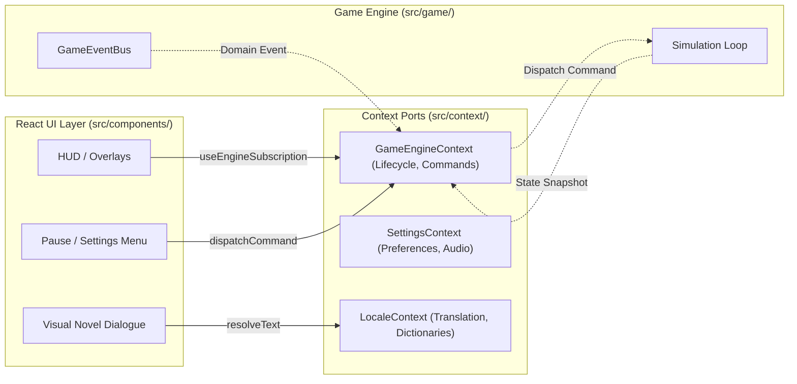

# Frontend & UI Engineering Standards (React 19)

Rules for presentation, HUD overlays, dialogs, Context ports, Design System, styling, and localization in `src/components/`, `src/context/`, and `src/ui/`.

---

## 0. PURPOSE & BOUNDARIES

1. React 19 in Vibrant Castle is strictly an **overlay presentation layer**: HUD, dialogue boxes, pause menus, inventory cards, settings, and developer tools.
2. React **NEVER** renders game entities (heroes, beasts, missiles, level terrain) — entity rendering belongs exclusively to Canvas 2D.
3. React components are strictly **read-only** consumers of the game simulation.

---

## 1. HARD INVARIANTS

- ❌ **FORBIDDEN: Mutating Engine State directly in React**: React components must never modify engine singletons, entity references, or physics vectors. All user actions (pause, jump, cast spell, use potion) are dispatched as Commands through React Context ports (`src/context/`). *(enforced: `layerLeakage.test.ts`)*
- ❌ **FORBIDDEN: Per-Frame React Re-renders**: Never bind `requestAnimationFrame` or high-frequency intervals to React state setters. State synchronizes via throttled snapshots or domain event subscriptions (`useEngineSubscription`).
- ❌ **FORBIDDEN: Raw HTML Elements in Features**: Direct use of native `<button>`, `<input>`, `<select>`, `<textarea>`, `<table>`, or `<label>` is permitted ONLY inside Design System primitives (`src/ui/`). All feature cards, modals, and HUD overlays must import primitives from `@ui`. *(enforced: `designSystemBoundaries.test.ts`)*
- ❌ **FORBIDDEN: Hardcoded Colors and Inline Theme Conditionals**: Never write hardcoded hex literals (e.g. `bg-[#2a1b18]`, `#e5c07b`) or theme branching in TSX (`resolvedTheme === 'dark' ? ...`). Styling must use semantic tokens (`bg-card`, `text-primary`, `border-border`) and CSS variables configured in `ThemeRegistry`. *(enforced: `designSystemBoundaries.test.ts`)*
- ❌ **FORBIDDEN: Production UI importing Developer Tools**: Production components in `src/components/` must never import from `src/developer/`.
- ❌ **FORBIDDEN: Hardcoded User-Facing Text**: Raw string literals in UI labels, tooltips, or dialogues are prohibited. Every string must be looked up via localization dictionaries (`@i18n`) with 100% key parity between English (`en`) and Polish (`pl`). *(enforced: `i18nParity.test.ts`)*
- ✅ **REQUIRED: Headless View Model Mappers**: Transform complex engine state snapshots into lightweight, localized view models using pure mappers (`*.mapper.ts`).
- ✅ **REQUIRED: Accessibility & Keyboard Operability**: All buttons, dialogs, and interactive widgets must support keyboard focus (`Tab`, `Enter`, `Escape`), provide ARIA attributes (`role="dialog"`, `aria-modal="true"`, `aria-label`), and trap focus in modals.

---

## 2. CONTEXT ARCHITECTURE & PORTS



### 2.1. Domain Context Slices
| Context | Location | Responsibility |
| :--- | :--- | :--- |
| `GameEngineContext` | `src/context/GameEngineContext.tsx` | Exposes engine running state, fixed-tick snapshots, and command ports (`pause`, `resume`, `resetLevel`). |
| `SettingsContext` | `src/context/SettingsContext.tsx` | Manages persistent user preferences (master/sfx/music volume, resolution, keymaps). |
| `LocaleContext` | `src/context/LocaleContext.tsx` | Manages active language (`en`, `pl`), dictionary lookup, and fallback formatting. |

---

## 3. ANTI-PATTERNS VS PATTERNS (CONTRASTIVE EXAMPLES)

### 3.1. Raw HTML vs Design System Primitives
❌ **BAD:**
```tsx
// Using native HTML elements directly in feature components
export function PauseMenu() {
  return (
    <div className="menu-container">
      <button onClick={handleResume} className="btn-primary">Resume</button>
    </div>
  );
}
```
✅ **GOOD:**
```tsx
import { Button } from '@ui';

export function PauseMenu() {
  return (
    <div className="flex flex-col gap-4">
      <Button variant="primary" onClick={handleResume}>
        {t('menu.resume')}
      </Button>
    </div>
  );
}
```

### 3.2. Inline Theme Ternaries vs Semantic CSS Tokens
❌ **BAD:**
```tsx
// Theme branching in TSX and hardcoded hex values
<div style={{ backgroundColor: theme === 'autumn' ? '#8a3324' : '#1c2438' }}>
  <span className="text-[#f5a623]">Vitality</span>
</div>
```
✅ **GOOD:**
```tsx
// Pure semantic CSS utility classes driven by theme design tokens
<div className="bg-card border border-border shadow-md">
  <span className="text-primary font-semibold">{t('stats.vitality')}</span>
</div>
```

### 3.3. Direct Singleton Coupling vs Context Bridge
❌ **BAD:**
```tsx
import { gameEngine } from '../game/GameEngine';

export function HealthBar() {
  const hp = gameEngine.player.hp; // Direct singleton coupling and mutable state access!
  return <div>HP: {hp}</div>;
}
```
✅ **GOOD:**
```tsx
import { usePlayerHealthSnapshot } from '../context/GameEngineContext';

export function HealthBar() {
  const { currentHp, maxHp } = usePlayerHealthSnapshot();
  return <ProgressBar value={currentHp} max={maxHp} variant="health" />;
}
```

---

## 4. ENFORCEMENT & VERIFICATION

- `bun test src/tests/arch/designSystemBoundaries.test.ts` — Guarantees zero native HTML primitives outside `@ui`.
- `bun test src/tests/arch/layerLeakage.test.ts` — Verifies UI never instantiates or imports engine singletons directly.
- `bun test src/tests/arch/i18nParity.test.ts` — Enforces 100% dictionary key parity across all locales.
- `bun lint` — Validates React hook rules and strict type safety.
