# CICD.md — Continuous Integration & Continuous Deployment Architecture

## 1. Overview & Core Philosophy

This document specifies the automated CI/CD pipeline, branching topology, release governance, and hosting infrastructure for **Vibrant Castle**.

*Vibrant Castle* is published as a client-side web application hosted on **GitHub Pages (`github.io`)**:

- **Portal Landing Page & Wiki**: `https://beoarcha.github.io/oXyFlow.VibrantCastle/`
- **Playable Game Client**: `https://beoarcha.github.io/oXyFlow.VibrantCastle/game/`

### 1.1. Core Pipeline Invariants

1. **Bun Runtime Discipline**: All pipeline steps execute natively via Bun with `bun.lock` caching. Node.js and npm are prohibited.
2. **Reusable Composite Action (`.github/actions/setup-project`)**: Standardized checkout, Bun environment provisioning, and dependency installation eliminating DRY across all workflow jobs.
3. **Strict Two-Branch Topology**:
   - `main`: Active development and integration branch.
   - `release`: Production-only branch mirror for releases and live deployments.
4. **Verified Promotion Gate (`promote.yml`)**: Direct pushes or merges into `release` by developers are forbidden. Code moves from `main` to `release` exclusively via the verified promotion workflow, which validates all CI stages on `main` before fast-forwarding `release`.
5. **Decoupled Game Release vs Documentation**:
   - `release.yml` produces a pure production build of the game client from `src/` (packaged as `vibrant-castle-game.zip`) and mints a GitHub Release.
   - `deploy-pages.yml` takes the released game build and embeds it into the `docs/wiki/` documentation portal for GitHub Pages deployment.
6. **Automated Coverage Quality Gate**: Enforces minimum coverage thresholds (`scripts/coverage.json`) with discrete reporting for Unit Tests ($\ge 60\%$), Integration Tests ($\ge 40\%$), and Combined Coverage ($\ge 80\%$).

---

## 2. CI/CD Lifecycle Architecture

```mermaid
graph TD
    subgraph MainBranch["1. main branch (Integration & Verification — main.yml)"]
        P1["git push to main / PR"]
        S1["Stage 1: Static Analysis<br/>(Parallel: typecheck & lint)"]
        S2["Stage 2: Tests & Coverage<br/>(unit + integration + arch + e2e)"]
        CG["Stage 2: Coverage Quality Gate<br/>(scripts/coverage-gate.ts)"]
        S3["Stage 3: Game Client Build<br/>(vite build z src/)"]
        S4["Stage 4: Candidate Metadata<br/>(Release candidate ID)"]

        P1 --> S1
        S1 -- Pass --> S2
        S2 --> CG
        CG -- Pass --> S3
        S3 -- Pass --> S4
    end

    subgraph PromotionGate["2. Controlled Promotion (promote.yml)"]
        Trigger["workflow_dispatch<br/>(Commit on main)"]
        VerifyChecks["Verify GitHub Checks API<br/>(All main.yml stages passed?)"]
        FastForward["git push origin $SHA:refs/heads/release<br/>(Fast-Forward)"]

        S4 -. Validated SHA .-> Trigger
        Trigger --> VerifyChecks
        VerifyChecks -- Yes --> FastForward
    end

    subgraph GameRelease["3. Production Game Release (release.yml)"]
        RTrigger["workflow_dispatch<br/>(Ref: release / main, Bump: SemVer)"]
        Preflight["Stage 1: Preflight Sanity<br/>(typecheck + test:arch)"]
        RBuild["Stage 2: Compile Pure Game<br/>(vite build z src/ -> vibrant-castle-game.zip)"]
        GHRelease["Stage 3: GitHub Release<br/>(Tag vX.Y.Z + release notes)"]

        FastForward -. Synchronized .-> RTrigger
        RTrigger --> Preflight
        Preflight --> RBuild
        RBuild --> GHRelease
    end

    subgraph PagesDeploy["4. Documentation & Portal Deploy (deploy-pages.yml)"]
        DTrigger["Release Published<br/>OR workflow_dispatch"]
        Fetch["Fetch vibrant-castle-game.zip<br/>from GitHub Release"]
        Assemble["Assemble Portal<br/>(docs/wiki/ + game/ client)"]
        Deploy["Deploy to GitHub Pages<br/>(actions/deploy-pages@v4)"]
        Smoke["Live HTTP 200 Verification"]

        GHRelease -. Event Trigger .-> DTrigger
        DTrigger --> Fetch
        Fetch --> Assemble
        Assemble --> Deploy
        Deploy --> Smoke
    end
```



---

## 3. Workflow Specifications

### 3.1. `main.yml` — Main CI Pipeline

- **Trigger**: Every `push` to `main` and `pull_request` targeting `main`.
- **Stage 1 (Static Analysis)**:
  - `typecheck`: `bun run typecheck` (`tsc --noEmit`).
  - `lint`: `bun run lint` (`tsc --noEmit`).
- **Stage 2 (Test Suite & Coverage Gate)**:
  - `unit`: `bun run test:unit:coverage` (generates `coverage/unit/lcov.info`).
  - `integration`: `bun run test:integration:coverage` (generates `coverage/integration/lcov.info`).
  - `coverage-gate`: Runs `bun run coverage:gate`, validates against `scripts/coverage.json` thresholds, outputs terminal ASCII table, emits GitHub Actions error annotations on failure, and publishes Markdown to `$GITHUB_STEP_SUMMARY`.
  - `architecture`: `bun run test:arch` (84 AST boundary and SSOT tests).
  - `e2e`: `bun run test:e2e` (Distribution smoke checks).
- **Stage 3 (Client Build Verification)**:
  - Compiles pure game client with `bun run build:game` (`VITE_BASE_PATH: ./`).
  - Asserts existence of `dist/index.html` and `dist/assets/`.
- **Stage 4 (Metadata)**:
  - Publishes candidate identifier (`0.2.2-dev.<run_number>.<sha>`) to `$GITHUB_STEP_SUMMARY`.

### 3.2. `promote.yml` — Controlled Promotion

- **Trigger**: Manual `workflow_dispatch`.
- **Invariant**: **Always promotes from `main` to `release`**, regardless of options chosen in GitHub Actions dispatch dialog.
- **Inputs**:
  - `target_sha`: Commit SHA from `main` to promote (default: latest HEAD of `main`).
- **Checks Verification**: Queries `gh api "repos/${{ github.repository }}/commits/${TARGET_SHA}/check-runs"`. Enforces that every required test and build verification from `main.yml` has `conclusion: "success"`.
- **Action**: Atomically fast-forwards `release`:

  ```bash
  git push origin "${TARGET_SHA}:refs/heads/release"
  ```

- **Independent**: Does **not** automatically trigger releases; synchronizes branches cleanly.

### 3.3. `release.yml` — Production Game Release

- **Trigger**: Strictly manual `workflow_dispatch`.
- **Inputs**:
  - `target_ref`: Git reference to release from (default: `release`, allows `main` or specific tag/branch).
  - `version_bump`: SemVer bump mode (`patch`, `minor`, `major`, `none`).
- **Preflight**: Runs static typecheck and architectural boundary tests.
- **Build**: Compiles production game client from `src/` only and packages `vibrant-castle-game.zip`.
- **Release**: Calculates SemVer tag `vX.Y.Z`, creates Git tag, and publishes GitHub Release with auto-generated notes and attached game client zip.

### 3.4. `deploy-pages.yml` — Documentation & Portal Deployment

- **Trigger**:
  - `release`: `types: [published]` (automatically triggers upon new GitHub Release).
  - `workflow_dispatch`: Manual trigger (with optional `release_tag` input, defaulting to latest release).
  - `push`: On `release` branch when `docs/wiki/**` files change.
- **Action**:
  - Downloads `vibrant-castle-game.zip` from the specified or latest release.
  - Mounts game client into `dist/game/` and copies `docs/wiki/` to `dist/` root.
  - Generates `dist/.nojekyll`.
  - Deploys bundle to GitHub Pages via `actions/deploy-pages@v4`.
  - Performs live HTTP 200 verification on `https://beoarcha.github.io/oXyFlow.VibrantCastle/`.

---

## 4. GitHub Repository Configuration Requirements

1. **GitHub Pages Settings**:
   - Navigate to **Settings $\rightarrow$ Pages**.
   - Under **Build and deployment $\rightarrow$ Source**, select **GitHub Actions**.
2. **Branch Protection Rules**:
   - **`main`**: Require status checks to pass (`Stage 1: Typecheck`, `Stage 1: Lint`, `Stage 2: Unit Tests & Coverage`, `Stage 2: Integration Tests & Coverage`, `Stage 2: Coverage Quality Gate`, `Stage 2: Architecture Boundary Tests`, `Stage 2: E2E Smoke Tests`, `Stage 3: Build Verification`).
   - **`release`**: Restrict pushes to GitHub Actions bot (`github-actions[bot]`).
3. **Actions Permissions**:
   - Under **Settings $\rightarrow$ Actions $\rightarrow$ General**:
     - **Workflow permissions**: Select **Read and write permissions**.
