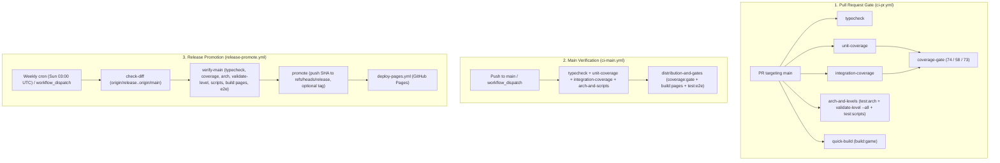

# CICD.md — Continuous Integration & Continuous Deployment Architecture

## 1. Overview & Core Philosophy

This document specifies the automated CI/CD pipeline, branching topology, release promotion workflow, and GitHub Pages hosting for **Vibrant Castle**, matching `.github/workflows/`.

*Vibrant Castle* is published as a client-side web application hosted on **GitHub Pages (`github.io`)**:

- **Portal Landing Page & Wiki**: `https://beoarcha.github.io/oXyFlow.VibrantCastle/`
- **Playable Game Client**: `https://beoarcha.github.io/oXyFlow.VibrantCastle/game/`

### 1.1. Core Pipeline Invariants

1. **Bun Runtime Discipline**: All pipeline steps execute natively via Bun using the shared composite action `.github/actions/setup-bun-cached` (`bun install --frozen-lockfile`). Node.js and npm are prohibited.
2. **Two-Branch Topology**:
   - `main`: Active development and integration branch.
   - `release`: Production-only branch promoted from verified `main` commits and deployed to GitHub Pages.
3. **Controlled Promotion (`release-promote.yml`)**: Direct developer pushes to `release` are not used; `release` advances from `main` only after full verification passes.
4. **Per-Suite LCOV Coverage Gate (`scripts/coverage-gate.ts` + `scripts/coverage.json`)**: Enforces minimum line coverage thresholds per suite:
   - **Unit Tests**: **74%** (`unitMin: 74`)
   - **Integration Tests**: **58%** (`integrationMin: 58`)
   - **Combined Coverage**: **73%** (`combinedMin: 73`)
   - Thresholds can be overridden via `COVERAGE_MIN_UNIT`, `COVERAGE_MIN_INTEGRATION`, and `COVERAGE_MIN_COMBINED`. *(Adjusting target thresholds is tracked in [`VC-060`](../tasks/phase-4-0.3.x.md#vc-060--coverage-gate-per-suite-integration-tests-on-prs)).*
5. **Phase Gates & Releases ([`docs/tasks/ROADMAP.md`](../tasks/ROADMAP.md))**:
   - Work runs in phases tied to minor versions (`0.(N-1).x`; Phase 4 = `0.3.x`, closing into Phase 5 = `0.4.0`).
   - Releases and version bumps happen **only at a phase gate** (Phase 4 gate: [`VC-090`](../tasks/phase-4-0.3.x.md#vc-090--phase-4-quality-gate-and-040)), after docs conformance, docs update, and general review. Hotfix releases inside a phase require owner approval.

---

## 2. CI/CD Lifecycle Architecture

---

## 3. Workflow Specifications (`.github/workflows/`)

### 3.1. `ci-pr.yml` — Pull Request Gate

- **Trigger**: `pull_request` targeting `main` (with per-PR concurrency cancellation).
- **Jobs**:
  - `typecheck`: `bun run typecheck` (`tsc --noEmit`).
  - `unit-coverage`: `bun run test:unit:coverage` (uploads `coverage/unit` artifact).
  - `integration-coverage`: `bun run test:integration:coverage` (uploads `coverage/integration` artifact).
  - `arch-and-levels`: runs `bun run test:arch`, `bun scripts/validate-level.ts --all`, and `bun run test:scripts`.
  - `coverage-gate`: depends on `unit-coverage` and `integration-coverage`, downloads LCOV artifacts, and runs `bun run coverage:gate` against `scripts/coverage.json` (`74 / 58 / 73`).
  - `quick-build`: `bun run build:game` (`vite build`).

### 3.2. `ci-main.yml` — Main Full Verification

- **Trigger**: `push` to `main` and `workflow_dispatch`.
- **Parallel Jobs**:
  - `typecheck`: `bun run typecheck`.
  - `unit-coverage`: `bun run test:unit:coverage` → `coverage-unit`.
  - `integration-coverage`: `bun run test:integration:coverage` → `coverage-integration`.
  - `arch-and-scripts`: `bun run test:arch`, `bun scripts/validate-level.ts --all`, and `bun run test:scripts`.
- **Gate Job (`distribution-and-gates`)**: depends on all four jobs above, evaluates `bun run coverage:gate`, assembles the full distribution with `bun run build:pages`, and runs `bun run test:e2e`.

### 3.3. `release-promote.yml` — Promote Verified Main

- **Trigger**: Weekly schedule (`cron: "0 3 * * 0"`, Sundays 03:00 UTC) and manual `workflow_dispatch` (`dry_run`, `create_tag`).
- **Jobs**:
  1. `check-diff`: Compares `origin/release..origin/main` to detect pending commits.
  2. `verify-main`: Checks out `target_sha` and runs `typecheck`, `test:unit:coverage`, `test:integration:coverage`, `test:arch`, `validate-level.ts --all`, `test:scripts`, `coverage:gate`, `build:pages`, and `test:e2e`.
  3. `promote`: Unless `dry_run=true`, pushes `target_sha` to `refs/heads/release` and optionally tags `release-YYYY.MM.DD-<sha7>`.
  4. `deploy-release`: Calls `./.github/workflows/deploy-pages.yml` with `ref: release`.
- **Backlog**: Porting dedicated GitHub Release artifact packaging (`vibrant-castle-game.zip`) and SemVer bumping into `release-promote.yml` is tracked in [`VC-061`](../tasks/phase-4-0.3.x.md#vc-061--release-artifacts).

### 3.4. `deploy-pages.yml` — GitHub Pages Deployment

- **Trigger**: `push` to `release`, `workflow_dispatch`, and `workflow_call` (from `release-promote.yml`).
- **Jobs**:
  1. `build-and-smoke`: Runs `bun run build:pages` (wiki + `/game/`), verifies `bun run test:e2e`, and uploads the `dist` artifact via `actions/upload-pages-artifact@v3`.
  2. `deploy`: Publishes to the `github-pages` environment via `actions/deploy-pages@v4`.

To preview the Pages distribution locally, run `bun run build:pages` followed by `bun run preview:pages` (serves `dist/` statically under `/oXyFlow.VibrantCastle/`). Do **not** run `bun run dist/index.html` — it starts Bun's single-entry HTML dev server and answers every path with the wiki page.
