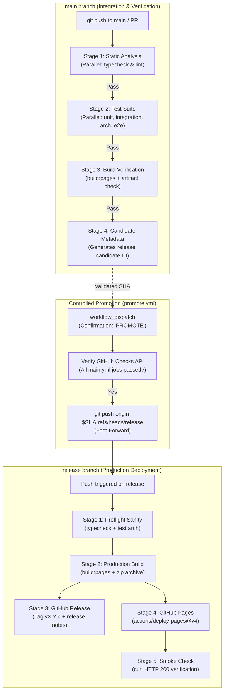

# CICD.md — Continuous Integration & Continuous Deployment Architecture

## 1. Overview & Core Philosophy

This document specifies the automated CI/CD pipeline, branching topology, release governance, and hosting infrastructure for **Vibrant Castle**.

*Vibrant Castle* is published as a client-side web application hosted on **GitHub Pages (`github.io`)**:

- **Portal Landing Page & Wiki**: `https://beoarcha.github.io/vibrant_castle/`
- **Playable Game Client**: `https://beoarcha.github.io/vibrant_castle/game/`

### 1.1. Core Pipeline Invariants

1. **Bun Runtime Discipline**: All pipeline steps execute natively via `oven-sh/setup-bun@v2` with `bun.lock` caching (~2s setup time). Node.js and npm are prohibited.
2. **Strict Two-Branch Topology**:
   - `main`: Active development and integration branch.
   - `release`: Production-only branch mirror deployed to GitHub Pages.
3. **Zero Automated Commits on `main`**: Pushes to `main` never generate empty automated commits (e.g. `chore(release): bump version`), avoiding CI trigger loops and git history noise.
4. **Verified Promotion Gate**: Direct pushes or merges into `release` by developers are forbidden. Code moves from `main` to `release` exclusively via the verified promotion workflow (`.github/workflows/promote.yml`).
5. **Cost & Concurrency Optimization**:
   - On `main`: `concurrency: { group: main-${{ github.ref }}, cancel-in-progress: true }` cancels obsolete runs on new pushes.
   - On `release`: `concurrency: { group: release-deploy, cancel-in-progress: false }` queues deployments sequentially to preserve deployment atomicity.

---

## 2. CI/CD Lifecycle Architecture



---

## 3. Workflow Specifications

### 3.1. `main.yml` — Main CI Pipeline

- **Trigger**: Every `push` to `main` and `pull_request` targeting `main`.
- **Stage 1 (Static Analysis)**:
  - `typecheck`: `bun run typecheck` (`tsc --noEmit`).
  - `lint`: `bun run lint` (`tsc --noEmit`).
  - Both run in parallel. Fails immediately on compiler error.
- **Stage 2 (Tests)** (`needs: [typecheck, lint]`):
  - `unit`: `bun run test:unit` (1310 unit tests).
  - `integration`: `bun run test:integration` (94 integration tests).
  - `architecture`: `bun run test:arch` (84 AST boundary and SSOT tests).
  - `e2e`: `bun run test:e2e` (6 distribution package smoke tests).
- **Stage 3 (Build Verification)** (`needs: [unit, integration, architecture, e2e]`):
  - Assembles `dist/` with `VITE_BASE_PATH: /vibrant_castle/game/`.
  - Asserts existence of `dist/index.html`, `dist/game/index.html`, and `dist/.nojekyll`.
- **Stage 4 (Metadata)** (`needs: [build-verify]`):
  - Publishes candidate identifier (`0.2.1-dev.<run_number>.<sha>`) to `$GITHUB_STEP_SUMMARY`.

### 3.2. `promote.yml` — Verified Promotion

- **Trigger**: Manual `workflow_dispatch`.
- **Inputs**:
  - `target_sha`: Commit SHA from `main` to promote (default: latest HEAD).
  - `confirmation`: Required string literal `"PROMOTE"`.
- **Checks Verification**: Queries `gh api "repos/${{ github.repository }}/commits/${TARGET_SHA}/check-runs"`. Enforces that every required test and build verification from `main.yml` has `conclusion: "success"`.
- **Action**: Atomically fast-forwards `release`:

  ```bash
  git push origin "${TARGET_SHA}:refs/heads/release"
  ```

### 3.3. `release.yml` — Production Release & Deployment

- **Trigger**: `push` to `release` or manual `workflow_dispatch` with SemVer bump choice (`patch`, `minor`, `major`, `none`).
- **Preflight**: Runs static typecheck and architectural boundary tests (~8s).
- **Build**: Compiles production package and archives `vibrant-castle-web.zip`.
- **Release**: Calculates SemVer tag `vX.Y.Z`, creates Git tag, and publishes GitHub Release with auto-generated notes.
- **Pages Deployment**: Uses `actions/upload-pages-artifact@v3` and `actions/deploy-pages@v4` in `environment: github-pages`.
- **Smoke Check**: Verifies live URL `https://beoarcha.github.io/vibrant_castle/` returns `HTTP 200 OK`.

---

## 4. GitHub Repository Configuration Requirements

To complete end-to-end automation on GitHub:

1. **GitHub Pages Settings**:
   - Navigate to **Settings $\rightarrow$ Pages**.
   - Under **Build and deployment $\rightarrow$ Source**, select **GitHub Actions**.
2. **Branch Protection Rules**:
   - **`main`**: Require pull request reviews, require status checks to pass (`typecheck`, `lint`, `unit`, `integration`, `architecture`, `e2e`, `build-verify`).
   - **`release`**: Restrict pushes to GitHub Actions bot (`github-actions[bot]`).
3. **Actions Permissions**:
   - Under **Settings $\rightarrow$ Actions $\rightarrow$ General**:
     - **Workflow permissions**: Select **Read and write permissions**.
     - Check **Allow GitHub Actions to create and approve pull requests**.
