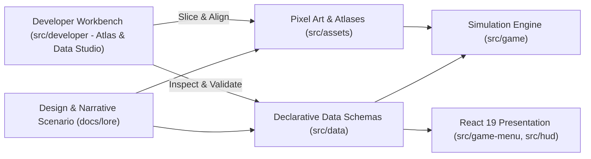

# CONTENT_PIPELINE.md — Content Architecture, Schemas & Asset Pipeline

## 1. Declarative Content Architecture

In *Vibrant Castle*, game content is strictly decoupled from the simulation engine. The engine (`src/game/`) acts as a pure, deterministic interpreter of declarative data:

$$\text{SCENARIO} \longrightarrow \text{JSON Data } (\text{src/data/}) \longrightarrow \text{Assets } (\text{src/assets/}) \longrightarrow \text{Engine Interpreter \& UI Presentation}$$

### 1.1. Core Content Invariants

* ✅ **Engine as Interpreter**: Game simulation code contains zero hardcoded level layouts, enemy stats, weapon damage tables, or dialogue scripts. All content loads from `src/data/`.
* ✅ **Single Source of Truth (SSOT)**: Every entity, item, skill, and location blueprint exists in one canonical JSON file referenced across systems via `@data` aliases.
* ✅ **Strict Schema & Purity Validation**: Validated at test/CI time by `src/tests/arch/` (`dataPurity.test.ts`, `dataIntegrity.test.ts`, `locationBlueprints.test.ts`, `locationLinks.test.ts`, `levelLogic.test.ts`, `assetIntegrity.test.ts`, `atlasMetaConsistency.test.ts`, `parallaxFiles.test.ts`, `platformTilesets.test.ts`, `trademarkNames.test.ts`).
* ❌ **FORBIDDEN: Dangling World Transitions**: Every exit portal in a location blueprint must reference a valid target location and registered entry point.
* ❌ **FORBIDDEN: Non-JSON Assets in `src/data/`**: Only `.json` files and the `src/data/index.ts` re-export facade are permitted in `src/data/`.

---

## 2. Data Layer Organization (`src/data/`)

| Subdirectory | Canonical Files | Data Domain & Operational Purpose |
| :--- | :--- | :--- |
| **`locations/`** | `courtyard.json`, `thorn_chasm.json`, `ashen_catacombs.json`, `clocktower.json`, `alchemist_library.json`, `aether_sanctuary.json`, `grand_bastion.json`, `eclipse_crown.json` | **Level Blueprints** (map 1 of each of the 8 worlds): dimensions, spawn points and named entries, theme, parallax layers, prefab dictionaries, and `layout` (solids, triggers, levers, portals, enemies, decor). |
| **`enemies/`** | `enemies.json` | **Monster Bestiary**: Canonical template registry for 17 enemy types: dimensions, stats, elemental multipliers, soul drop metadata, atlas binding, procedural fallback, and bestiary keys. |
| **`items/`** | `items.json` | **Item & Equipment Registry**: 18 items (weapons, shields, helmets, armor, amulets, rings, potions). |
| **`skills/`** | `skills.json`, `spells.json` | **Skill Constellations**: Active spells, wards, passives, and enemy ability definitions. |
| **`structures/`** | `structures.json` | **Interactive Map Objects**: Levers, gates, hazards, and structure definitions. |
| **`narrative/`** | `dialogues_vn.json`, `narrator_reactive.json` | **Narrative Manifests**: Visual novel character dialogue sequences and reactive narrator quotes (not yet wired to the live engine). *(Historical `scenario_act1.json` and `triggers.json` were removed in 2784276; disposition tracked in [`VC-081`](../tasks/phase-4-0.3.x.md#vc-081--narrative-catalogs)).* |
| **`progression/`** | `skill_trees.json` | **Skill tree layout** for Valen and Aurelia. |
| **`defaults/`** | `defaultControls.json`, `defaultSettings.json` | **System Defaults**: Baseline keyboard/gamepad bindings, audio, display, and HUD settings. |

---

## 3. Location Blueprint Specification

Campaign design targets **8 worlds × 8 maps** ([`docs/tasks/VISION.md`](../tasks/VISION.md)); today map 1 of each world is shipped. Map contract authoring and hybrid/alignment updates are on the backlog ([`VC-020`](../tasks/phase-4-0.3.x.md#vc-020--map-contract-for-the-8x8-campaign), [`VC-021`…`VC-028`](../tasks/phase-5-0.4.x.md#vc-021--vc-025--hybrid-maps-courtyard-thorn_chasm-clocktower-aether_sanctuary-grand_bastion)).

### 3.0. Shipped Maps (`src/data/locations/*.json`)

| Map | Size (px) | Solids | Levers | Enemies | Portals to | Tilesets |
| :--- | :--- | ---: | ---: | ---: | :--- | :--- |
| `courtyard` | 4800 × 1040 | 21 | 1 | 9 | `thorn_chasm`, `clocktower` | `courtyard_stone`, `courtyard_wood` |
| `thorn_chasm` | 4560 × 1120 | 16 | 0 | 8 | `courtyard`, `ashen_catacombs` | `chasm_rock` |
| `ashen_catacombs` | 2640 × 1560 | 19 | 1 | 7 | `thorn_chasm`, `clocktower` | `bastion_stone` |
| `clocktower` | 2440 × 1740 | 23 | 1 | 8 | `ashen_catacombs`, `alchemist_library` | `clocktower_brick` |
| `alchemist_library` | 3840 × 1380 | 21 | 1 | 7 | `clocktower`, `aether_sanctuary` | `clocktower_brick` |
| `aether_sanctuary` | 4240 × 1400 | 14 | 0 | 7 | `alchemist_library`, `grand_bastion` | `sanctuary_crystal` |
| `grand_bastion` | 4840 × 1140 | 13 | 1 | 7 | `aether_sanctuary`, `eclipse_crown` | `bastion_stone` |
| `eclipse_crown` | 4640 × 1460 | 15 | 1 | 7 | `grand_bastion`, `courtyard` | `bastion_stone`, `sanctuary_crystal` |

**Platform tileset field.** Every non-gate solid or one-way prefab carries `"tileset": "<id>"` (enforced by `src/tests/arch/platformTilesets.test.ts`). Shipped tileset IDs (8): `courtyard_stone`, `courtyard_wood`, `courtyard_marble`, `bastion_stone`, `clocktower_brick`, `chasm_rock`, `chasm_ledge`, `sanctuary_crystal`.

### 3.1. Portal World Graph Integrity

Every portal targets an existing location and valid entry (`src/tests/arch/locationBlueprints.test.ts` and `src/tests/arch/locationLinks.test.ts`).

### 3.2. Decor (`layout.decor`)

`layout.decor` places non-colliding visual props (`hanging_lantern`, etc.) using `{ id, propId, x, y, layer, flipX, phase }`, referencing compiled prop folders under `src/assets/props/<propId>/` (`<propId>_prop_meta.json`, `<propId>_hi8bit.png`, `<propId>_hi16bit.png`). Shipped props (12): `aether_crystal_cluster`, `candelabra`, `ember_skull_lantern`, `garden_lamp_post`, `hanging_lantern`, `iron_chain`, `leaf_pile`, `tattered_banner`, `thorn_bramble`, `wall_gear`, `wall_torch`, `war_brazier`.

---

## 4. Monster Bestiary Architecture (`enemies.json`)

* **Identity**: `id`, `nameKey`, `defaultName`, `category` (`construct`, `clockwork`, `sentinel`, `gargoyle`, `beast`, `spirit`, `flora`, `elite`, `boss`).
* **Dimensions & Physics**: `dimensions.width`, `dimensions.height`, `isAerial`, `isDummy`.
* **Combat Stats**: `stats.health`, `maxHealth`, `speed`, `attackPower`, `scoreReward`, `defense`, `xpReward`. Today enemies patrol only (`attackPower` and `abilities` are data-only backlog).
* **Elemental Multipliers (`elementalResistances`)**: Damage multipliers (`< 1.0` resists, `> 1.0` vulnerable) across elements (`physical`, `fire`, `frost`, `lightning`, `holy`, `shadow`, `aether`, `astral`, `chrono`).
* **Soul Drop Metadata**: `soulId`, `type` (`bullet`, `guardian`, `enchant`), `dropRate`, `grantedSkillId`, `manaCost`, and i18n keys (data-only backlog).
* **Atlas Binding**: `atlas.presetId` selects the folder under `src/assets/enemies/<id>/`, allowing multiple templates to share a sheet. `proceduralFallback` provides fallback colors when no sheet loads.
* **Lore & Tactics**: `bestiary.killThresholds` (`{ basic: 1, tactics: 3, lore: 5 }`).

---

## 5. Asset Tier Policy & Pipeline (`src/assets/`, `scripts/`)

### 5.1. Three-Tier Asset Policy (`.agents/rules/content_and_assets.md` §6.1)

Policy: **every element** (hero, enemy, structure, prop, tile) is defined across three quality tiers (`AssetQuality` in `src/types/assets.ts` = `"low" | "mid" | "high"`):

| Code Key | Tier Name | Policy Role | Current Implementation Status |
| :--- | :--- | :--- | :--- |
| `low` | `hi8bit` | **Simple SVG placeholder for every element**, including elements whose high-tier art is painted PNG. 12-bit `#rgb` palette, 48 px base cell for enemies. | Implemented for 11 enemies (SVG), heroes (quantized PNG), tilesets (16 px PNG), and props (PNG). **Backlog**: [`VC-010`](../tasks/phase-4-0.3.x.md#vc-010--three-tier-asset-policy-and-completeness-test) completeness test & [`VC-012`](../tasks/phase-4-0.3.x.md#vc-012--generate-missing-hi8bit-placeholders) missing placeholders (e.g. `shadow_knight`, `bastion_sentinel_boss`, `training_dummy`, `clockwork_owl_gargoyle`, structures). |
| `mid` | `hi16bit` | **SVG source baked to PNG at build time**. RGB565 palette, 96 px base cell for enemies. | Enemy `hi16bit` SVGs exist for 13 enemies and are rasterised once at runtime (`svgRaster.ts`). **Backlog**: [`VC-011`](../tasks/phase-5-0.4.x.md#vc-011--hi16bit-build-step-svg-to-png-atlas) build-time bake to PNG atlas. Heroes, tilesets (32 px), and props ship PNGs. |
| `high` | `high` | **Painted PNG** (`<id>_packed_high.png` / `<hero>_level_1_high_packed.png`). | Implemented for heroes, 4 structures (`aether_gate`, `chrono_lever`, `grand_portcullis`, `hazard_thorns`), and `clockwork_owl_gargoyle` (`training_dummy` has `training_dummy_high.png`). Remaining enemies fall back to `hi16bit` until painted `high` sheets are added (Phase 6+ backlog). |

* **True Alpha & FAR Invariant**: All sprites and non-`FAR` parallax layers require true alpha transparency (`alpha < 255`); the `FAR` layer must be 100% opaque (`opaque: true`).
* **Note on AI Backdrops**: The three newer worlds (`ashen_catacombs`, `alchemist_library`, `eclipse_crown`) and shared boss/mid layers currently load `.jpg` images from `src/assets/images/` via `src/game/locations/parallaxLayerRegistry.ts`.

### 5.2. Restored Sprite & Atlas Pipeline (`scripts/sprites/`, `scripts/atlas/`, `scripts/repack-atlas.ts`)

The sprite compiler, atlas repacker, and parallax seam tools (restored in VC-003) operate via Bun:

| Tool | Purpose |
| :--- | :--- |
| `bun scripts/sprites/compile.ts <id>` (`--all`, `--check`, `--preview <dir>`) | **Unified Sprite Compiler** (`defineEnemySprite`, `defineHeroSprite`, `defineTileset`, `defineProp`). Searches `scripts/sprites/{enemies,heroes,tilesets,props}/` and emits deterministic SVGs/PNGs + meta JSONs. Validated by `bun test:scripts` (`scripts/__tests__/`). |
| `bun scripts/repack-atlas.ts <id>` (`--all`, `--dry-run`, `--overlay <dir>`) | **Atlas Repack** (`scripts/atlas/` + `scripts/atlas/repack.config.json`). Cuts original painted AI sheets (`*_high.png`) into islands and repacks them onto clean grids (`*_packed_high.png` + `*_packed_meta.json` with `layout.bodyBox`). |
| `bun scripts/check-parallax-seams.ts` | Checks horizontal seam continuity on `src/assets/bg/` PNGs; warns where `mirrorTile: true` is needed. |
| `bun scripts/validate-level.ts <id>` (`--all`, `--json`) | **Level-Logic Validator** (mirrors `src/tests/arch/levelLogic.test.ts` + `src/tests/arch/helpers/levelLogic/`). |

See `scripts/sprites/README.md` for full authoring APIs (`PixelCanvas`, hero quantization, tileset and prop rules).

---

## 6. Developer Workbench Integration (`src/developer/`)

The Developer Workbench (`DeveloperSuite.tsx` + `src/developer/registry/devToolRegistry.tsx`) is accessible in dev builds only (`[C]`):

* **Atlas Studio (`AtlasSlicerSubtab.tsx`)**: Inspects spritesheets, grids, `bodyBox`, hero quality tiers, and animation tracks. *(Splitting into focused subcomponents is tracked in [`VC-071`](../tasks/phase-4-0.3.x.md#vc-071--split-the-atlas-studio)).*
* **Levels 8x8 (`LevelsSubtab.tsx`)**: Previews locations and audits asset readiness (`assetReadinessAudit.ts`; wiring real tileset/prop discovery is tracked in [`VC-004`](../tasks/phase-4-0.3.x.md#vc-004--asset-readiness-audit-reads-real-files)).
* **Data Studio (`DataStudioSubtab.tsx`)**: Inspects `src/data/` blueprints and bestiary/spell schemas.
* **Testing / Debug / Logs (`TestingSubtab.tsx`, `DebugSubtab.tsx`, `LogsSubtab.tsx`)**: Live scenario triggers, telemetry, and `RingBufferTransport` log inspection. *(Parity audit with 8121dad tools is tracked in [`VC-070`](../tasks/phase-4-0.3.x.md#vc-070--dev-tools-parity-check)).*
