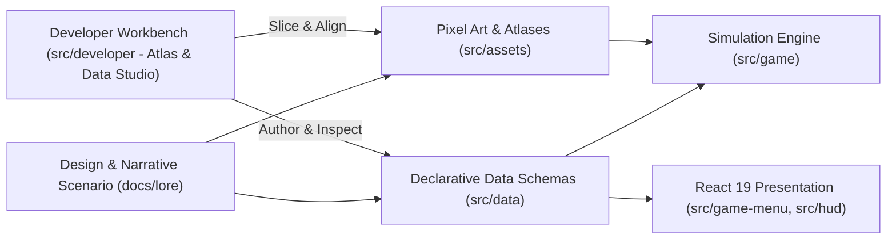
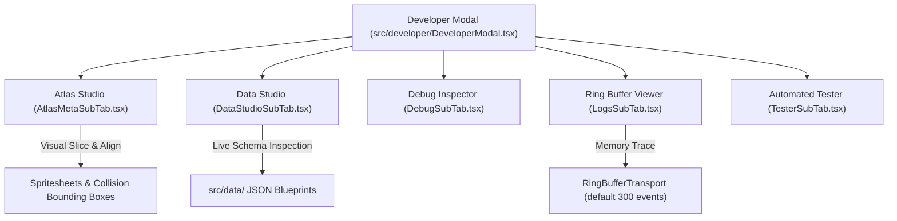

# CONTENT_PIPELINE.md — Content Architecture, Schemas & Asset Pipeline

## 1. Declarative Content Architecture

In *Vibrant Castle*, game content is strictly decoupled from the simulation engine. The engine (`src/game/`) acts as a pure, deterministic interpreter of declarative data:

$$\text{SCENARIO} \longrightarrow \text{JSON Data } (\text{src/data/}) \longrightarrow \text{Assets } (\text{src/assets/}) \longrightarrow \text{Engine Interpreter \& UI Presentation}$$



### 1.1. Core Content Invariants

* ✅ **Engine as Interpreter**: Game simulation code contains zero hardcoded level layouts, enemy stats, weapon damage tables, or dialogue scripts. All content loads from `src/data/`.
* ✅ **Single Source of Truth (SSOT)**: Every entity, item, skill, and location blueprint exists in exactly one canonical JSON file referenced across all systems via `@data` aliases.
* ✅ **Strict Schema Validation**: All JSON blueprints are validated at build and test time (`bun test:arch`). Malformed keys or missing required fields halt CI execution.
* ❌ **FORBIDDEN: Dangling World Transitions**: Every exit portal in a location blueprint must reference a valid target location and registered entry point.
* ❌ **FORBIDDEN: Raw Asset Ingestion Without Metadata**: No sprite or atlas texture may be ingested into the game loop without corresponding slicing metadata.

---

## 2. Data Layer Organization (`src/data/`)

Static content is structured into specialized, domain-focused subdirectories:

| Subdirectory | Canonical Files | Data Domain & Operational Purpose |
| :--- | :--- | :--- |
| **`locations/`** | `courtyard.json`;`thorn_chasm.json`;`clocktower.json`;`aether_sanctuary.json`;`grand_bastion.json` | **Level Blueprints**: World dimensions, spawn points and named entries, theme, parallax layers, prefab dictionaries and the compact `layout` (solids, triggers, levers, portals, enemies). |
| **`enemies/`** | `enemies.json` | **Monster Bestiary**: Canonical template registry for 19 enemy types: dimensions, stats, elemental resistances, soul drops, atlas binding, procedural fallback and lore entries. |
| **`items/`** | `items.json` | **Item & Equipment Registry**: Weapons, shields, armor, rings, amulets, and consumable potions with combat modifiers and status effects. |
| **`skills/`** | `skills.json`;`spells.json` | **Skill Constellations**: Skill trees for Valen and Aurelia detailing tiers, mana/stamina costs, cooldown frames, projectiles, and prerequisite node connections. |
| **`structures/`** | `structures.json` | **Interactive Map Objects**: Levers, pressure plates, locked portcullises, chests, save shrines, and aether lanterns. |
| **`narrative/`** | `dialogues_vn.json`;`narrator_reactive.json`;`scenario_act1.json`;`triggers.json` | **Narrative Manifests**: Visual novel character dialogue sequences, reactive narrator cues, and world trigger definitions. |
| **`progression/`** | `skill_trees.json` | **Skill tree layout** for the two champions. |
| **`defaults/`** | `defaultControls.json`;`defaultPlayerStats.json`;`defaultSettings.json` | **System Defaults**: Baseline keybindings, gamepad button indices, base player stats, audio volume levels, and display settings. |

---

## 3. Location Blueprint Specification

Every level blueprint in `src/data/locations/` conforms to the canonical location schema:

```json
{
  "schemaVersion": "1.0",
  "id": "courtyard",
  "nameKey": "locationCourtyardName",
  "descriptionKey": "locationCourtyardDesc",
  "openingNarrationKey": "narrationOpening",
  "sceneType": "action_platformer",
  "dimensions": { "width": 7200, "height": 1350 },
  "spawnPoints": {
    "default": { "x": 140, "y": 1120 },
    "p2Offset": { "x": 45, "y": 0 },
    "entries": { "from_chasm": { "x": 6950, "y": 1120 }, "from_tower": { "x": 2100, "y": 834 } }
  },
  "theme": {
    "bgGradientTop": "#2d140a",
    "bgGradientBottom": "#120602",
    "ambientParticle": "leaf",
    "fogColor": "rgba(224, 108, 53, 0.08)",
    "musicIntensity": 0.1
  },
  "parallaxBackground": {
    "boxWidth": 7600,
    "boxHeight": 1600,
    "layers": [ /* 5 tiers: FAR ("opaque": true) to CLOSE; optional "mirrorTile": true */ ]
  },
  "dictionaries": { "entities": { /* prefabs: type, colours, labels */ }, "portals": { /* targetLocationId, targetSpawnPoint */ } },
  "layout": {
    "solids": [ /* prefab placements, including gates */ ],
    "triggers": [ /* narration volumes */ ],
    "levers": [ { "id": "court_gate_lever", "triggerId": "lever_courtyard", "targetGateId": "court_gate_main" } ],
    "portals": [ /* placements referencing dictionary portals */ ],
    "enemies": [ { "id": "court_dummy_1", "monsterKey": "training_dummy", "x": 380, "y": 1110 } ]
  }
}
```

### 3.0. Shipped Maps

| Map | Size (px) | Solids | Levers | Enemies | Portals to |
| :--- | :--- | ---: | ---: | ---: | :--- |
| `courtyard` | 7200 x 1350 | 66 | 1 | 16 | thorn_chasm |
| `thorn_chasm` | 6000 x 1500 | 41 | 1 | 17 | courtyard, clocktower |
| `clocktower` | 3600 x 3000 | 63 | 1 | 17 | thorn_chasm, aether_sanctuary |
| `aether_sanctuary` | 6400 x 1600 | 44 | 1 | 13 | clocktower, grand_bastion |
| `grand_bastion` | 8000 x 1500 | 56 | 2 | 22 | aether_sanctuary, courtyard (`from_bastion`) |

**Platform tileset field.** A solid or one-way prefab may carry an optional `"tileset": "<id>"` (`EntityPrefabSchema.tileset`). The location parser copies it to the runtime `Entity.tileset`; the structure renderer then fills the platform from `src/assets/tiles/<id>/` (see `PARALLAX_AND_RENDERING.md` §7). Without the field, or without the files, the platform keeps its procedural look. Planned ids: `courtyard_stone`, `courtyard_wood`, `bastion_stone`, `clocktower_brick`, `chasm_rock`, `chasm_ledge`, `sanctuary_crystal`.

Counts are taken from `src/data/locations/*.json`. The courtyard has no portal of its own towards the tower or bastion; those entries only receive players.

### 3.1. Portal World Graph Integrity

To maintain world coherence, every portal targets an existing location and entry:

* If location `courtyard` defines a portal with target `"clocktower"` and entry `"from_courtyard"`, file `clocktower.json` MUST exist and declare `spawnPoints.entries.from_courtyard`.
* Any orphaned portal or dangling entry key fails automated architecture tests (`src/tests/arch/locationBlueprints.test.ts`).

---

## 4. Monster Bestiary Architecture (`enemies.json`)

Enemies are authored centrally in `src/data/enemies/enemies.json`. The engine instantiates enemies by copying template data, guaranteeing deterministic baseline attributes:

### 4.1. Bestiary Entry Schema

* **Identity**: `id`, `nameKey`, `defaultName`, `category` (free string; used values: `dummy`, `ground_patrol`, `aerial`, `automaton`, `construct`, `elite`).
* **Dimensions & Physics**: `dimensions.width`, `dimensions.height`, `isAerial` (ignores ground friction/gravity).
* **Combat Stats**: `stats.health`, `maxHealth`, `speed`, `attackPower`, `scoreReward` (optional `defense`, `xpReward`). Today enemies patrol and deal no damage, so `attackPower` and `abilities` are data only (planned).
* **Elemental Resistances**: Normalized values from `-1.0` (vulnerable, +100% damage) to `1.0` (immune) across `physical`, `fire`, `frost`, `astral`, and `shadow`.
* **Soul Drop System**: `soulId`, `type` (`bullet`, `guardian`, `enchant`), `dropRate`, `grantedSkillId`, and localized description keys (data only; not granted at runtime yet).
* **Atlas Binding**: `atlas.presetId` names the sheet folder, so several templates can share one sheet (`gargoyle_scout` uses `clockwork_owl_gargoyle`, `bastion_gargoyle` uses `chasm_gargoyle`); `defaultAnimation`, `hitAnimation`, `attackAnimation`, `deathAnimation` name sheet rows. `proceduralFallback` colours are used when no sheet loads.
* **Lore & Tactics**: Progressive unlocks based on kill thresholds (`killThresholds: { basic: 1, tactics: 3, lore: 5 }`).

---

## 5. Visual Asset Delivery Standards (`src/assets/`)

Visual assets must adhere to strict pixel art and technical rendering constraints:

### 5.1. File Format & Alpha Contracts

* **PNG Format Only (one exception)**: All textures, spritesheets, and backdrops must be lossless PNG files. JPEGs and WebPs are prohibited in the rendering pipeline. The sole SVG exception is enemy sheets for the `low` and `mid` quality tiers, generated by the sprite compiler and never hand-edited (see `.agents/rules/content_and_assets.md` §6).
* **True Alpha Transparency**: Layers 2–5 (`MID_FAR`, `MID`, `MID_CLOSE`, `CLOSE`), champion sprites, enemies, and map objects must feature true alpha channel cutouts (`alpha < 255`). Fake color keying (e.g. solid black or magenta backgrounds meant to be keyed out at runtime) is forbidden.
* **The FAR Hard Invariant**: As defined in `PARALLAX_AND_RENDERING.md`, the `FAR` layer texture must be 100% opaque without any transparent pixels, covering the full viewport at all zoom scales.

### 5.2. Sprite Grid Alignment & Baseline Rules

* **Grid Consistency**: Spritesheets must align to uniform pixel grids (e.g. 64x64, 96x96, 128x128).
* **Ground Baseline Preservation**: The foot contact line across all frames of an entity (idle, run, crouch, attack, hit) must remain mathematically identical relative to the bottom boundary of each cell.
* **Wide Action Frames**: Sweeping greatsword attacks, lunging rapier thrusts, or spell detonations exceeding the standard cell width must occupy exactly 2 or 3 cells horizontally, with the origin anchor preserved.
* **Zero Burned-in Text**: Sprites and background textures must never contain baked-in text, typography, or UI icons. All text is rendered dynamically via `@i18n`.

The enemy SVG sheet contract (grid, colour depth, meta format, fallback chain) is defined in `.agents/rules/content_and_assets.md` §6. Level layout rules (zone sequence, vertical steps, gap limits, lever/gate pairing, spawn and patrol constraints) are defined in §7 of the same document. Both are enforced by tests and are not repeated here.

---

### 5.3. Sprite and Atlas Tooling (Bun)

| Tool | Purpose |
| :--- | :--- |
| `bun scripts/sprites/compile.ts <tileset-id>` (`--all`, `--check`, `--preview <dir>`) | **Platform tilesets**: `scripts/sprites/tilesets/<id>.ts` (`defineTileset`, see `scripts/sprites/README.md` Tilesets) compile to `<id>_hi8bit.png` (16 px tiles), `<id>_hi16bit.png` (32 px tiles) and `<id>_tiles_meta.json` in `src/assets/tiles/<id>/`. Validation rejects empty tiles, non-opaque solid tiles and hi-16bit tiles that are a 2x copy of hi-8bit; seam mismatches are warnings. |
| `bun scripts/sprites/compile.ts <id>` (`--all`, `--check`, `--preview <dir>`) | **Pixel sprite compiler**. Draw scripts in `scripts/sprites/enemies/<id>.ts` (PixelCanvas API, see `scripts/sprites/README.md`) compile to `<id>_hi8bit.svg`, `<id>_hi16bit.svg` and `<id>_meta.json` in `src/assets/enemies/<id>/`. Validation rejects empty frames, content touching the cell edge, floating feet, hi-8bit / hi-16bit frames that are pixel-identical, and a body aspect far from the hitbox. `--check` fails when committed files differ from their scripts (also covered by `bun test:scripts`). Heroes are supported too: scripts in `scripts/sprites/heroes/<id>.ts` (`defineHeroSprite`) take their grid (row order, frame counts, column spans of wide frames) from `src/assets/characters/<id>/<id>_packed_meta.json`, use cells of the packed `mid` cell (hi-16bit, rounded up to even) and half of it (hi-8bit), and write `<id>_hi8bit.png`, `<id>_hi16bit.png` (lossless PNG, not SVG: quantized painted frames make multi-megabyte SVGs) and `<id>_pixel_meta.json` (grid, per-tier cell size and scale, `frameRects`, body box, feet origin) next to the painted sheets. Valen and Aurelia are quantized from their painted frames (palette quantizer, see `scripts/sprites/README.md`); `sample_hero` is the hand-drawn template. The runtime loads these sheets when present. |
| `bun scripts/repack-atlas.ts <id>` (`--all`, `--dry-run`, `--overlay <dir>`) | **Atlas repack**. Cuts an original AI sheet (`<id>_high.png`) into islands and re-lays it on a clean grid (`<id>_packed_high.png` plus `<id>_packed_meta.json` with `bodyBox`); configuration in `scripts/atlas/repack.config.json`; hero sheets (Aurelia, Valen) are repacked the same way into `<stem>_{low,mid,high}_packed.png`. Frame geometry is verified by the tests in `scripts/__tests__/`. |
| `bun scripts/check-parallax-seams.ts` | Reports horizontal seam quality of every PNG under `src/assets/bg`; layers that warn need `mirrorTile`. |
| `bun scripts/validate-level.ts <id>` (`--json`) | **Level validator**, see §5.4. |

**Auto-discovery**: a compiled or packed enemy needs no code registration. The game collects `src/assets/enemies/<id>/` automatically; the template in `enemies.json` selects it through `atlas.presetId`. The SVG exception, grid and fallback contract is in `.agents/rules/content_and_assets.md` §6.

### 5.4. Level-Logic Validator

A map can satisfy its JSON schema and still be unplayable. `src/tests/arch/levelLogic.test.ts` (helpers in `src/tests/arch/helpers/levelLogic/`) simulates every location against the player's movement envelope. Constants are mirrored from `playerKinematics.ts` in `constants.ts`: comfortable rise 96 px, maximum rise 109 px, comfortable flat gap 170 px, maximum flat gap 216 px, dash distance 136 px, spawn drop at most 64 px. Rule groups: reachability, levers and gates, portals and entries, spawns, enemies (patrol feet on a platform, aerial clearance), layout. ERRORs fail the test; known defects would be listed in `knownLevelDefects.ts` (empty for all five maps today). The same checks run from the CLI above. The design grammar (zone sequence, 96 px steps, one lever and gate per zone) is in `.agents/rules/content_and_assets.md` §7.

### 5.5. Enemy Quality Tiers

The display setting `assetQuality` (`low` | `mid` | `high`) selects the art tier an enemy is drawn with. The canonical definition is `.agents/rules/content_and_assets.md` §6.1; the facts that matter for content work are:

| Tier | Name | Artwork | Cell size | Colour depth |
| :--- | :--- | :--- | :--- | :--- |
| `low` | hi-8bit | SVG from the sprite compiler (`<id>_hi8bit.svg`) | 48 px | 12-bit, 4,096 colours |
| `mid` | hi-16bit | SVG from the sprite compiler (`<id>_hi16bit.svg`) | 96 px | RGB565, 65,536 colours |
| `high` | high | Painted PNG sheet (`<id>_packed_high.png`) | Set by the packed meta | Full colour |

Both SVG tiers are generated and never hand-edited. Shipped sheets use 10–16 colours per enemy at hi-8bit and 16–23 at hi-16bit.

## 6. Developer Workbench Integration (`src/developer/`)

The content pipeline is supported by the in-engine Developer Workbench:



* **Atlas Studio**: Visualizes sprite grids, configures slicing presets, inspects hitboxes/hurtboxes, and previews animation sequences in real time.
* **Atlas Studio hero tiers**: for a hero with compiled pixel files (`<id>_hi8bit.png`, `<id>_hi16bit.png`, `<id>_pixel_meta.json`) a tier toggle (hi-8bit / hi-16bit / painted) appears next to the preset picker (`atlas/AtlasTierToggle.tsx`, `atlas/heroPixelTiers.ts`). Pixel tiers load through `src/game/engine/heroPixel` and are sliced by the meta `frameRects` (freeform rects, smoothing off); heroes without pixel files only show the painted sheet.
* **Data Studio** (`src/developer/subtabs/datastudio/`): Inspection and validation of data blueprints, a bestiary gallery and inspector, a visual novel preview and an AI generator card. Live editing during play is not verified.
* **RingBuffer Log Viewer**: Diagnostic inspection of recent game engine tick events, domain state transitions, and audio triggers without polluting the browser console.
