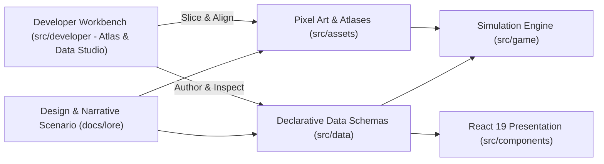
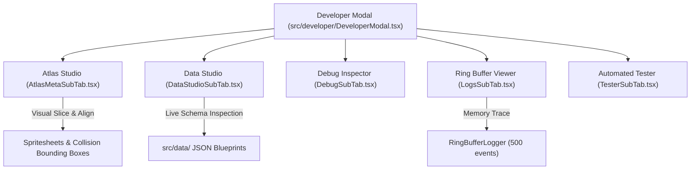

# CONTENT_PIPELINE.md — Content Architecture, Schemas & Asset Pipeline

## 1. Declarative Content Architecture

In *Vibrant Castle*, game content is strictly decoupled from the simulation engine. The engine (`src/game/`) acts as a pure, deterministic interpreter of declarative data:

$$\text{SCENARIO} \longrightarrow \text{JSON Data } (\text{src/data/}) \longrightarrow \text{Assets } (\text{src/assets/}) \longrightarrow \text{Engine Interpreter \& UI Presentation}$$



### 1.1. Core Content Invariants

* ✅ **Engine as Interpreter**: Game simulation code contains zero hardcoded level layouts, enemy stats, weapon damage tables, or dialogue scripts. All content loads from `src/data/`.
* ✅ **Single Source of Truth (SSOT)**: Every entity, item, skill, and location blueprint exists in exactly one canonical JSON file referenced across all systems via `@data` aliases.
* ✅ **Strict Schema Validation**: All JSON blueprints are validated at build and test time (`bun test:arch`). Malformed keys or missing required fields halt CI execution.
* ❌ **FORBIDDEN: Dangling World Transitions**: Every exit portal in a location blueprint must reference a valid target location and registered entry point.
* ❌ **FORBIDDEN: Raw Asset Ingestion Without Metadata**: No sprite or atlas texture may be ingested into the game loop without corresponding slicing metadata.

---

## 2. Data Layer Organization (`src/data/`)

Static content is structured into specialized, domain-focused subdirectories:

| Subdirectory | Canonical Files | Data Domain & Operational Purpose |
| :--- | :--- | :--- |
| **`locations/`** | `courtyard.json`;`clocktower.json`;`grand_bastion.json`;`thorn_chasm.json`;`aether_sanctuary.json` | **Level Blueprints**: World dimensions, camera bounding boxes, spawn points, parallax layers, collision geometry, and entity placements. |
| **`enemies/`** | `enemies.json` | **Monster Bestiary**: Canonical template registry for all enemy types: dimensions, base health, speed, attack power, elemental resistances, soul drops, and lore entries. |
| **`items/`** | `items.json` | **Item & Equipment Registry**: Weapons, shields, armor, rings, amulets, and consumable potions with combat modifiers and status effects. |
| **`skills/`** | `skills.json`;`spells.json` | **Skill Constellations**: Skill trees for Valen and Aurelia detailing tiers, mana/stamina costs, cooldown frames, projectiles, and prerequisite node connections. |
| **`structures/`** | `structures.json` | **Interactive Map Objects**: Levers, pressure plates, locked portcullises, chests, save shrines, and aether lanterns. |
| **`narrative/`** | `dialogues_vn.json`;`narrator_reactive.json`;`scenario_act1.json`;`triggers.json` | **Narrative Manifests**: Visual novel character dialogue sequences, reactive narrator cues, and world trigger definitions. |
| **`defaults/`** | `defaultControls.json`;`defaultSettings.json` | **System Defaults**: Baseline keybindings, gamepad mappings, audio volume levels, and display settings. |

---

## 3. Location Blueprint Specification

Every level blueprint in `src/data/locations/` conforms to the canonical location schema:

```json
{
  "schemaVersion": "1.0",
  "id": "courtyard",
  "nameKey": "locationCourtyardName",
  "descriptionKey": "locationCourtyardDesc",
  "openingNarrationKey": "narrationOpening",
  "sceneType": "action_platformer",
  "dimensions": { "width": 3600, "height": 900 },
  "spawnPoints": {
    "default": { "x": 140, "y": 640 },
    "p2Offset": { "x": 45, "y": 0 },
    "entries": {
      "from_chasm": { "x": 3280, "y": 640 },
      "from_tower": { "x": 2600, "y": 380 }
    }
  },
  "theme": {
    "bgGradientTop": "#2d140a",
    "bgGradientBottom": "#120602",
    "ambientParticle": "leaf",
    "fogColor": "rgba(224, 108, 53, 0.08)",
    "musicIntensity": 0.1
  },
  "parallaxBackground": {
    "boxWidth": 4400,
    "boxHeight": 1150,
    "layers": [ /* 5 parallax tiers: FAR (opaque: true) to CLOSE */ ]
  },
  "collisionMap": [ /* Solid, OneWay, Hazard, Lever, Goal */ ],
  "entities": [ /* Enemies, breakable urns, levers */ ],
  "triggers": [ /* Narration volumes, environmental cutscenes */ ]
}
```

### 3.1. Portal World Graph Integrity

To maintain world coherence, all doors and portals form a closed directed graph:

* If location `courtyard` defines a portal with target `"clocktower"` and entry `"from_courtyard"`, file `clocktower.json` MUST exist and declare `spawnPoints.entries.from_courtyard`.
* Any orphaned portal or dangling entry key fails automated architecture tests (`src/tests/arch/locationBlueprints.test.ts`).

---

## 4. Monster Bestiary Architecture (`enemies.json`)

Enemies are authored centrally in `src/data/enemies/enemies.json`. The engine instantiates enemies by copying template data, guaranteeing deterministic baseline attributes:

### 4.1. Bestiary Entry Schema

* **Identity**: `id`, `nameKey`, `defaultName`, `category` (`undead`, `construct`, `beast`, `boss`, `dummy`).
* **Dimensions & Physics**: `dimensions.width`, `dimensions.height`, `isAerial` (ignores ground friction/gravity).
* **Combat Stats**: `health`, `maxHealth`, `speed`, `attackPower`, `scoreReward`.
* **Elemental Resistances**: Normalized values from `-1.0` (vulnerable, +100% damage) to `1.0` (immune) across `physical`, `fire`, `frost`, `astral`, and `shadow`.
* **Soul Drop System**: `soulId`, `dropRate`, `grantedSkillId`, and localized description keys for champion mastery unlocks.
* **Lore & Tactics**: Progressive unlocks based on kill thresholds (`killThresholds: { basic: 1, tactics: 3, lore: 5 }`).

---

## 5. Visual Asset Delivery Standards (`src/assets/`)

Visual assets must adhere to strict pixel art and technical rendering constraints:

### 5.1. File Format & Alpha Contracts

* **PNG Format Only**: All textures, spritesheets, and backdrops must be lossless PNG files. JPEGs, WebPs, and SVGs are prohibited in the rendering pipeline.
* **True Alpha Transparency**: Layers 2–5 (`MID_FAR`, `MID`, `MID_CLOSE`, `CLOSE`), champion sprites, enemies, and map objects must feature true alpha channel cutouts (`alpha < 255`). Fake color keying (e.g. solid black or magenta backgrounds meant to be keyed out at runtime) is forbidden.
* **The FAR Hard Invariant**: As defined in `PARALLAX_AND_RENDERING.md`, the `FAR` layer texture must be 100% opaque without any transparent pixels, covering the full viewport at all zoom scales.

### 5.2. Sprite Grid Alignment & Baseline Rules

* **Grid Consistency**: Spritesheets must align to uniform pixel grids (e.g. 64x64, 96x96, 128x128).
* **Ground Baseline Preservation**: The foot contact line across all frames of an entity (idle, run, crouch, attack, hit) must remain mathematically identical relative to the bottom boundary of each cell.
* **Wide Action Frames**: Sweeping greatsword attacks, lunging rapier thrusts, or spell detonations exceeding the standard cell width must occupy exactly 2 or 3 cells horizontally, with the origin anchor preserved.
* **Zero Burned-in Text**: Sprites and background textures must never contain baked-in text, typography, or UI icons. All text is rendered dynamically via `@i18n`.

---

## 6. Developer Workbench Integration (`src/developer/`)

The content pipeline is supported by the in-engine Developer Workbench:



* **Atlas Studio**: Visualizes sprite grids, configures slicing presets, inspects hitboxes/hurtboxes, and previews animation sequences in real time.
* **Data Studio**: Live inspection and dynamic editing of location blueprints, item tables, and enemy parameters during active gameplay sessions.
* **RingBuffer Log Viewer**: Diagnostic inspection of recent game engine tick events, domain state transitions, and audio triggers without polluting the browser console.
