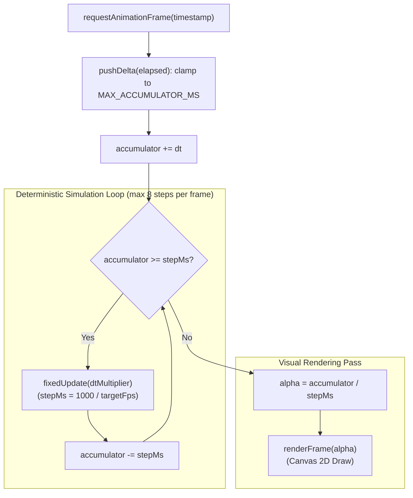
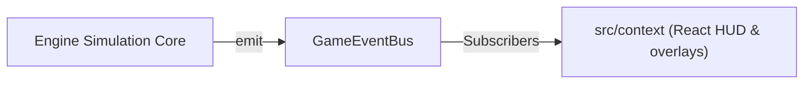
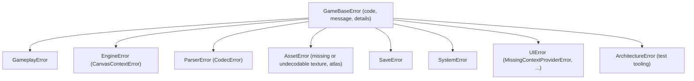

# ENGINEERING.md — Engine Architecture & Principles

## 1. Engineering Guide & Core Goals

This document specifies the technical architecture, execution loop, subsystem contracts, and engineering principles of the **Vibrant Castle Game Engine** (`src/game/`).

### 1.1. Engineering Goals

Every engineering decision in the engine must advance at least one of the following without compromising the others:

- **Correctness**: Physics, combat calculations, and collision resolutions produce mathematically predictable results.
- **Determinism**: Simulation logic depends strictly on fixed timesteps, never on variable frame rendering rates.
- **Performance (60 FPS Stable)**: Frame times must remain below 16.666 ms, with zero Garbage Collection (GC) pauses during gameplay.
- **Maintainability & Modularity**: The engine is composed of small, focused systems interacting via decoupled events rather than monolithic state trees.
- **Testability**: Pure math, vector calculations, and state machines are executable in headless environments (Bun) with zero Canvas or DOM dependencies.

---

## 2. Core Architectural Principles

1. **Separation of Concerns**:
   - `src/game/` (ENGINE) owns simulation, physics, combat, collision, and Canvas 2D rendering.
   - `src/data/` (DATA) is the universal, declarative source of truth (JSON).
   - `src/context/` (CONTEXT) provides bidirectional communication ports bridging React with the Engine.
   - `src/game-menu/` & `src/hud/` (UI) are passive, read-only presentation overlays.
2. **Interpreter Pattern**: The engine acts as an **interpreter** of declarative data structures. It never hardcodes level geometry, enemy rosters, or item attributes in simulation logic.
3. **Pure TypeScript Core**: The simulation core contains zero React imports, zero JSX, and zero DOM manipulations.

---

## 3. Decoupled Game Loop Architecture

The engine implements a fully decoupled, fixed-timestep game loop separating continuous physics updates from visual rendering:

### 3.1. Mathematical Contract

Source: `src/game/engine/fpsManager.ts`, `src/game/loop/engineLoopRunner.ts`.

- **Tick rate (`targetFps`)**: One of 30, 60, 90 or 120 (`TargetFps`, display setting, default 60). One fixed step lasts `1000 / targetFps` ms, independent of the monitor refresh rate.
- **Delta multiplier**: Every step passes `dtMultiplier = 60 / targetFps` (2.0, 1.0, 0.667, 0.5). All gameplay constants (speeds, gravity, timers in frames) are authored in 60 Hz units and multiplied by `dtMultiplier`, so the game runs at the same real-world speed at every tick rate. Timers count in 60 Hz units, never in milliseconds.
- **Spiral-of-death guards**: Elapsed time is clamped to `MAX_ACCUMULATOR_MS` (250 ms) and at most `MAX_STEPS_PER_FRAME` (8) steps run per rendered frame. A step that throws is isolated by the loop circuit breaker (`loopCircuitBreaker.ts`).
- **Render alpha**: The loop passes `alpha = accumulator / stepMs` to `renderFrame`; the frame renderer adds it to the simulation tick counter to obtain a continuous tick for animation timing (`engineFrameRenderer.ts`). Entity positions are drawn from the latest simulated state.

---

## 4. Modular Subsystem Architecture

The simulation tick (`src/game/loop/engineSimulationStep.ts`, `enginePlayerUpdateStep.ts`) delegates sequentially to decoupled modules:

| System | Module Location | Responsibility & Contract |
| :--- | :--- | :--- |
| **`GameInputEngine`** | `src/game/loop/input.ts` | Reads keyboard and gamepad (player 1 = pad index 0, player 2 = pad index 1), applies remappable bindings loaded from `src/data/defaults/defaultControls.json`, and merges both sources into one `InputMap`. |
| **`PlayerKinematics`** | `src/game/physics/playerKinematics.ts` | Acceleration, friction, asymmetric gravity, variable jump, coyote time, jump buffer, slide/backstep momentum. |
| **`PlayerController`** | `src/game/engine/playerController.ts` | Resource regeneration, cooldowns, slide/backstep and melee triggers. |
| **`CollisionEngine` / `EnvironmentCollisionSystem`** | `src/game/physics/collisions.ts`, `environmentCollisionSystem.ts` | AABB overlap resolution through per-`CollisionType` strategies (solid, one-way, hazard, trigger, lever, goal), ground state, moving-platform carriage. |
| **`CombatSystem`** | `src/game/engine/combatSystem.ts` | Player melee boxes and projectiles against enemies and levers, 15-frame enemy damage window, hit feedback. |
| **`EnemyAISystem` / `GamePhysicsEngine.updateEnemy`** | `src/game/engine/enemyAISystem.ts`, `src/game/physics/physics.ts` | Enemies patrol between `patrolMinX` and `patrolMaxX`; they have no attacks and deal no damage (planned). |
| **`NarrationSystem`** | `src/game/engine/narrationSystem.ts` | Timed subtitles (default 220 ticks) resolved from i18n keys. |

Per step, in order: auto skills, player-player collision, melee, projectiles, enemy update, moving entities, environment collisions (portal and lever handling), music modulation, particles, narration timer. Player kinematics, potions and spells run earlier in `enginePlayerUpdateStep.ts`.

### 4.1. Animation Clocks

Animation state is owned by the simulation, never by the renderer:

- **Enemies**: `GamePhysicsEngine.advanceEnemyAnimation` sets `enemy.animationState` (`hit` while `damageTimer > 0`, else `fly` for aerial, `move` for moving ground enemies, otherwise `idle`) and advances `enemy.animationTicks` by `dtMultiplier`. The clock resets to 0 on every state change; a melee or projectile hit sets `hit` and resets it.
- **Structures**: `src/game/locations/structureAnimationClock.ts` keeps `entity.animationTicks` for levers and portals (`inactive` / `active` from `isActivated`) and advances any other entity whose clock was started.
- **Unit**: `animationTicks` accumulates 60 units per simulated second at every tick rate. Renderers convert ticks to frames; they must not read wall-clock time.

### 4.2. Level Lifecycle and Lever/Gate Rule

`LevelLifecycleManager` (`src/game/locations/levelLifecycleManager.ts`) loads locations, handles portals and runs the structure clocks. A lever carries `targetGateId`; when pulled, `unlockLeverGates` (`src/game/locations/leverGateUnlock.ts`) opens exactly that solid. A lever without a resolvable target falls back to the legacy behaviour (opening every solid whose id contains `gate` or `wall`) and logs a warning. Opening a gate moves it to `y = -1000`, which collision code treats as removed; there is no opening animation yet (planned).

### 4.3. Asset Lifecycle

- **Location backgrounds** (`src/game/locations/locationAssetLifecycle.ts`): the entered location's layer textures load immediately; its direct portal-graph neighbours (outbound portals and `nextLocationId`) preload when the main thread is idle; textures of locations that are neither current nor neighbours are evicted. Decoded background memory is therefore bounded to current plus neighbours. The lifecycle is asynchronous I/O only and never touches simulation state.
- **Atlas variants** (`src/game/engine/atlas/`): see `PARALLAX_AND_RENDERING.md` §6. Only the tier being drawn is fetched; the previous tier keeps drawing until the new one is ready.
- **Sprite source factory** (`src/game/engine/sprites/spriteSourceFactory.ts`, `ISpriteSourceFactory`): the single owner of the graphics quality and the only place that maps (entity id, requested quality, progression tier) to a sprite variant. It walks the fallback chain (requested, then its chain, skipping tiers marked failed), stores hero sprite maps registered per character and progression tier, and notifies subscribers once when the quality actually changes. It is injected by constructor: `AssetLoader` and `AtlasTextureManager` follow its changes (enemy and structure atlases switch tier, heroes preload the new tier), `ActorRenderer` reads the current quality from it, and `GameEngine` exposes it (`engine.spriteSources`, overridable through `IGameDependencies.spriteSources`). The default instance belongs to the `assetLoader` singleton, which delegates to it. The setting enters once through `EngineSettingsController` (`display.assetQuality` calls `setQuality`), never per frame, and React reads the same instance through `GameEngineContext.spriteSources`. A new art tier for heroes plugs in by registering its variants with `registerCharacter`; no caller indexes variants by quality (`src/tests/arch/spriteQualityResolution.test.ts` enforces this).

### 4.4. Determinism Rules New Code Relies On

1. Simulation code takes time only as `dtMultiplier`; gameplay timers must not use wall-clock time. (`ReactiveNarratorManager` uses `Date.now()` for cooldowns; it is not wired into the engine yet and must be moved to simulation time when it is.)
2. Timers and clocks count in 60 Hz units and are advanced once per step.
3. Renderers, culling (`src/game/renderer/viewCulling.ts`) and asset loading read simulation state but never write it.
4. Render paths allocate nothing (scratch vectors, preallocated rects, as in `ViewCuller` and `LayerRect`); this is enforced for `render()` by the architecture tests. The simulation step still contains some `forEach` closures (for example in `physics.ts`); tightening them is not yet done.

---

## 5. GameEventBus & Discrete Communication

The engine features a dedicated, zero-dependency event bus (`src/game/engine/eventBus.ts`) enabling inversion of control:

### 5.1. Domain Event Registry

- `PLAYER_DAMAGED`: Dispatched when an attack resolves against a champion, carrying damage amount, source, and remaining HP.
- `PLAYER_HEALED`: Dispatched on potion use or aether regeneration.
- `ITEM_CONSUMED`: Dispatched when an inventory item is expended.
- `NARRATION_TRIGGERED`: Dispatched on entering room sectors or achieving combat milestones, directing the Narrator to speak.
- `LOCATION_CHANGED`: Dispatched upon traversing a portal into a new sector.
- `LEVEL_RESET`: Dispatched on hero defeat or checkpoint reset.
- `STATE_SNAPSHOT`: Emitted on simulation ticks for read-only React context synchronization.

### 5.2. Error-Isolated Dispatch

Subscriber callbacks are executed inside isolated `try/catch` boundaries. If an external listener (e.g. a faulty React component or sound trigger) throws an error, it is caught, recorded in the diagnostic ring buffer, and the simulation loop continues uninterrupted at 60 Hz.

---

## 6. Error Handling & Diagnostics Architecture

### 6.1. Domain Error Hierarchy (`GameBaseError`)

Generic `new Error(...)` is strictly forbidden in production code. All runtime failures instantiate structured subclasses inheriting from `GameBaseError` (`src/lib/errors/GameBaseError.ts`):

### 6.2. RingBufferLogger

The engine includes an in-memory, zero-allocation ring buffer logger (`src/lib/logger/transports/RingBufferTransport.ts`):

- Stores a fixed circular buffer (`RingBufferTransport`, default capacity 300) of structured log records.
- Never writes directly to the DOM; accessible via developer tools (`src/developer/`) and the Atlas Studio debug console.
- Overwrites oldest entries when full, preventing memory leaks during indefinite gameplay sessions.

---

## 7. Performance & Memory Management (The 60 FPS Contract)

1. **Zero Allocations in the Render Loop**:
   - `render()` must execute with **zero heap allocations**.
   - No `new Vector2D()`, no arrow functions `() => {}`, and no array slicing `[...entities]`.
   - Reusable scratch vectors (`scratchPos`, `scratchBounds`) and object pools are preallocated during system initialization.
2. **Canvas State Preservation**:
   - Minimize `ctx.save()` and `ctx.restore()` calls; reset transform matrices using `ctx.setTransform(1, 0, 0, 1, 0, 0)`.
   - Never resize or query the Canvas DOM element (`canvas.width = ...`) per frame; viewport dimensions are cached and updated only on window resize events.
3. **Render-only View Culling**:
   - `ViewCuller` holds the camera view rectangle expanded by 200 px and skips entities and enemies outside it; per-frame draw counters feed the profiler overlay.
