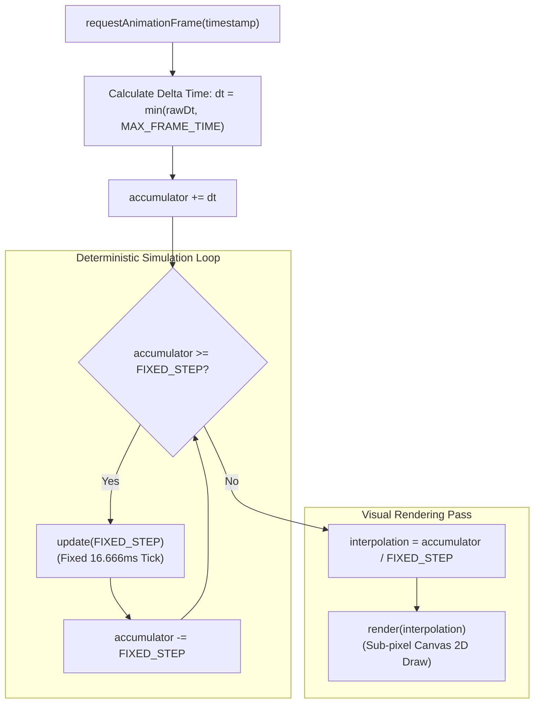
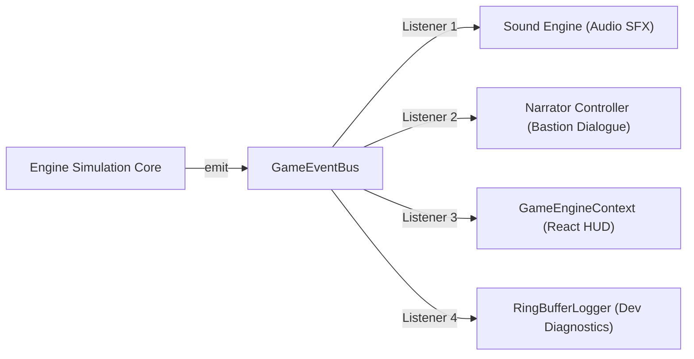
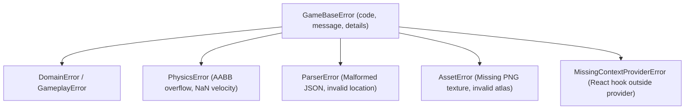

# ENGINEERING.md — Engine Architecture & Principles

## 1. Engineering Guide & Core Goals

This document specifies the technical architecture, execution loop, subsystem contracts, and engineering principles of the **Vibrant Castle Game Engine** (`src/game/`).

### 1.1. Engineering Goals

Every engineering decision in the engine must advance at least one of the following without compromising the others:

- **Correctness**: Physics, combat calculations, and collision resolutions produce mathematically predictable results.
- **Determinism**: Simulation logic depends strictly on fixed timesteps, never on variable frame rendering rates.
- **Performance (60 FPS Stable)**: Frame times must remain below 16.666 ms, with zero Garbage Collection (GC) pauses during gameplay.
- **Maintainability & Modularity**: The engine is composed of small, focused systems interacting via decoupled events rather than monolithic state trees.
- **Testability**: Pure math, vector calculations, and state machines are executable in headless environments (Bun) with zero Canvas or DOM dependencies.

---

## 2. Core Architectural Principles

1. **Separation of Concerns**:
   - `src/game/` (ENGINE) owns simulation, physics, combat, collision, and Canvas 2D rendering.
   - `src/data/` (DATA) is the universal, declarative source of truth (JSON).
   - `src/context/` (CONTEXT) provides bidirectional communication ports bridging React with the Engine.
   - `src/components/` (UI) is a passive, read-only presentation overlay.
2. **Interpreter Pattern**: The engine acts as an **interpreter** of declarative data structures. It never hardcodes level geometry, enemy rosters, or item attributes in simulation logic.
3. **Pure TypeScript Core**: The simulation core contains zero React imports, zero JSX, and zero DOM manipulations.

---

## 3. Decoupled Game Loop Architecture

The engine implements a fully decoupled, fixed-timestep game loop separating continuous physics updates from visual rendering:

### 3.1. Mathematical Contract

- **Fixed Simulation Step (`FIXED_STEP`)**: Defaults to `1000 / 60` ms (16.666 ms). The simulation ticks at exactly 60 Hz regardless of monitor refresh rates (30, 60, 90, 120, or 144 Hz).
- **Frame Clamping (`MAX_FRAME_TIME`)**: Delta time is clamped to 100 ms to prevent the "spiral of death" during browser tab switching or background throttling.
- **Sub-Pixel Interpolation**: Visual positions are calculated using the interpolation alpha:
  $$\text{RenderPos} = \text{PrevPos} + (\text{CurrentPos} - \text{PrevPos}) \times \text{interpolation}$$
  This guarantees silky-smooth camera and entity locomotion without physics jittering.

---

## 4. Modular Subsystem Architecture

The monolithic update loop is strictly abolished. The simulation tick delegates sequentially to decoupled systems:

| System | Module Location | Responsibility & Contract |
| :--- | :--- | :--- |
| **`InputSystem`** | `src/game/systems/InputSystem.ts` | Consumes raw keyboard/gamepad events, applies key bindings, normalizes direction vectors, and maintains jump/attack input buffers. |
| **`MovementSystem`** | `src/game/systems/MovementSystem.ts` | Integrates entity velocity, calculates gravitational acceleration, applies surface friction, and updates spatial coordinates. |
| **`CollisionSystem`** | `src/game/systems/CollisionSystem.ts` | Performs broadphase spatial hashing, resolves Axis-Aligned Bounding Box (AABB) intersections, handles ground snapping, and manages one-way platforms. |
| **`CombatSystem`** | `src/game/systems/CombatSystem.ts` | Evaluates attack hitboxes against defender hurtboxes, computes damage mitigation, checks poise reduction, and manages invulnerability windows (i-frames). |
| **`AnimationSystem`** | `src/game/systems/AnimationSystem.ts` | Advances frame clocks for active sprite atlas sheets, resolves row transitions, and fires frame-specific combat event triggers. |

---

## 5. GameEventBus & Discrete Communication

The engine features a dedicated, zero-dependency event bus (`src/game/engine/eventBus.ts`) enabling inversion of control:

### 5.1. Domain Event Registry

- `PLAYER_DAMAGED`: Dispatched when an attack resolves against a champion, carrying damage amount, source, and remaining HP.
- `PLAYER_HEALED`: Dispatched on potion use or aether regeneration.
- `ITEM_CONSUMED`: Dispatched when an inventory item is expended.
- `NARRATION_TRIGGERED`: Dispatched on entering room sectors or achieving combat milestones, directing the Narrator to speak.
- `LOCATION_CHANGED`: Dispatched upon traversing a portal into a new sector.
- `LEVEL_RESET`: Dispatched on hero defeat or checkpoint reset.
- `STATE_SNAPSHOT`: Emitted on simulation ticks for read-only React context synchronization.

### 5.2. Error-Isolated Dispatch

Subscriber callbacks are executed inside isolated `try/catch` boundaries. If an external listener (e.g. a faulty React component or sound trigger) throws an error, it is caught, recorded in the diagnostic ring buffer, and the simulation loop continues uninterrupted at 60 Hz.

---

## 6. Error Handling & Diagnostics Architecture

### 6.1. Domain Error Hierarchy (`GameBaseError`)

Generic `new Error(...)` is strictly forbidden in production code. All runtime failures instantiate structured subclasses inheriting from `GameBaseError` (`src/lib/errors/GameBaseError.ts`):

### 6.2. RingBufferLogger

The engine includes an in-memory, zero-allocation ring buffer logger (`src/lib/logger/RingBufferLogger.ts`):

- Stores a fixed circular buffer (e.g. 500 entries) of structured log records: `{ timestamp, level, category, message, details }`.
- Never writes directly to the DOM; accessible via developer tools (`src/developer/`) and the Atlas Studio debug console.
- Overwrites oldest entries when full, preventing memory leaks during indefinite gameplay sessions.

---

## 7. Performance & Memory Management (The 60 FPS Contract)

1. **Zero Allocations in the Render Loop**:
   - `render()` must execute with **zero heap allocations**.
   - No `new Vector2D()`, no arrow functions `() => {}`, and no array slicing `[...entities]`.
   - Reusable scratch vectors (`scratchPos`, `scratchBounds`) and object pools are preallocated during system initialization.
2. **Canvas State Preservation**:
   - Minimize `ctx.save()` and `ctx.restore()` calls; reset transform matrices using `ctx.setTransform(1, 0, 0, 1, 0, 0)`.
   - Never resize or query the Canvas DOM element (`canvas.width = ...`) per frame; viewport dimensions are cached and updated only on window resize events.
3. **Texture Atlas Batching**:
   - Draw calls are batched by active sprite atlas sheet to avoid redundant image binding switches.
