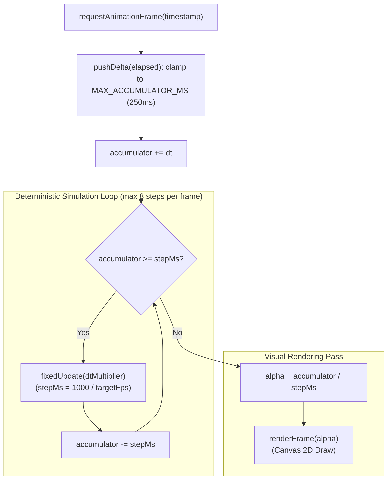

# ENGINEERING.md — Engine Architecture & Principles

## 1. Engineering Guide & Core Goals

This document specifies the technical architecture, execution loop, subsystem contracts, and engineering principles of the **Vibrant Castle Game Engine** (`src/game/`).

### 1.1. Engineering Goals

- **Correctness**: Physics, combat calculations, and collision resolutions produce mathematically predictable results.
- **Determinism**: Simulation logic depends strictly on fixed timesteps, never on variable frame rendering rates.
- **Performance (60 FPS Stable)**: Frame times remain below `16.666 ms`, with zero Garbage Collection (GC) allocations inside `render()`.
- **Maintainability & Modularity**: Small, focused systems interacting via decoupled events (`GameEventBus`) rather than monolithic state trees.
- **Testability**: Pure math, vector calculations, and state machines execute under Bun with zero Canvas or DOM dependencies.

---

## 2. Core Architectural Principles

1. **Separation of Concerns**:
   - `src/game/` (ENGINE) owns simulation, physics, combat, collision, and Canvas 2D rendering.
   - `src/data/` (DATA) is the declarative JSON source of truth.
   - `src/context/` (CONTEXT) provides bidirectional communication ports bridging React with the Engine.
   - `src/game-menu/` & `src/hud/` (UI) are passive presentation overlays.
2. **Interpreter Pattern**: The engine interprets declarative data from `src/data/` rather than hardcoding level geometry or stats.
3. **Pure TypeScript Core**: Zero React imports, zero JSX, and zero DOM coupling in simulation logic (`src/tests/arch/architectureBoundaries.test.ts`, `layerLeakage.test.ts`).

---

## 3. Decoupled Game Loop Architecture

### 3.1. Mathematical Contract (`src/game/engine/fpsManager.ts`, `src/game/loop/engineLoopRunner.ts`)

- **Tick rate (`targetFps`)**: `30`, `60`, `90`, or `120` (`TargetFps`, default `60`). One fixed step lasts `1000 / targetFps` ms.
- **Delta multiplier**: `dtMultiplier = 60 / targetFps` (`2.0`, `1.0`, `0.6667`, `0.5`). All speeds, gravity, and frame timers are authored in 60 Hz units and multiplied by `dtMultiplier`.
- **Spiral-of-death guards**: Elapsed delta is clamped to `MAX_ACCUMULATOR_MS` (`250 ms`), capped at `MAX_STEPS_PER_FRAME` (`8`), and guarded by `loopCircuitBreaker.ts`.
- **Render alpha**: `alpha = accumulator / stepMs` is passed to `renderFrame(alpha)` (`engineFrameRenderer.ts`).

---

## 4. Modular Subsystem Architecture

The simulation tick (`src/game/loop/engineSimulationStep.ts`, `enginePlayerUpdateStep.ts`) delegates sequentially to decoupled modules:

| System | Module Location | Responsibility & Contract |
| :--- | :--- | :--- |
| **`GameInputEngine`** | `src/game/loop/input.ts` | Reads keyboard and gamepad (`P1 = pad 0`, `P2 = pad 1`), applies remappable bindings from `defaultControls.json`, supports `setMenuCapture(bool)` while game menus are open. |
| **`PlayerKinematics`** | `src/game/physics/playerKinematics.ts` | Acceleration, friction, asymmetric gravity, variable jump, coyote time, jump buffer, slide/backstep momentum. |
| **`PlayerController`** | `src/game/engine/playerController.ts` | Resource regeneration, cooldowns, slide/backstep and melee triggers. |
| **`CollisionEngine` / `EnvironmentCollisionSystem`** | `src/game/physics/collisions.ts`, `environmentCollisionSystem.ts` | AABB overlap resolution per `CollisionType` (`solid`, `oneway`, `hazard`, `trigger`, `lever`, `goal`), ground state, moving-platform carriage. |
| **`CombatSystem`** | `src/game/engine/combatSystem.ts` | Player melee hitboxes (`40 px` reach) and projectiles against enemies and levers, 15-frame enemy `damageTimer`, hit feedback. |
| **`EnemyAISystem` / `GamePhysicsEngine.updateEnemy`** | `src/game/engine/enemyAISystem.ts`, `src/game/physics/physics.ts` | Patrols between `patrolMinX` and `patrolMaxX`. Enemy attacks and contact damage are **backlog** (Phase 5 in [`docs/tasks/ROADMAP.md`](../tasks/ROADMAP.md)). |
| **`CameraManager`** | `src/game/engine/cameraManager.ts` | Smooth viewport tracking (`lerpFactor: 0.08`, continuous `verticalLerpFactor` ramp up to `0.14` over `180 px`), bounds clamping, and screen shake. |
| **`NarrationSystem`** | `src/game/engine/narrationSystem.ts` | Timed subtitles (`defaultDuration: 220` ticks) resolved from i18n keys. |

### 4.1. Animation Clocks

- **Enemies**: `GamePhysicsEngine.advanceEnemyAnimation` sets `enemy.animationState` (`hit` while `damageTimer > 0`, else `fly`, `move`, or `idle`) and advances `enemy.animationTicks` by `dtMultiplier`.
- **Structures**: `src/game/locations/structureAnimationClock.ts` advances `entity.animationTicks` for levers (`LEVER_ACTIVATING_TICKS = 30`), portals, and opening gates (`updateGateCollision`, `GATE_OPEN_TICKS = 72` = `1.2 s`).

### 4.2. Level Lifecycle and Lever/Gate Rule

`LevelLifecycleManager` (`src/game/locations/levelLifecycleManager.ts`) and `LOCATION_REGISTRY` (`src/game/locations/registry.ts`) manage all 8 shipped locations. When a lever is struck, `unlockLeverGates` (`src/game/locations/leverGateUnlock.ts`) opens the solid named by `targetGateId` via `beginOpeningGate` (`src/game/physics/gateState.ts`).

### 4.3. Asset Lifecycle & Quality Resolution

- **Location backgrounds** (`src/game/locations/locationAssetLifecycle.ts`): Loads current location textures immediately, preloads direct portal-graph neighbours on idle, and evicts non-adjacent locations.
- **Tilesets & Props**: `TilesetManager` (`src/game/engine/tiles/`) and `PropManager` (`src/game/engine/props/`) discover compiled assets via Vite `import.meta.glob` (filesystem fallback under Bun) and react to `ISpriteSourceFactory` quality changes.
- **Hero Pixel Tiers (`src/game/engine/heroPixel/`)**: Discovers `<hero>_hi8bit.png`, `<hero>_hi16bit.png`, and `<hero>_pixel_meta.json` for live tier switching.
- **Sprite Source Factory (`src/game/engine/sprites/spriteSourceFactory.ts`)**: Single owner of `assetQuality` (`low | mid | high`) and fallback chain (`atlasVariantResolver.ts`). Enforced by `src/tests/arch/spriteQualityResolution.test.ts`. **Backlog**: build-time baking of `hi16bit` SVGs to PNG atlases is tracked in [`VC-011`](../tasks/phase-5-0.4.x.md#vc-011--hi16bit-build-step-svg-to-png-atlas).

### 4.4. Determinism & Backlog Notes

1. Simulation code uses `dtMultiplier` and 60 Hz tick units; `ReactiveNarratorManager` (`src/game/logic/narrative/reactiveNarratorManager.ts`) uses `Date.now()` and is **not yet wired** into the engine loop (Phase 5 backlog).
2. Attribute-driven vitals/growth ([`VC-031`](../tasks/phase-5-0.4.x.md#vc-031--attributes-and-automatic-growth-engine)) and D20x10 monster scaling ([`VC-032`](../tasks/phase-5-0.4.x.md#vc-032--monsters-on-the-attribute-scale)) are Phase 5 backlog.
3. Render paths allocate zero objects (`ViewCuller`, `LayerRect`).

---

## 5. GameEventBus & Discrete Communication (`src/game/engine/eventBus.ts`)

Discrete events (`PLAYER_DAMAGED`, `PLAYER_HEALED`, `ITEM_CONSUMED`, `NARRATION_TRIGGERED`, `LOCATION_CHANGED`, `LEVEL_RESET`, `STATE_SNAPSHOT`) are dispatched inside isolated `try/catch` boundaries so subscriber errors log to `RingBufferTransport` without halting the simulation loop.

---

## 6. Error Handling & Diagnostics (`@lib/errors`, `src/lib/logger/`)

Generic `new Error(...)` is forbidden in production code. Structured errors inherit from `GameBaseError` (`src/lib/errors/GameBaseError.ts`): `GameplayError`, `EngineError` (`CanvasContextError`), `ParserError` (`CodecError`), `AssetError`, `SaveError`, `SystemError`, `UIError` (`MissingContextProviderError`), and `ArchitectureError`.

Log records flow into `RingBufferTransport` (default capacity 300) for inspection in the Developer Suite.

---

## 7. Performance & Memory Contract

1. **Zero Allocations in `render()`**: Preallocate scratch vectors/rects (`ViewCuller`, `LayerRect`).
2. **No Per-Frame Canvas Resizing**: Configure canvas dimensions only at init/resize.
3. **Render-Only Culling**: `ViewCuller` (`src/game/renderer/viewCulling.ts`) expands the camera rectangle by `200 px` and skips out-of-view entities.
