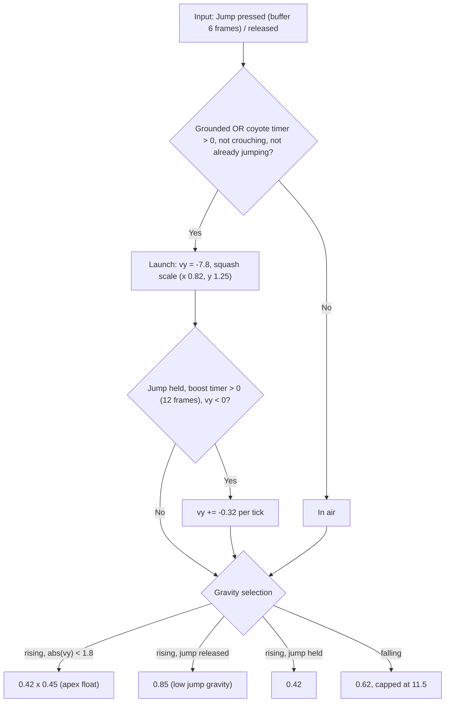

# GAMEPLAY.md — Mechanics, Combat, Kinematics & Champions

## 1. Core Combat Philosophy & Game Feel

*Vibrant Castle* is a 2D metroidvania aiming for *Mario*-feel movement, *Castlevania: Aria of Sorrow* maps, heroes, and enemies, an autumn mood, and *Bastion*-style narration ([`docs/tasks/VISION.md`](../tasks/VISION.md)). This document describes **what the code executes today** and marks planned vision features as **backlog**.

### 1.1. Core Gameplay Tenets

* **Animation-Driven & Readable**: Every strike, leap, and dodge uses fixed-tick durations and AABB hitboxes/hurtboxes.
* **Telegraphed Enemy Offense (Backlog — Phase 5)**: Today enemies only patrol, hover, or stay stationary and deal **no** attack or contact damage ([`docs/tasks/ROADMAP.md`](../tasks/ROADMAP.md)).
* **Game Feel & Impact**: Melee/spell hits produce screen shake (`cameraManager.triggerShake(7, 4)`), spark particle bursts, sound effects, and a 15-frame enemy `damageTimer`.

---

## 2. Kinematics & Platforming Physics

All constants are authored in 60 Hz units (`src/game/physics/playerKinematics.ts`) and scaled by `dtMultiplier = 60 / targetFps`.

### 2.1. Kinematic Constants

| Parameter | Value | Operational Purpose |
| :--- | :---: | :--- |
| `baseGravity` / `fallGravity` | `0.42` / `0.62` | Upward ascent vs snappier descent. |
| `lowJumpGravity` / `apexGravityMultiplier` | `0.85` / `0.45` | Variable jump cut and apex float (`|vy| < 1.8`). |
| `initialJumpForce` / `jumpHoldAcceleration` | `-7.8` / `-0.32` | Takeoff and sustained hold boost (`maxJumpHoldDuration = 12` frames). |
| `maxFallSpeed` | `11.5` | Terminal Y velocity clamp. |
| `groundAcceleration` / `airAcceleration` | `0.75` / `0.55` | Horizontal responsiveness. |
| `groundFriction` / `airFriction` | `0.78` / `0.94` | Deceleration when neutral. |
| `maxRunSpeed` | `4.8` | Maximum horizontal run speed. |
| `maxCoyoteFrames` / `maxJumpBufferFrames` | `6` / `6` | ~100 ms ledge forgiveness and landing buffer. |

### 2.2. Jump Envelope Used by the Level Validator

`src/tests/arch/helpers/levelLogic/constants.ts`: maximum rise `109 px`, comfortable rise `96 px`, maximum flat jump `216 px`, comfortable flat gap `170 px`, dash distance `136 px`, player box `32 × 48 px`.

---

## 3. Collision Hierarchy, Levers & Maps

### 3.1. Collision Strategies

* **`Solid`**: Resolves penetration along shallowest axis; moving platforms impart displacement to riders.
* **`OneWay`**: Upward jumps pass through; downward falls snap feet to platform top.
* **`Hazard`**: Inflicts `20` damage with knockback (`vx = ±6, vy = -5`) unless shielded by `Prismatic Barrier` or `Aether Barrier`.
* **`Lever`**: Activated once by melee or projectile; opens the solid named by `targetGateId` (`1.2 s` / `GATE_OPEN_TICKS = 72` shrinking collision from bottom; `src/game/physics/gateState.ts`).
* **`Trigger`**: One-shot narration volume.
* **`Goal`**: Portal transitioning to `targetLocationId` and `targetEntryKey` (falling back to `targetSpawnPoint` when present).

### 3.2. Current Worlds (Map 1 of 8 × 8 Campaign)

| Map | Size (px) | Levers | Enemies | Portals to |
| :--- | :--- | ---: | ---: | :--- |
| `courtyard` | 4800 × 1040 | 1 | 9 | `thorn_chasm`, `clocktower` |
| `thorn_chasm` | 4560 × 1120 | 0 | 8 | `courtyard`, `ashen_catacombs` |
| `ashen_catacombs` | 2640 × 1560 | 1 | 7 | `thorn_chasm`, `clocktower` |
| `clocktower` | 2440 × 1740 | 1 | 8 | `ashen_catacombs`, `alchemist_library` |
| `alchemist_library` | 3840 × 1380 | 1 | 7 | `clocktower`, `aether_sanctuary` |
| `aether_sanctuary` | 4240 × 1400 | 0 | 7 | `alchemist_library`, `grand_bastion` |
| `grand_bastion` | 4840 × 1140 | 1 | 7 | `aether_sanctuary`, `eclipse_crown` |
| `eclipse_crown` | 4640 × 1460 | 1 | 7 | `grand_bastion`, `courtyard` |

**Backlog**: Expanding to 8 × 8 maps under the map contract ([`VC-020`](../tasks/phase-4-0.3.x.md#vc-020--map-contract-for-the-8x8-campaign)), hybrid baseline expansions ([`VC-021`…`VC-025`](../tasks/phase-5-0.4.x.md#vc-021--vc-025--hybrid-maps-courtyard-thorn_chasm-clocktower-aether_sanctuary-grand_bastion)), contract alignment ([`VC-026`…`VC-028`](../tasks/phase-5-0.4.x.md#vc-026--vc-028--fix-new-maps-ashen_catacombs-alchemist_library-eclipse_crown)), and ability-gated portals (Phase 6 of [`docs/tasks/ROADMAP.md`](../tasks/ROADMAP.md)).

---

## 4. Combat, Evasion & Enemy Behaviour

### 4.1. Melee & Projectiles (`src/game/engine/combatSystem.ts`, `playerController.ts`)

* **Melee Hitbox**: `40 px` reach in front of the player (`attackTime = 14` ticks; `attackCooldownTicks` = `18` for Valen, `22` for Aurelia).
* **Damage & Rewards**: Uses `calculatePlayerDerivedStats(player).totalAttack`; struck enemies enter a 15-frame `damageTimer` and `hit` state; kills award `+150` score and `+1` skill point.

### 4.2. Evasive Maneuvers (`Action 2`)

* **Forward Slide (`isDashing`)**: Duration `13` ticks, speed `10.5`, cooldown `38` ticks (Valen) / `30` ticks (Aurelia), stamina cost `18` / `15`.
* **Tactical Backstep (`isBackstepping`)**: Duration `10` ticks, speed `7.5` backwards with small hop (`vy = -2.2`), cooldown `32` ticks (Valen) / `26` ticks (Aurelia).

### 4.3. Enemy Behaviour (Implemented vs Backlog)

* **Today**: 19 templates in `src/data/enemies/enemies.json`. Non-dummy enemies patrol horizontally between `patrolMinX` and `patrolMaxX`; dummies stay still. There is no enemy chase, attack, contact damage, or live soul drop.
* **Backlog**: Enemy attacks and contact damage (Phase 5), monster D20x10 attribute scaling ([`VC-032`](../tasks/phase-5-0.4.x.md#vc-032--monsters-on-the-attribute-scale)), and balance audit ([`VC-080`](../tasks/phase-5-0.4.x.md#vc-080--balance-review-after-c4758f3)).

---

## 5. Champions & Skills (`src/game/characters/characterProfiles.ts`, `src/data/skills/spells.json`)

* **Valen (*Solar Knight* / *Słoneczny Rycerz*)**: Base HP `115`, Mana `90`, Stamina `115`, Attack `23`, Defense `7`, Spell Power `1.0x`.
  * Signature spells: `solar_flare` (`35` dmg, `12` mana, `24` cd), `solar_fireball` (`52` dmg, `24` mana, `48` cd), `radiant_strike` (`78` dmg, `35` mana, `75` cd), `shield_bash`, `prismatic_shield`, `sun_sentinel`, plus passives.
* **Aurelia (*Scholar of Arcanum* / *Uczona Arkanów*)**: Base HP `90`, Mana `125`, Stamina `95`, Attack `18`, Defense `4`, Spell Power `1.15x`, Mana Cost `0.9x`.
  * Signature spells: `aether_bolt` (`26` dmg, `10` mana, `20` cd), `frost_nova` (`50` dmg, `26` mana, `55` cd), `emerald_barrage` (`38` dmg, `20` mana, `42` cd), `celestial_comet` (`85` dmg, `38` mana, `80` cd), `aether_barrier`, `chrono_rewind`, `sentinel_spark`, plus passives.
* **Backlog**: D20x10 six-attribute model (`STR/DEX/CON/INT/WIS/CHA`; Valen `151/166/156/136/146/151`, Aurelia `131/152/136/176/162/149`) and player-selected 1/2/3 priority growth ([`VC-030`](../tasks/phase-4-0.3.x.md#vc-030--character-system-design-doc), [`VC-031`](../tasks/phase-5-0.4.x.md#vc-031--attributes-and-automatic-growth-engine), [`VC-033`](../tasks/phase-5-0.4.x.md#vc-033--valen-and-aurelia-progression-trees)).
* **Controls Backlog**: Default pad bindings in `defaultControls.json` currently map bumpers/triggers directly to `magic2` and `potion1–3`; gameplay restricted-pad selector semantics (bumpers as selectors) are scheduled for Phase 5 ([`docs/tasks/ROADMAP.md`](../tasks/ROADMAP.md)).
