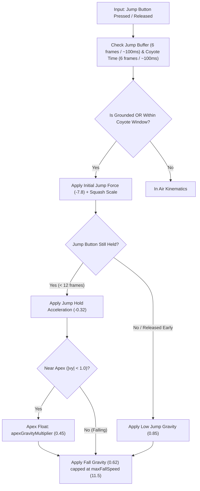
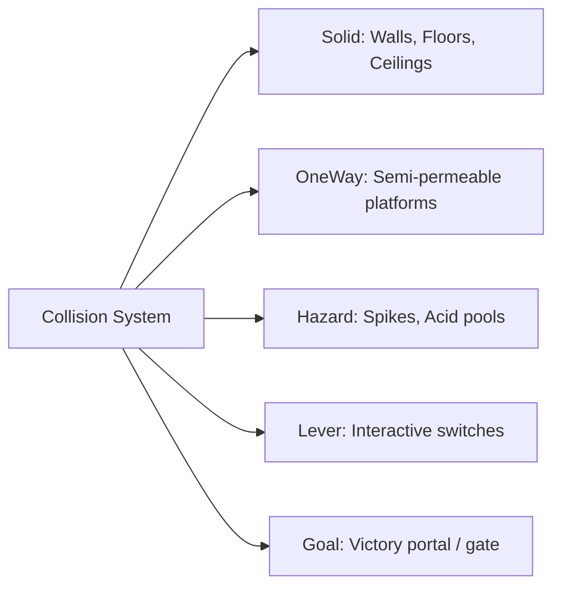
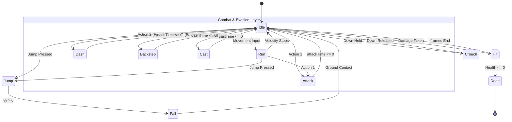

# GAMEPLAY.md — Mechanics, Combat, Kinematics & Champions

## 1. Core Combat Philosophy & Game Feel

*Vibrant Castle* delivers a responsive, deliberate, and high-impact action-platformer experience inspired by classic *Castlevania* titles and modern action games like *Bastion* and *Celeste*.

### 1.1. Core Gameplay Tenets
* **Animation-Driven & Readable**: Every strike, leap, and dodge possesses clearly defined startup, active, and recovery frames. No instant invisible threats or ambiguous damage sources.
* **Telegraphed Enemy Offense**: Enemies visually wind up attacks, telegraphing danger zones to reward observation, parrying, and evasive positioning.
* **Hitbox & Hurtbox Determinism**: Physics and combat rely on axis-aligned bounding boxes (AABB). Attacks connect only when active weapon/spell hitboxes physically intersect target hurtboxes.
* **Game Feel & Impact Juiciness**: Successful hits produce kinetic camera shake (trauma decay), directional particle bursts (`spark`), sound effects, and momentary enemy damage invulnerability frames (i-frames).

---

## 2. Kinematics & Platforming Physics

Platforming feel is tuned for high responsiveness without feeling weightless or slippery. The physics simulation operates on a fixed 60 Hz tick with frame-rate independent delta multipliers.



### 2.1. Kinematic Constants & Dynamic Gravity
| Parameter | Value | Operational Purpose |
| :--- | :--- | :--- |
| **`baseGravity`** | 0.42 | Gravity applied during standard upward ascent. |
| **`fallGravity`** | 0.62 | Accelerated gravity applied during descent to prevent "floaty" platforming. |
| **`lowJumpGravity`** | 0.85 | Aggressive gravity multiplier triggered immediately when the jump button is released early (variable jump height). |
| **`apexGravityMultiplier`** | 0.45 | Gentle float applied at the arc's apex ($|v_y| < 1.0$), providing precision air control for landing. |
| **`maxFallSpeed`** | 11.5 | Terminal velocity clamp on the Y-axis. |
| **`groundAcceleration`** | 0.75 | Rate of horizontal acceleration when grounded. |
| **`airAcceleration`** | 0.55 | Rate of horizontal acceleration when airborne. |
| **`groundFriction`** | 0.78 | Ground deceleration factor per tick when movement inputs are released. |
| **`airFriction`** | 0.94 | Low air drag ensuring maintained momentum across jumps. |
| **`maxRunSpeed`** | 4.8 | Maximum standard horizontal running velocity. |

### 2.2. Precision Platforming Enhancements
1. **Variable Jump Height**: Players control jump height dynamically. Holding the jump button sustains upward force for up to 12 frames (`maxJumpHoldDuration`, ~200ms) at `jumpHoldAcceleration` (-0.32). Releasing the button triggers `lowJumpGravity`.
2. **Coyote Time (`maxCoyoteFrames = 6`, ~100ms)**: When walking off a platform ledge into empty air, the player retains full jumping ability for 6 frames, eliminating frustrating input timing penalties.
3. **Jump Buffering (`maxJumpBufferFrames = 6`, ~100ms)**: Pressing jump up to 6 frames prior to landing queues the jump; the takeoff executes deterministically on the exact frame ground contact is detected.
4. **Corner Nudging (Ledge Forgiveness)**: If a jumping player grazes a platform ceiling corner by $\le 8$ pixels (`overlapX <= 8`), the physics engine nudges the player horizontally by `overlapX + 1` pixels instead of halting upward momentum.
5. **Squash & Stretch**: Jumping scales the sprite vertically ($y = 1.25, x = 0.85$); landing scales horizontally ($y = 0.80, x = 1.25$). A spring relaxation function smoothly returns scales to $1.0$.

---

## 3. Collision Hierarchy & Terrain Interaction

Collisions use mathematical AABB overlap resolution. Entities define explicit `CollisionType` behaviors:



### 3.1. Collision Strategies
* **`Solid`**: Resolves penetration along the shallowest axis. Vertical landings snap feet to `entity.y - player.height`, zero out vertical velocity (`vy = 0`), reset `isJumping`, and adopt platform momentum if standing on moving structures.
* **`OneWay` (Semi-Permeable Platforms)**:
  * Upward jumps freely pass through without collision.
  * Downward falls check if the player's previous foot position was above the surface ($y_{feet} - v_y \le y_{top} + 14$) and current feet are at or below ($y_{feet} \ge y_{top} - 4$). If true, snaps feet to $y_{top} - player.height$ and solidifies ground state.
* **`Hazard` (Spikes & Acid)**: Inflicts 20 base damage, applies immediate knockback force ($v_x = \pm 6, v_y = -5$), plays `SFX_HIT`, ungrounds the player, and records statistics. If health drops to 0, triggers defeat narration.
* **`Lever`**: Interactive switches toggled by proximity interaction or direct weapon/projectile hits, broadcasting state changes to doors and gates.
* **`Goal`**: Portal transitions leading to level completion upon player contact.

---

## 4. Melee Combat & Damage Resolution

Melee combat is fast-paced, animation-synchronized, and tactical.

### 4.1. Attack Parameters & Hitboxes
* **Melee Weapon Reach**: 40 pixels forward reach from the player's bounding box edge:
  $$x_{hitbox} = \text{player.facingLeft} \ ? \ (x_{player} - 40) : (x_{player} + width_{player})$$
  $$y_{hitbox} = y_{player}, \quad width = 40, \quad height = height_{player}$$
* **Hit Timing & Cooldowns**:
  * Melee attack duration: 14 frames (`attackTime`).
  * Melee attack cooldown: 20 frames (`attackCooldown`).
* **Damage Resolution**:
  * Total damage is calculated deterministically from player base stats, weapon modifiers, and equipment attributes (`calculatePlayerDerivedStats`).
  * Enemy struck takes damage, receives 15 frames of damage invulnerability (`enemy.damageTimer = 15`), flashes visually, and spawns 10 particle sparks (`#fbbf24`).
  * Screen trauma is applied: `cameraManager.triggerShake(7, 4)`.

### 4.2. Evasive Maneuvers (Slide & Backstep)
Tied to `Action 2` input and consuming 18 stamina:
* **Forward Slide (`isDashing`)**: Triggered when moving forward or neutral. Duration: 13 frames. Cooldown: 38 frames. Horizontal speed: 10.5. Glides across ground under low obstacles.
* **Tactical Backstep (`isBackstepping`)**: Triggered by pressing `Action 2` while holding the direction OPPOSITE to current facing orientation. Duration: 10 frames. Cooldown: 32 frames. Speed: 7.5 backwards with a small vertical hop ($v_y = -2.2$). Grants evasive disengagement.

---

## 5. Champion Archetypes & Skill Trees

*Vibrant Castle* features two complementary duelist champions:

```
                                  CHAMPION ROSTER
         ┌───────────────────────────────┴───────────────────────────────┐
         ▼                                                               ▼
   VALEN THE DUELIST                                           AURELIA THE WARDEN
   "Solar Precision"                                           "Aetherial Ward"
   • Solar Rapier strikes                                      • Ethereal Greatsword sweeps
   • Agile Forward Slide                                       • Phase Step & Astral Blink
   • Sun & Fire Incantations                                   • Frost Nova & Aether Comets
   • High kinetic burst damage                                 • Crowd control & barrier protection
```

### 5.1. Valen (The Chrono Duelist)
* **Archetype**: Agile fencer specializing in rapid rapier thrusts, temporal acceleration, and fiery solar energy.
* **Core Weapon**: Solar Rapier (`solar_rapier`).
* **Signature Skills**:
  * **`solar_flare` (Tier 1)**: Shoots a quick solar projectile dealing 35 damage at speed 9.5. Low mana cost (12), rapid cooldown (16 frames).
  * **`solar_fireball` (Tier 2)**: Heavy explosive fire sphere dealing 65 damage. Moderate cooldown (30 frames).
  * **`radiant_strike` (Tier 3)**: Devastating melee infusion empowering rapier strikes with cascading sunbursts.
  * **`stamina_surge` / `chrono_burst`**: Passive boosts accelerating stamina regeneration and reducing evasive slide cooldowns.

### 5.2. Aurelia (The Aetherblade Warden)
* **Archetype**: Battle-mage protector wielding heavy ethereal slashes, barrier wards, and cosmic frost magic.
* **Core Weapon**: Aether Greatblade (`aether_blade`).
* **Signature Skills**:
  * **`aether_bolt` (Tier 1)**: High-precision piercing bolt of pure aether dealing 38 damage at speed 9.0.
  * **`frost_nova` (Tier 2)**: Radial freezing burst dealing 50 damage and chilling enemy movement speeds across an area.
  * **`celestial_comet` (Tier 3)**: Summons an astral comet crashing down from the heavens for massive area-of-effect destruction.
  * **`astral_shield` / `magic_barrier`**: Temporary protective ward absorbing incoming physical and hazard damage for a designated duration (`shieldDurationFrames`).

---

## 6. Action State Machine & Priority

At any given simulation frame, a player entity resides in exactly one primary `AnimationState`:



### 6.1. State Priority Rules
1. **`Dead`**: Highest priority. Cancels all inputs, disables collisions, applies fall gravity with ground friction until rest.
2. **`Hit`**: Stun duration overrides actions unless protected by invulnerability timers.
3. **`Dash` / `Backstep`**: Uninterruptible by normal attacks during initial frames; preserves evasive trajectory.
4. **`Attack` / `Cast`**: Executes weapon hitbox or projectile spawn.
5. **`Jump` / `Fall`**: Air maneuvers with dynamic gravity and apex float.
6. **`Run` / `Crouch` / `Idle`**: Base locomotion states.
