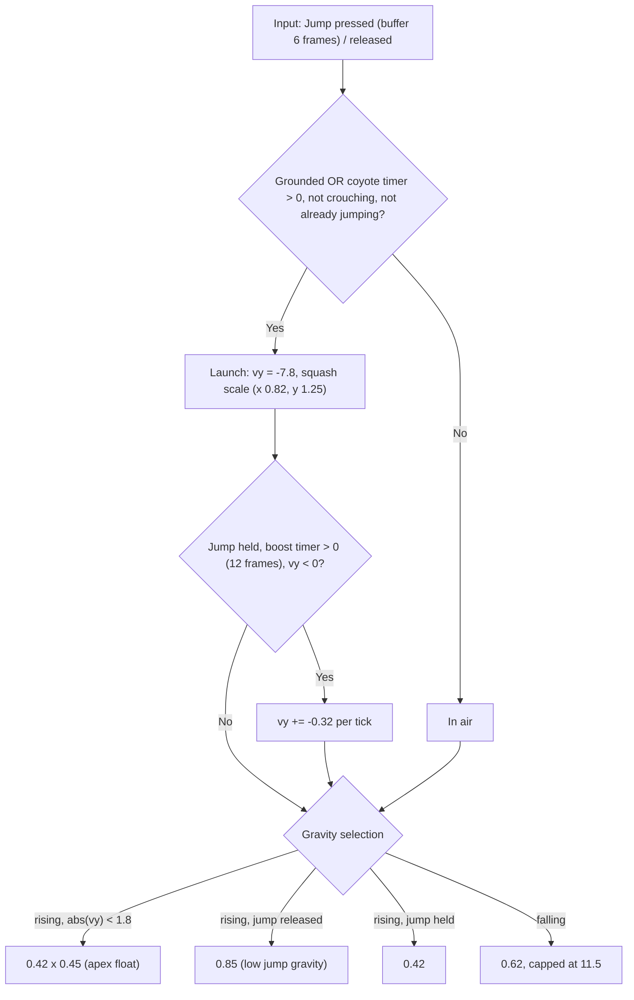
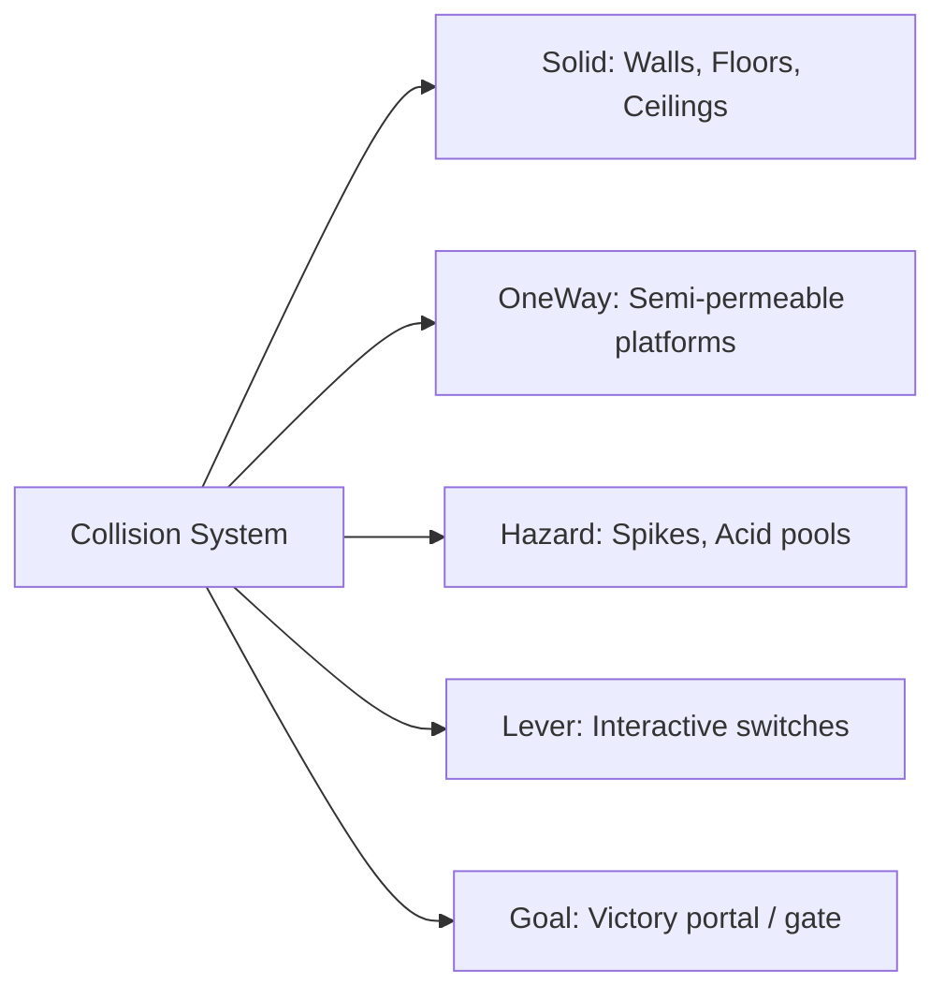
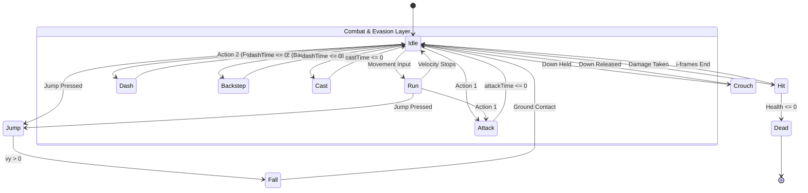

# GAMEPLAY.md — Mechanics, Combat, Kinematics & Champions

## 1. Core Combat Philosophy & Game Feel

*Vibrant Castle* is a metroidvania with simplified *Castlevania* gameplay, good on keyboard or pad, and *Mario*-feel movement (see the Design Pillars in `MASTERMAP.md` §1.1; the honest status of each pillar is in §1.2). This document describes what the code does today and marks planned behaviour explicitly.

### 1.1. Core Gameplay Tenets

* **Animation-Driven & Readable**: Every strike, leap, and dodge possesses clearly defined startup, active, and recovery frames. No instant invisible threats or ambiguous damage sources.
* **Telegraphed Enemy Offense (planned)**: Enemies will wind up attacks and telegraph danger zones. Today enemies only patrol and deal no damage (see §4.3).
* **Hitbox & Hurtbox Determinism**: Physics and combat rely on axis-aligned bounding boxes (AABB). Attacks connect only when active weapon/spell hitboxes physically intersect target hurtboxes.
* **Game Feel & Impact Juiciness**: Successful hits produce camera shake, a `spark` particle burst, sound effects, and a 15-frame enemy damage window (`damageTimer`).

---

## 2. Kinematics & Platforming Physics

Platforming feel is tuned for high responsiveness without feeling weightless or slippery. All constants below are in 60 Hz units (per tick at 60 Hz); at 30/90/120 Hz the engine passes `dtMultiplier = 60 / targetFps` so the feel is identical (see `ENGINEERING.md` §3.1). Source: `src/game/physics/playerKinematics.ts`.



### 2.1. Kinematic Constants & Dynamic Gravity

| Parameter | Value | Operational Purpose |
| :--- | :--- | :--- |
| **`baseGravity`** | 0.42 | Gravity applied during standard upward ascent. |
| **`fallGravity`** | 0.62 | Accelerated gravity applied during descent to prevent "floaty" platforming. |
| **`lowJumpGravity`** | 0.85 | Gravity while rising faster than 1.8 with the jump button released (variable jump height). |
| **`apexGravityMultiplier`** | 0.45 | Multiplies `baseGravity` while rising slower than $|v_y| < 1.8$ (apex float). |
| **`initialJumpForce`** | -7.8 | Takeoff velocity. |
| **`jumpHoldAcceleration`** | -0.32 | Extra upward acceleration per tick while the button is held, for up to `maxJumpHoldDuration` = 12 frames. |
| **`maxFallSpeed`** | 11.5 | Terminal velocity clamp on the Y-axis. |
| **`groundAcceleration`** | 0.75 | Rate of horizontal acceleration when grounded. |
| **`airAcceleration`** | 0.55 | Rate of horizontal acceleration when airborne. |
| **`groundFriction`** | 0.78 | Ground deceleration factor per tick when movement inputs are released. |
| **`airFriction`** | 0.94 | Low air drag ensuring maintained momentum across jumps. |
| **`maxRunSpeed`** | 4.8 | Maximum standard horizontal running velocity. |

### 2.2. Precision Platforming Enhancements

1. **Variable Jump Height**: Players control jump height dynamically. Holding the jump button sustains upward force for up to 12 frames (`maxJumpHoldDuration`, ~200ms) at `jumpHoldAcceleration` (-0.32). Releasing the button triggers `lowJumpGravity`.
2. **Coyote Time (`maxCoyoteFrames = 6`, ~100ms)**: When walking off a platform ledge into empty air, the player retains full jumping ability for 6 frames, eliminating frustrating input timing penalties.
3. **Jump Buffering (`maxJumpBufferFrames = 6`, ~100ms)**: Pressing jump up to 6 frames prior to landing queues the jump; the takeoff executes deterministically on the exact frame ground contact is detected.
4. **Corner Nudging (Ledge Forgiveness)**: If a jumping player grazes a platform ceiling corner by $\le 8$ pixels (`overlapX <= 8`), the physics engine nudges the player horizontally by `overlapX + 1` pixels instead of halting upward momentum.
5. **Squash & Stretch**: Jumping scales the sprite ($x = 0.82, y = 1.25$); landing scales it ($x = 1.22, y = 0.82$). A spring (rate 0.22 per tick) returns the scale to $1.0$.
6. **Moving platforms**: A rider inherits the platform velocity on takeoff.

### 2.3. Jump Envelope Used by the Level Validator

Map design relies on `src/tests/arch/helpers/levelLogic/constants.ts`: maximum rise 109 px (lowest apex across tick rates; about 112.8 px at 60 Hz), maximum flat jump 216 px, slide distance 136 px, player box 32 x 48 px. Required rises stay at or below 96 px and main-path gaps at or below 170 px.

---

## 3. Collision Hierarchy & Terrain Interaction

Collisions use mathematical AABB overlap resolution. Entities define explicit `CollisionType` behaviors:



### 3.1. Collision Strategies

* **`Solid`**: Resolves penetration along the shallowest axis. Vertical landings snap feet to `entity.y - player.height`, zero out vertical velocity (`vy = 0`), reset `isJumping`, and adopt platform momentum if standing on moving structures.
* **`OneWay` (Semi-Permeable Platforms)**:
  * Upward jumps freely pass through without collision.
  * Downward falls check if the player's previous foot position was above the surface ($y_{feet} - v_y \le y_{top} + 14$) and current feet are at or below ($y_{feet} \ge y_{top} - 4$). If true, snaps feet to $y_{top} - player.height$ and solidifies ground state.
* **`Hazard` (Spikes & Acid)**: Inflicts 20 base damage, applies immediate knockback force ($v_x = \pm 6, v_y = -5$), plays `SFX_HIT`, ungrounds the player, and records statistics. If health drops to 0, triggers defeat narration.
* **`Lever`**: Activated once by a melee attack overlapping it (`LeverCollisionStrategy`) or by a projectile hit (`combatSystem.ts`). It opens the solid named by its `targetGateId` (see §3.2).
* **`Trigger`**: One-shot narration volume.
* **`Goal`**: A portal; touching it moves the players to the portal's target location and entry (`activation` is `touch` in all shipped maps; `interact` exists in the schema).

---

### 3.2. Levers, Gates and Maps

- **Rule**: one lever and one gate per zone, the lever reachable while the gate is closed, every gate blocks something; a lever names its gate with `targetGateId` (grammar in `.agents/rules/content_and_assets.md` §7, enforced by the level validator).
- **Opening**: `unlockLeverGates` (`src/game/locations/leverGateUnlock.ts`) calls `beginOpeningGate` (`src/game/physics/gateState.ts`), plays the unlock sound, a narration key and a dust burst. The gate then runs an explicit state on the structure animation clock: `closed` (no state), `opening` for 1.2 s (`GATE_OPEN_TICKS` = 72 clock units), `open`. While opening, the collision rect keeps its top and shrinks from the bottom (`entity.height`, rounded, never below 1 px) while `entity.gateBaseHeight` holds the closed height; at progress 1 the gate is `open`, height 0, and `isGateOpen` makes physics, projectile and hitbox code skip it. The clock is simulation time, so the opening is deterministic and frozen while paused. Reloading a level rebuilds the entities, so a gate always starts closed (gate state is not persisted). A lever without a resolvable target falls back to opening every solid whose id contains `gate` or `wall` and logs a warning.
- **Progression**: lever gates are the only blocking mechanism; there are no ability gates (planned, see `MASTERMAP.md` §1.2).

| Map | Size (px) | Levers | Enemies | Exits |
| :--- | :--- | ---: | ---: | :--- |
| `courtyard` | 7200 x 1350 | 1 | 16 | thorn_chasm |
| `thorn_chasm` | 6000 x 1500 | 1 | 17 | courtyard, clocktower |
| `clocktower` | 3600 x 3000 | 1 | 17 | thorn_chasm, aether_sanctuary |
| `aether_sanctuary` | 6400 x 1600 | 1 | 13 | clocktower, grand_bastion |
| `grand_bastion` | 8000 x 1500 | 2 | 22 | aether_sanctuary, courtyard |

## 4. Melee Combat & Damage Resolution

Melee combat is fast-paced, animation-synchronized, and tactical.

### 4.1. Attack Parameters & Hitboxes

* **Melee Weapon Reach**: 40 pixels forward reach from the player's bounding box edge:
  $$x_{hitbox} = \text{player.facingLeft} \ ? \ (x_{player} - 40) : (x_{player} + width_{player})$$
  $$y_{hitbox} = y_{player}, \quad width = 40, \quad height = height_{player}$$
* **Hit Timing & Cooldowns**:
  * Melee attack duration: 14 frames (`attackTime`).
  * Melee attack cooldown: 20 frames (`attackCooldown`).
* **Damage Resolution**:
  * Total damage is calculated deterministically from player base stats, weapon modifiers, and equipment attributes (`calculatePlayerDerivedStats`).
  * Enemy struck takes damage, receives 15 frames of damage invulnerability (`enemy.damageTimer = 15`), enters the `hit` animation state and spawns a spark burst.
  * Screen trauma is applied: `cameraManager.triggerShake(7, 4)`.

### 4.2. Evasive Maneuvers (Slide & Backstep)

Tied to `Action 2` input and consuming 18 stamina:

* **Forward Slide (`isDashing`)**: Triggered when moving forward or neutral. Duration: 13 frames. Cooldown: 38 frames. Horizontal speed: 10.5. Glides across ground under low obstacles.
* **Tactical Backstep (`isBackstepping`)**: Triggered by pressing `Action 2` while holding the direction OPPOSITE to current facing orientation. Duration: 10 frames. Cooldown: 32 frames. Speed: 7.5 backwards with a small vertical hop ($v_y = -2.2$). Grants evasive disengagement.

---

### 4.3. Enemy Behaviour (as implemented)

- 19 templates in `src/data/enemies/enemies.json`; maps place 13 to 22 enemies each.
- `GamePhysicsEngine.updateEnemy` moves non-dummy enemies horizontally at their `vx` between `patrolMinX` and `patrolMaxX`, turning at the ends; dummies stand still. There is no chase, no attack and no contact damage; `attackPower`, `abilities` and soul drops are data only (planned).
- The player can damage and kill enemies; kills are recorded in the statistics and bestiary counters.
- Enemy animation (`idle`, `move`, `fly`, `hit`) is derived from simulation state with a simulation-owned clock (`ENGINEERING.md` §4.1). The `attack` rows that several sheets carry are unused.
- The player's only damage sources are hazards (20 damage plus knockback), pit falls (death below level height + 100 px) and nothing else, so combat currently carries no risk.

## 5. Champion Archetypes & Skill Trees

*Vibrant Castle* features two complementary duelist champions:

```text
                                  CHAMPION ROSTER
         ┌───────────────────────────────┴───────────────────────────────┐
         ▼                                                               ▼
   VALEN THE DUELIST                                           AURELIA THE WARDEN
   "Solar Precision"                                           "Aetherial Ward"
   • Solar Rapier strikes                                      • Ethereal Greatsword sweeps
   • Agile Forward Slide                                       • Phase Step & Astral Blink
   • Sun & Fire Incantations                                   • Frost Nova & Aether Comets
   • High kinetic burst damage                                 • Crowd control & barrier protection
```

### 5.1. Valen (The Chrono Duelist)

* **Archetype**: Agile fencer specializing in rapid rapier thrusts, temporal acceleration, and fiery solar energy.
* **Core Weapon**: Solar Rapier (`solar_rapier`).
* **Signature Skills**:
  * **`solar_flare` (Tier 1)**: Solar projectile, 35 damage, mana 12, cooldown 16 frames.
  * **`solar_fireball` (Tier 2)**: Fire sphere, 65 damage, mana 25, cooldown 28 frames.
  * **`radiant_strike` (Tier 3)**: 90 damage, mana 35, cooldown 45 frames.
  * **Others** (`shield_bash`, `prismatic_shield`, `sun_sentinel`, `blade_infusion`, `stamina_surge`, `vitality_surge`): see `src/data/skills/spells.json`.

### 5.2. Aurelia (The Aetherblade Warden)

* **Archetype**: Battle-mage protector wielding heavy ethereal slashes, barrier wards, and cosmic frost magic.
* **Core Weapon**: Aether Greatblade (`aether_blade`).
* **Signature Skills**:
  * **`aether_bolt` (Tier 1)**: Aether bolt, 38 damage, mana 15, cooldown 18 frames.
  * **`frost_nova` (Tier 2)**: 50 damage, mana 28, cooldown 45 frames.
  * **`celestial_comet` (Tier 3)**: 95 damage, mana 40, cooldown 55 frames.
  * **Others** (`aether_barrier`, `chrono_rewind`, `sentinel_spark`, `mana_font`, `scholarly_focus`, `astral_attunement`, `emerald_barrage`): see `src/data/skills/spells.json`. An active shield absorbs hazard damage (`environmentCollisionSystem.ts`).

---

## 6. Action State Machine & Priority

At any given simulation frame, a player entity resides in exactly one primary `AnimationState` (`resolveAnimationState` in `playerKinematics.ts`; `Hit` is a design state: the current code has no enemy hit on players, only hazards):



### 6.1. State Priority Rules

1. **`Dead`**: Highest priority. Cancels all inputs, disables collisions, applies fall gravity with ground friction until rest.
2. **`Hit`**: Stun duration overrides actions unless protected by invulnerability timers.
3. **`Dash` / `Backstep`**: Uninterruptible by normal attacks during initial frames; preserves evasive trajectory.
4. **`Attack` / `Cast`**: Executes weapon hitbox or projectile spawn.
5. **`Jump` / `Fall`**: Air maneuvers with dynamic gravity and apex float.
6. **`Run` / `Crouch` / `Idle`**: Base locomotion states.
