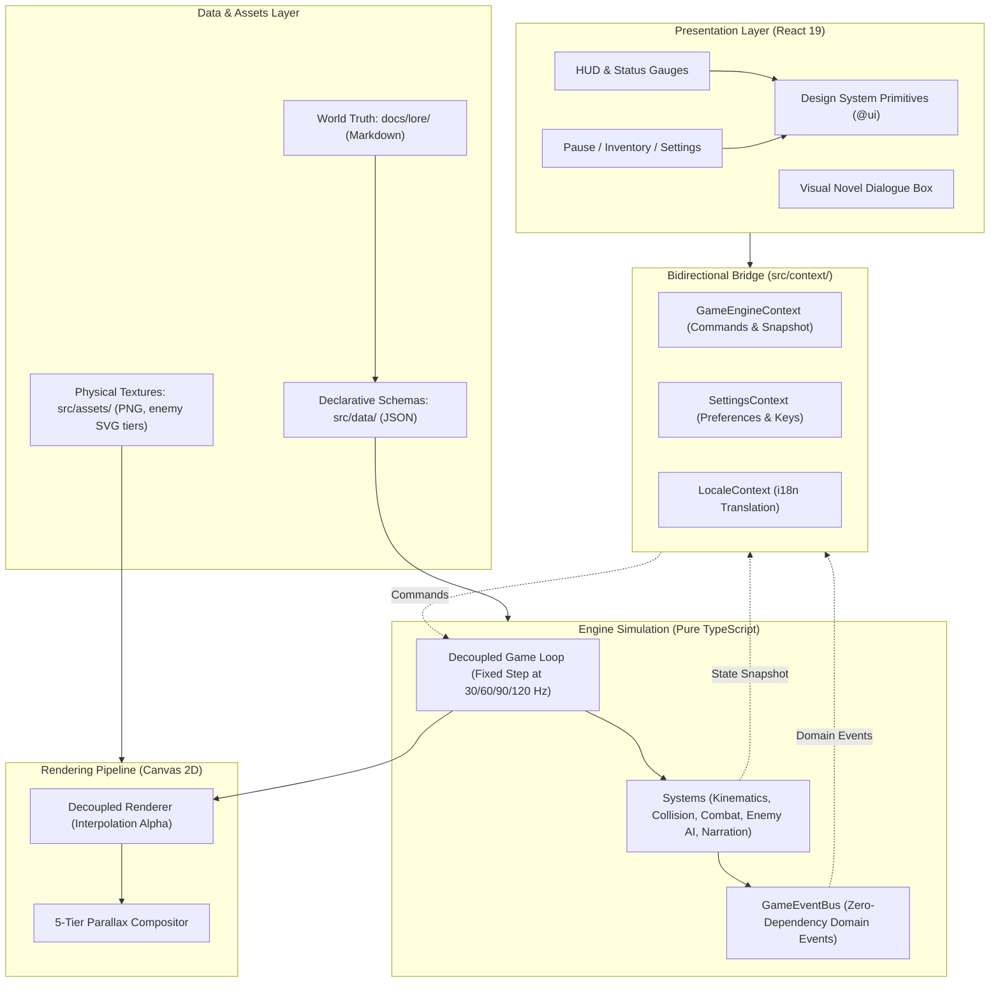

# MASTERMAP.md — Architecture & Product Roadmap

## 1. Vision & Core Identity

*Vibrant Castle* is a metroidvania set in a melancholic gothic fantasy world bathed in an eternal golden autumn. The game fuses kinetic combat, platforming agility, and atmospheric storytelling.

### 1.1. Design Pillars

This section is the single source of truth for design direction. It replaces the earlier inspiration list ("Design Triad").

1. **Mario-feel movement**: responsive, forgiving, readable platforming (acceleration, variable jump height, coyote time, jump buffering).
2. **Aria of Sorrow style**: the style and general feeling of maps, heroes and enemies follow *Castlevania: Aria of Sorrow*; the world is one interconnected castle explored and re-explored.
3. **Autumn palette and mood**: colour palette and atmosphere are autumn (amber, rust, dark timber, drifting leaves).
4. **Bastion narration**: a narrator that observes and comments on what the player does.
5. **Simplified Castlevania gameplay, keyboard or pad**: melee, a few spells, dash; playable equally well on keyboard or pad. The pad layout is restricted to 2 triggers, 4 face buttons, and bumpers used as selectors for actions.
6. **Two-level menu**: one level for the game (menu, help, inventory, skills), one for development (Developer Suite).

### 1.2. Where We Are and What Is Missing

Assessment against the code at the time of writing. Gaps are tracked in `AGENTS.md` §5.

| Pillar | Where we are | What is missing |
| :--- | :--- | :--- |
| **Mario-feel movement** | `src/game/physics/playerKinematics.ts`: ground acceleration 0.75, air acceleration 0.55, ground friction 0.78, air friction 0.94, max run speed 4.8, jump force -7.8 with up to 12 frames of hold boost (-0.32), early release switches to `lowJumpGravity` 0.85, coyote time 6 frames, jump buffer 6 frames, asymmetric gravity (0.42 up, 0.62 down, apex float below `abs(vy) < 1.8`), terminal speed 11.5, squash and stretch; corner nudge of up to 8 px in `src/game/physics/collisions.ts`. Slide (speed 10.5) and backstep in `src/game/engine/playerController.ts`. | One flat run speed, no sprint tier, no air dash or double jump, no turn-around tuning. The building blocks of Mario feel are present; the numbers have not been tuned against a reference. |
| **Aria of Sorrow style** | Interconnected sectors (portal loop courtyard, thorn_chasm, clocktower, aether_sanctuary, grand_bastion, back to courtyard), 19 enemy templates with soul-drop and bestiary data, NES/SNES class sprite tiers, two duelist heroes with skill trees. | Enemies only patrol and deal no damage (`physics.ts` `updateEnemy`), so combat carries no risk. Soul drops are data only. No ability gating: portals carry unused `isLocked` / `unlockTriggerId` schema fields, only lever gates block routes. No map screen. |
| **Autumn palette and mood** | Four of five location `theme` blocks are warm (courtyard, thorn_chasm, clocktower, grand_bastion: amber and rust gradients, `leaf`, `dust`, `spark` particles). UI tokens in `src/styles/theme.ts` are amber on dark timber. | `aether_sanctuary` is blue and cyan (`#172554`, cyan fog, `magic` particles) and Aurelia's UI identity is cyan; neither has been reviewed against the pillar. |
| **Bastion narration** | `src/game/engine/narrationSystem.ts` shows timed subtitles from i18n keys on location entry, trigger volumes, lever pulls, goals, hits and defeat. Data and logic for reactive quotes exist: `src/data/narrative/narrator_reactive.json` (priorities, cooldowns, session caps) and `src/game/logic/narrative/reactiveNarratorManager.ts`. | The reactive manager and the dialogue graph runner are not connected to the engine (only the data facade, developer previews and tests use them). No voice. Narration is fixed per trigger and does not yet react to play style. |
| **Simplified gameplay, keyboard or pad** | Keyboard: move, jump, two melee/evasion actions, two spells, three potions, for two players (`src/data/defaults/defaultControls.json`). Gamepad with remappable buttons, left stick plus d-pad (`src/game/loop/input.ts`). | Pad defaults bind 8 buttons by index: jump 0, action1 2, action2 1, magic1 3, magic2 5 (RB), potion1 4 (LB), potion2 6 (LT), potion3 7 (RT). Bumpers and triggers are direct bindings, not selectors, so the restriction (2 triggers, 4 face buttons, bumpers as selectors) is not met. |
| **Two-level menu** | The Developer Suite (`src/developer/DeveloperModal.tsx`: Testing, Debug, Logs, Atlas Slicer, Data Studio) is a separate modal from the game menu (`src/game-menu/menu/MenuModal.tsx`). | Both are reached from the same navigation bar (`ModalNavigationTabs`, tab "C"), gated only by the `showCreationTab` HUD setting (default true). The game level and the development level are not truly separated. |
| **Metroidvania structure** | Five maps linked by a portal graph with return portals; one lever and gate per zone; named entry points; the level validator proves reachability. | The graph is a loop, not a world with locked regions. No ability pickups, so nothing motivates backtracking. Gate opening has no animation. |

### 1.3. Narrative Setting

Players explore the ancient **Citadel of Aether** — once the pinnacle of horologists, astronomers, and fencing scholars — now suspended in temporal stasis following a catastrophic dimensional fracture. As the **Awakened Duelists**, players navigate ruined spires, reactivate dormant clockwork machinery, and overcome corrupted guardians under the guidance of an enigmatic, observant Narrator.

---

## 2. System Architecture

Vibrant Castle strictly separates deterministic simulation from passive UI presentation:



### 2.1. Dual State Communication Streams

1. **Continuous State Stream (simulation tick)**: Immutable `StateSnapshot` exposed to Context consumers for read-only HUD telemetry.
2. **Discrete Domain Event Stream (Real-Time)**: `GameEventBus` instantly notifies subscribers of isolated domain occurrences (`PLAYER_DAMAGED`, `PLAYER_HEALED`, `ITEM_CONSUMED`, `NARRATION_TRIGGERED`, `LOCATION_CHANGED`, `LEVEL_RESET`, `STATE_SNAPSHOT`) without coupling the engine to external modules.

---

## 3. Product Roadmap & Milestones

```mermaid
gantt
    title Vibrant Castle Roadmap Milestones
    dateFormat  YYYY-MM
    section Milestones
    M0: Engine Core & Loop Determinism   :done, m0, 2026-08, 2026-09
    M1: Awakened Duelists & Courtyard    :active, m1, 2026-09, 2026-11
    M2: Temporal Mechanics & Clocktower  :m2, 2026-11, 2027-01
    M3: Co-op Symphony & Citadel Climax  :m3, 2027-01, 2027-03
```

### Milestone M0: Deterministic Engine Core `[COMPLETED]`

- **Focus**: Foundational simulation loop and architecture boundaries.
- **Key Deliverables**:
  - Decoupled fixed timestep loop (`update(fixedStep)` vs `render(interpolation)`).
  - AABB collision detection with spatial and layer filtering.
  - Zero-dependency `GameEventBus` with error-isolated dispatch.
  - `GameBaseError` domain hierarchy and `RingBufferLogger`.
  - AST architecture tests securing boundary contracts (`src/tests/arch/`).

### Milestone M1: Awakened Duelists & Courtyard `[CURRENT]`

- **Focus**: Hero kinetica, combat feel, and the inaugural campaign sector.
- **Key Deliverables**:
  - Playable Champions:
    - **Valen (Chrono Duelist)**: Rapier precision, thrust combos, parry frames, `Chrono Dash`.
    - **Aurelia (Aetherblade Warden)**: Manifested ethereal blade, sweeping arcs, `Phase Dash`.
  - Level Sector: **Courtyard of Awakening** with 5-tier parallax backdrop.
  - Enemies: Corrupted Clockwork Scouts and Stone Gargoyles.
  - Audio & Narrative: Narration subtitles on triggers and combat events; reactive narrator cues are specified but not yet wired (planned).
- **Delivered by the sprites/enemies/maps update**:
  - All five sector maps rebuilt (courtyard 7200x1350, thorn_chasm 6000x1500, clocktower 3600x3000, aether_sanctuary 6400x1600, grand_bastion 8000x1500) and validated by the level-logic suite.
  - 19 enemy templates; 11 have NES/SNES class SVG sheets, 2 have painted PNG sheets; atlas quality tiers with fallback.
  - Grid-clean repacked sheets, pixel sprite compiler, frame-geometry tests, view culling, parallax geometry with mirrored tiles, background preload and eviction, levers that open their gate.
- **Still open**: enemy attacks and contact damage, ability gating, pad layout, in-game visual novel (see §1.2 and `AGENTS.md` §5).

### Milestone M2: Temporal Mechanics & Clocktower `[PLANNED]`

- **Focus**: Environmental puzzle platforming and vertical gameplay.
- **Key Deliverables**:
  - Level Sector: **Clockwork Tower** featuring rotating gear-platforms, pendulums, and steam vents.
  - Temporal Mechanics: Localized stasis fields and rewind triggers.
  - Skill Tree Progression: Node unlocks for Solar Glyphs and Astral Shielding.
  - Boss Encounter: The Corrupted Chrono-Archon Automaton.

### Milestone M3: Co-op Symphony & Citadel Climax `[PLANNED]`

- **Focus**: Two-player cooperative synergy and full campaign delivery.
- **Key Deliverables**:
  - Two-Player Local Co-op with synchronized camera viewport and dual-character combos.
  - Level Sectors: **Chasm of Thorns** and the summit **Aether Sky Sanctuary**.
  - Final Boss: The Shattered Timekeeper.
  - Polished visual novel dialogue sequences and multi-language localization (EN & PL).

---

## 4. Release Engineering & Versioning Invariants

1. **Semantic Versioning (SemVer)**:
   - Releases adhere to `MAJOR.MINOR.PATCH`.
   - On the `main` branch, release minor version numbers are **ALWAYS EVEN** (e.g. `0.2.0`, `0.4.0`, `1.0.0`). Odd minor versions are reserved for development and feature branches.
2. **Mastermap vs Changelog Invariant**:
   - `MASTERMAP.md` is strictly an architecture and product roadmap tracking milestones and structural vision. **It is never a commit log.**
   - All granular changes, bug fixes, and feature additions are recorded in `CHANGELOG.md` adhering to *Keep a Changelog* format with explicit version suffixes on section headers.
3. **Hierarchy of Authority**:
   - In case of discrepancy:
     $$\text{Code \& AST Tests} \longrightarrow \text{.agents/rules/} \longrightarrow \text{docs/manifesto/} \longrightarrow \text{Other Documentation}$$

---

## 5. Definition of Done & Quality Invariants

A milestone or feature is complete ONLY when:

- **Determinism**: Game simulation advances in fixed steps (one step per `1000 / targetFps` ms, 30/60/90/120 Hz) scaled by `dtMultiplier = 60 / targetFps`, with no variable-timestep math.
- **Performance**: 60 FPS verified with zero memory allocations (`new Vector`, lambdas, arrays) in `render()`.
- **Architecture**: All AST tests pass in `src/tests/arch/`, including the level-logic suite (`levelLogic.test.ts`).
- **Layer Leakage**: Zero UI or React imports in `src/game/`.
- **Data Purity**: `src/data/` contains exclusively declarative JSON and the typed `index.ts` re-export facade.
- **Localization**: 100% key parity between canonical English (`en`) and Polish (`pl`).
