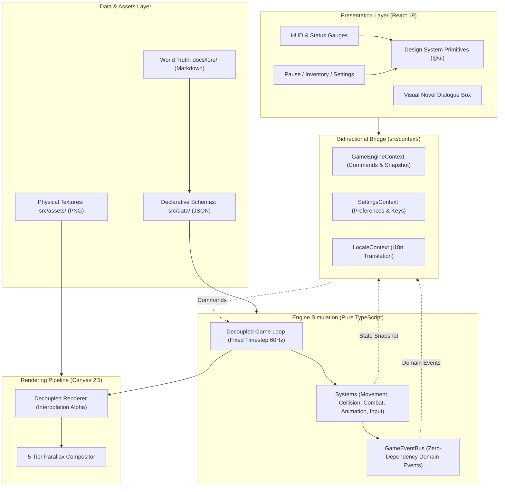

# MASTERMAP.md — Architecture & Product Roadmap

## 1. Vision & Core Identity

*Vibrant Castle* is a 2D action-adventure platformer set in a melancholic gothic fantasy world bathed in an eternal golden autumn. The game fuses kinetic combat, platforming agility, and rich atmospheric storytelling.

### 1.1. Design Triad
The game draws its core pillars from three definitive inspirations:
* **Bastion & Hades**: Responsive, contextual narration that observes player actions; kinetic, crunchy combat pacing; dynamic visual warmth with rich golden-autumn lighting.
* **Castlevania (Aria of Sorrow)**: Interconnected gothic Citadel progression; precise AABB hit detection; distinct duelist archetypes; responsive movement (slides, dashes, parries).
* **Owlboy**: Clean visual readability; depth separation without muddy noise; strong silhouettes and controlled lighting palettes.

### 1.2. Narrative Setting
Players explore the ancient **Citadel of Aether** — once the pinnacle of horologists, astronomers, and fencing scholars — now suspended in temporal stasis following a catastrophic dimensional fracture. As the **Awakened Duelists**, players navigate ruined spires, reactivate dormant clockwork machinery, and overcome corrupted guardians under the guidance of an enigmatic, observant Narrator.

---

## 2. System Architecture

Vibrant Castle strictly separates deterministic simulation from passive UI presentation:



### 2.1. Dual State Communication Streams
1. **Continuous State Stream (60Hz Tick)**: Immutable `StateSnapshot` exposed to Context consumers for read-only HUD telemetry.
2. **Discrete Domain Event Stream (Real-Time)**: `GameEventBus` instantly notifies subscribers of isolated domain occurrences (`PLAYER_DAMAGED`, `PLAYER_HEALED`, `ITEM_CONSUMED`, `NARRATION_TRIGGERED`, `LOCATION_CHANGED`) without coupling the engine to external modules.

---

## 3. Product Roadmap & Milestones

```mermaid
gantt
    title Vibrant Castle Roadmap Milestones
    dateFormat  YYYY-MM
    section Milestones
    M0: Engine Core & Loop Determinism   :done, m0, 2026-08, 2026-09
    M1: Awakened Duelists & Courtyard    :active, m1, 2026-09, 2026-11
    M2: Temporal Mechanics & Clocktower  :m2, 2026-11, 2027-01
    M3: Co-op Symphony & Citadel Climax  :m3, 2027-01, 2027-03
```

### Milestone M0: Deterministic Engine Core `[COMPLETED]`
* **Focus**: Foundational simulation loop and architecture boundaries.
* **Key Deliverables**:
  - Decoupled fixed timestep loop (`update(fixedStep)` vs `render(interpolation)`).
  - AABB collision detection with spatial and layer filtering.
  - Zero-dependency `GameEventBus` with error-isolated dispatch.
  - `GameBaseError` domain hierarchy and `RingBufferLogger`.
  - 83 AST architecture tests securing boundary contracts (`src/tests/arch/`).

### Milestone M1: Awakened Duelists & Courtyard `[CURRENT]`
* **Focus**: Hero kinetica, combat feel, and the inaugural campaign sector.
* **Key Deliverables**:
  - Playable Champions:
    - **Valen (Chrono Duelist)**: Rapier precision, thrust combos, parry frames, `Chrono Dash`.
    - **Aurelia (Aetherblade Warden)**: Manifested ethereal blade, sweeping arcs, `Phase Dash`.
  - Level Sector: **Courtyard of Awakening** with 5-tier parallax backdrop.
  - Enemies: Corrupted Clockwork Scouts and Stone Gargoyles.
  - Audio & Narrative: Dynamic reactive narration cues triggered on combat and environmental milestones.

### Milestone M2: Temporal Mechanics & Clocktower `[PLANNED]`
* **Focus**: Environmental puzzle platforming and vertical gameplay.
* **Key Deliverables**:
  - Level Sector: **Clockwork Tower** featuring rotating gear-platforms, pendulums, and steam vents.
  - Temporal Mechanics: Localized stasis fields and rewind triggers.
  - Skill Tree Progression: Node unlocks for Solar Glyphs and Astral Shielding.
  - Boss Encounter: The Corrupted Chrono-Archon Automaton.

### Milestone M3: Co-op Symphony & Citadel Climax `[PLANNED]`
* **Focus**: Two-player cooperative synergy and full campaign delivery.
* **Key Deliverables**:
  - Two-Player Local Co-op with synchronized camera viewport and dual-character combos.
  - Level Sectors: **Chasm of Thorns** and the summit **Aether Sky Sanctuary**.
  - Final Boss: The Shattered Timekeeper.
  - Polished visual novel dialogue sequences and multi-language localization (EN & PL).

---

## 4. Release Engineering & Versioning Invariants

1. **Semantic Versioning (SemVer)**:
   - Releases adhere to `MAJOR.MINOR.PATCH`.
   - On the `main` branch, release minor version numbers are **ALWAYS EVEN** (e.g. `0.2.0`, `0.4.0`, `1.0.0`). Odd minor versions are reserved for development and feature branches.
2. **Mastermap vs Changelog Invariant**:
   - `MASTERMAP.md` is strictly an architecture and product roadmap tracking milestones and structural vision. **It is never a commit log.**
   - All granular changes, bug fixes, and feature additions are recorded in `CHANGELOG.md` adhering to *Keep a Changelog* format with explicit version suffixes on section headers.
3. **Hierarchy of Authority**:
   - In case of discrepancy:
     $$\text{Code \& AST Tests} \longrightarrow \text{.agents/rules/} \longrightarrow \text{docs/manifesto/} \longrightarrow \text{Other Documentation}$$

---

## 5. Definition of Done & Quality Invariants

A milestone or feature is complete ONLY when:
* **Determinism**: Game simulation runs at fixed 60 Hz with zero variable-timestep math.
* **Performance**: 60 FPS verified with zero memory allocations (`new Vector`, lambdas, arrays) in `render()`.
* **Architecture**: 83/83 AST tests pass in `src/tests/arch/`.
* **Layer Leakage**: Zero UI or React imports in `src/game/`.
* **Data Purity**: `src/data/` contains exclusively declarative JSON and the typed `index.ts` re-export facade.
* **Localization**: 100% key parity between canonical English (`en`) and Polish (`pl`).
