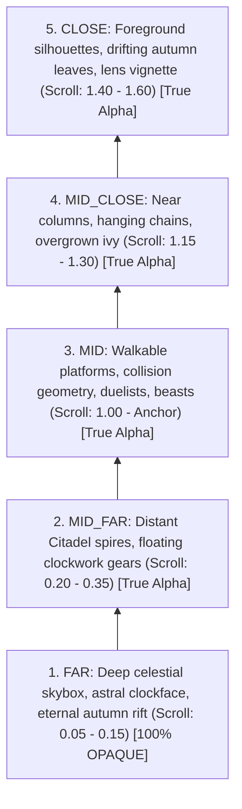
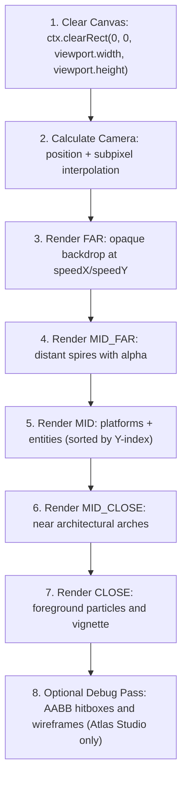

# PARALLAX_AND_RENDERING.md — Canvas 2D Pipeline & Parallax System

## 1. Visual Direction & Aesthetic Philosophy

*Vibrant Castle* achieves its visual identity through a hybrid aesthetic marrying three iconic styles:

- **Bastion / Hades**: Warm golden-autumn color palettes, rich ambient lighting, and high-contrast atmospheric tone.
- **Owlboy**: Clean pixel art geometry, unmistakable silhouettes, and strict depth separation.
- **Castlevania**: Gothic architectural motifs, interconnected vertical spires, and readable combat foregrounds.

### Visual Invariants

- ✅ **REQUIRED: Strong Silhouettes**: Entities, obstacles, and interactive structures must have immediately readable silhouettes distinguishable from the background in a split second.
- ✅ **REQUIRED: Controlled Lighting**: Light sources (astral lamps, glowing glyphs, solar rifts) create localized focal points without blowing out sprite contrast.
- ❌ **FORBIDDEN: Muddy Colors & Realistic Textures**: Hand-drawn and pixel-crafted art only. No noisy photorealistic textures, gradients with dithering artifacts, or indistinct color palettes.

---

## 2. The 5-Tier Parallax Layer Hierarchy

Depth in the Citadel of Aether is composed strictly across five discrete parallax tiers:

### 2.1. Tier Specifications

| Tier | Layer Key | Alpha Contract | Scroll Speed Ratio | Visual & Spatial Purpose |
| :--- | :--- | :--- | :--- | :--- |
| **`FAR`** | `layer_far` | **100% Opaque (`opaque: true`)** | 0.05 – 0.15 | **The Infinite Horizon**. Deep skybox, astral clockface, and perpetual sunset. Covers the entire viewport without gaps. |
| **`MID_FAR`** | `layer_mid_far` | True Transparency | 0.20 – 0.35 | **Distant Architecture**. Silhouette spires of the Citadel, suspended aqueducts, and massive clock gears slowly turning in the distance. |
| **`MID`** | `layer_mid` | True Transparency | 1.00 (Anchor) | **The Gameplay Plane**. Walkable terrain, collision tiles, duelist champions, monsters, spell projectiles, and interactive map levers/chests. |
| **`MID_CLOSE`** | `layer_mid_close` | True Transparency | 1.15 – 1.30 | **Near Environmental Framing**. Foreground gothic arches, stone columns, and hanging iron chandeliers that scroll slightly faster than the player. |
| **`CLOSE`** | `layer_close` | True Transparency | 1.40 – 1.60 | **Foreground Atmospheric Veil**. Rapidly scrolling foreground elements: silhouettes of ancient banners, drifting golden leaves, and localized fog. |

---

## 3. The `FAR` Layer Critical Hard Invariant

> [!CAUTION]
> **Zero Visual Holes Rule**: The `FAR` layer is the sole exception to the general "PNG with alpha" rule.

1. **100% Viewport Coverage**: The `FAR` layer must cover 100% of the room's renderable viewport under all possible camera zooms and aspect ratios.
2. **Mandatory Opacity**: The `FAR` texture must be an opaque PNG with zero transparent pixels (`alpha = 255` across all pixels) and must declare `"opaque": true` in the location blueprint JSON.
3. **Prevention of Visual Voids**: If the `FAR` layer has transparency or fails to cover the camera bounding box, the black HTML5 canvas background bleeds through, creating an unacceptable visual defect.
4. **All Other Layers (2–5)**: Must utilize true PNG alpha transparency to permit depth layering and occlusion. Fake color keying (e.g. solid black borders meant to mimic alpha) is strictly forbidden.

---

## 4. Canvas 2D Rendering Pipeline & Compositing

The rendering engine processes layers strictly from back to front in a single pass:

### 4.1. Parallax Scroll Calculation

The screen position of any parallax layer element is calculated deterministically:
$$\text{drawX} = \text{Math.round}((\text{cameraX} \times \text{speedX}) + \text{layerOffsetX})$$
$$\text{drawY} = \text{Math.round}((\text{cameraY} \times \text{speedY}) + \text{layerOffsetY})$$

- Coordinates passed to `ctx.drawImage()` are rounded to nearest whole pixels to prevent bilinear texture filtering blurriness on pixel art baselines.
- Camera tracking itself maintains high-precision floating point coordinates to preserve sub-pixel interpolation smoothness.

### 4.2. Entity Depth Sorting (Y-Sorting)

Within the `MID` gameplay tier, dynamic entities (champions, monsters, particles) are rendered sorted by their bottom baseline Y-coordinate (`y + height`), ensuring that characters standing lower on the screen naturally overlap characters behind them.

---

## 5. Performance & Asset Delivery Invariants

1. **Zero Garbage Collection Allocations**:
   - `renderBackground()` and `renderEntities()` must allocate zero objects per frame.
   - Reusable scratch vectors and cached layer image references must be used.
2. **No Canvas Resizing per Frame**:
   - The logical canvas dimensions (`canvas.width`, `canvas.height`) are configured exclusively during initialization or on explicit window resize events. Modifying canvas dimensions in the render loop purges internal GPU buffers and breaks 60 FPS performance.
3. **No Burned-in Text or UI in Assets**:
   - Background textures must never include baked-in typography, signage, or interface markers. All textual elements must be rendered dynamically via `@i18n` overlays.
4. **Asset Schema Validation**:
   - Every parallax layer declared in a location blueprint must be backed by a non-empty PNG file verified by `src/tests/arch/locationBlueprints.test.ts`.
