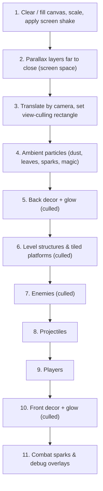

# PARALLAX_AND_RENDERING.md — Canvas 2D Pipeline & Parallax System

## 1. Visual Direction & Aesthetic Philosophy

*Vibrant Castle* follows the visual pillars in [`docs/tasks/VISION.md`](../tasks/VISION.md):

- **Aria of Sorrow style**: Gothic architecture, readable combat foregrounds, and distinct hero/enemy silhouettes across all three art tiers (`hi8bit`, `hi16bit`, `high`).
- **Autumn palette and mood**: Warm amber, rust, dark timber, and drifting leaves. Note: `aether_sanctuary` (and Aurelia's cyan identity) remain on the backlog for an autumn palette review ([`docs/tasks/VISION.md`](../tasks/VISION.md), Phase 8+ of [`docs/tasks/ROADMAP.md`](../tasks/ROADMAP.md)).

### Visual Invariants

- ✅ **Strong Silhouettes & Controlled Lighting**: Readable foreground entities separated from backdrops, with localized light-casting props (`DecorRenderer`).
- ❌ **Zero Allocations in `render()`**: All draw paths reuse preallocated scratch rectangles and vectors.

---

## 2. The Parallax Layer Hierarchy & Meta-Driven Registry

Every shipped world defines an implicit opaque `far` backdrop plus `var_a`..`var_d` variations across 5 standard bands (`far`, `mid_far`, `mid`, `mid_close`, `close`), zone variants of the closest layer (`var_d_zone_boss`, `var_d_zone_rest`), and optional image effects (`_shared:fx_sigil`, `eclipse_crown:fx_throne`) in `<worldId>_parallax_meta.json` (`src/game/parallax/meta/bandDefaults.ts`):

| Band | Standard `scrollSpeedX` / `scrollSpeedY` | Alpha Contract | Visual Role |
| :--- | :--- | :--- | :--- |
| **`far`** | `0.04` / `0.02` | **100% Opaque (`opaque: true`)** | Horizon / skybox covering 100% of the viewport. |
| **`mid_far`** | `0.18` / `0.07` | True Transparency | Distant battlements and towers. |
| **`mid`** | `0.36` / `0.12` | True Transparency | Mid backdrop ramparts and arches. |
| **`mid_close`** | `0.56` / `0.18` | True Transparency | Near columns and framing stonework. |
| **`close`** | `0.78` / `0.24` | True Transparency | Foreground veil and silhouettes. |

### 2.1. Meta-Driven Parallax System (`src/game/parallax/`)

- **Registry (`src/game/parallax/registry.ts`)**: `ParallaxRegistry` (`defaultParallaxRegistry`) discovers `src/assets/parallax/*/*_parallax_meta.json` and tier images (`_hi8bit`, `_hi16bit`, `_high`), exposing canonical keys without aliases: `<worldId>:far`, `<worldId>:var_<x>`, `<worldId>:var_<x>@<zoneKind>`, `<worldId>:fx_<id>`, and `_shared:fx_<id>`.
- **Progressive Loading (`src/game/parallax/loading/ParallaxLoadQueue.ts`)**: `LocationAssetLifecycle` delegates to `ParallaxLoadQueue` (`FAR` → `LAYER` → `ZONE_VARIANT` → `EFFECT` → `NEIGHBOUR` at `low`), decoding off-thread with `createImageBitmap` pre-scaling and 200 ms fade-ins.
- **Zone Crossfades (`src/game/parallax/zones/zoneResolver.ts`)**: Entering `boss` or `rest` zones smoothly crossfades the closest layer (`var_d`) to its zone variant using a deterministic smoothstep feather (`featherPx: 260`).
- **Quality Modes & Auto Heuristic (`src/game/parallax/parallaxQualityHeuristic.ts`)**: `parallaxQuality` supports `auto`, `high`, `mid`, `low`, `simplified` (`far` at `low` only), and `off` (placeholder gradient only), backed by `ParallaxFrameTimeProbe` runtime downgrade.
- **Enforced Contracts**: `src/tests/arch/parallaxFiles.test.ts`, `parallaxTaxonomy.test.ts`, and `parallaxRenderBoundaries.test.ts`. *(8 legacy `.jpg` files in `ashen_catacombs`, `alchemist_library`, `eclipse_crown`, and `_shared/fx_sigil_high.jpg` remain on `LEGACY_PARALLAX_JPG_ALLOWLIST` until `VC-109b`.)*

---

## 3. The `FAR` Layer Hard Invariant

1. **100% Viewport Coverage & Opacity**: The `far` layer must declare `"opaque": true` in location JSONs and cover the full viewport without transparent holes (`src/tests/arch/locationBlueprints.test.ts`).
2. **Non-`far` Layers**: Must never declare `opaque: true` and must use true alpha transparency.

---

## 4. Canvas 2D Rendering Pipeline & Compositing

### 4.1. Parallax Geometry & View Culling

- Source: `src/game/parallax/render/ParallaxSystem.ts`, `ParallaxBackdropRenderer.ts`, `ParallaxSurfaceCache.ts`, `PlaceholderRenderer.ts`, and `src/game/renderer/background/{parallaxGeometry.ts,parallaxTiling.ts}`.
- `MAX_LAYER_UPSCALE = 1.65` prevents soft over-stretching on tall boxes; `tiling: "mirror"` in `*_parallax_meta.json` flips alternating world tiles where edges are not seamless (`bun scripts/check-parallax-seams.ts`).
- `ViewCuller` (`src/game/renderer/viewCulling.ts`) expands the camera rectangle by `200 px` and skips out-of-view entities with zero per-frame allocations.

---

## 5. Atlas Quality Tiers & Sprite Anchoring

Source: `src/game/engine/atlas/`, `src/game/renderer/atlasSpriteRenderer.ts`, `src/game/engine/heroPixel/`.

### 5.1. Tiers (`low` = `hi8bit`, `mid` = `hi16bit`, `high` = `high`)

* **Fallback chain (`atlasVariantResolver.ts`)**: `low` → `low, mid, high`; `mid` → `mid, high, low`; `high` → `high, mid, low`; otherwise `proceduralFallback`.
* **Runtime SVG Rasterisation (`svgRaster.ts`)**: Enemy SVG sheets are rasterised once into an offscreen bitmap at integer scale (`≥ 192 px` cell width). **Backlog**: build-time baking of `hi16bit` SVGs into PNG atlases is tracked in [`VC-011`](../tasks/phase-5-0.4.x.md#vc-011--hi16bit-build-step-svg-to-png-atlas).
* **Auto-discovery (`atlasFileDiscovery.ts`)**: Collects `src/assets/enemies/<id>/` and `src/assets/structures/<id>/` (`aether_gate`, `chrono_lever`, `grand_portcullis`, `hazard_thorns`).
* **Hero Pixel Tiers (`src/game/engine/heroPixel/`)**: `valen` and `aurelia` ship `<hero>_hi8bit.png`, `<hero>_hi16bit.png`, `<hero>_pixel_meta.json`, and painted `*_packed.png` sheets, maintaining consistent world height across tiers.

### 5.2. Current Asset Coverage

* **Enemies (`src/assets/enemies/`)**:
  * All **19** enemy templates (`15` asset folders, with `clockwork_owl_gargoyle` and `training_dummy` shared via `presetId`) ship both `hi8bit.svg` and `hi16bit.svg`.
  * Painted `high` PNGs: `clockwork_owl_gargoyle` (`*_packed_high.png` + `*_packed_meta.json`) and `training_dummy` (`*_high.png` + `*_meta.json`). Remaining 13 enemy folders fall back to `hi16bit` until painted `high` sheets are added (Phase 5/6+ backlog).
* **Structures (`src/assets/structures/`)**: All 4 structures (`aether_gate`, `chrono_lever`, `grand_portcullis`, `hazard_thorns`) ship `hi8bit.svg`, `hi16bit.svg`, and `high.png` (`VC-122`, `VC-124`).

---

## 6. Platform Tilesets & Decor Props

* **Platform Tilesets (`src/game/engine/tiles/`, `StructureRenderer`)**: 8 shipped tilesets in `src/assets/tiles/` (`hi8bit` 16 px PNG, `hi16bit` 32 px PNG, `*_tiles_meta.json`). `buildTilePlan` caches a flat `Int32Array` draw plan per entity for allocation-free rendering. Enforced by `src/tests/arch/platformTilesets.test.ts`.
* **Decor Props (`src/game/engine/props/`, `DecorRenderer`)**: 12 shipped props in `src/assets/props/` (`hi8bit` drawn 2x, `hi16bit`, `*_prop_meta.json`) with simulation-tick deterministic animation and pre-rendered additive glow discs.
