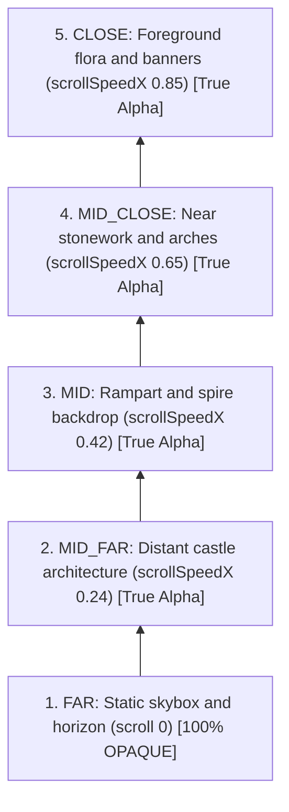
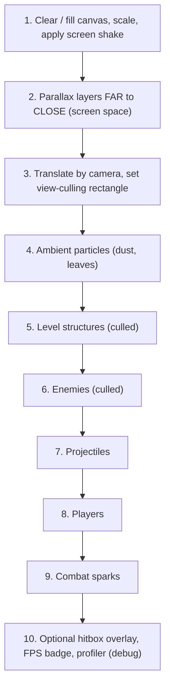

# PARALLAX_AND_RENDERING.md — Canvas 2D Pipeline & Parallax System

## 1. Visual Direction & Aesthetic Philosophy

*Vibrant Castle* follows the design pillars in `MASTERMAP.md` §1.1. For visuals that means:

- **Aria of Sorrow style**: maps, heroes and enemies in the style and feeling of *Castlevania: Aria of Sorrow* (16-bit pixel art, gothic architecture, readable combat foregrounds).
- **Autumn palette and mood**: warm amber, rust and dark timber, drifting leaves, golden ambient light. Location `theme` blocks carry the gradient and fog colours; `aether_sanctuary` is currently the one cold (blue) sector (see `MASTERMAP.md` §1.2).
- Unmistakable silhouettes and strict depth separation remain the readability rules below.

### Visual Invariants

- ✅ **REQUIRED: Strong Silhouettes**: Entities, obstacles, and interactive structures must have immediately readable silhouettes distinguishable from the background in a split second.
- ✅ **REQUIRED: Controlled Lighting**: Light sources (astral lamps, glowing glyphs, solar rifts) create localized focal points without blowing out sprite contrast.
- ❌ **FORBIDDEN: Muddy Colors & Realistic Textures**: Hand-drawn and pixel-crafted art only. No noisy photorealistic textures, gradients with dithering artifacts, or indistinct color palettes.

---

## 2. The 5-Tier Parallax Layer Hierarchy

Depth in the Citadel of Aether is composed strictly across five discrete parallax tiers:

### 2.1. Tier Specifications

All five shipped locations use the same speeds (`scrollSpeedX` / `scrollSpeedY` per layer in the location JSON). Parallax layers are backgrounds only: terrain, entities, enemies, projectiles and players are drawn afterwards in world space (see §4), and no layer scrolls faster than the camera.

| Tier | Layer Key | Alpha Contract | `scrollSpeedX` / `scrollSpeedY` | Visual & Spatial Purpose |
| :--- | :--- | :--- | :--- | :--- |
| **`FAR`** | `far` | **100% Opaque (`opaque: true`)** | 0 / 0 (static, cover-fit) | **The Infinite Horizon**. Skybox and horizon. Covers the entire viewport without gaps. |
| **`MID_FAR`** | `mid_far` | True Transparency | 0.24 / 0.10 | **Distant Architecture**. Castle silhouettes. |
| **`MID`** | `mid` | True Transparency | 0.42 / 0.18 | **Mid Backdrop**. Ramparts and spires behind the gameplay plane. |
| **`MID_CLOSE`** | `mid_close` | True Transparency | 0.65 / 0.30 | **Near Environmental Framing**. Stonework and arches. |
| **`CLOSE`** | `close` | True Transparency | 0.85 / 0.45 | **Foreground Veil**. Flora and foreground elements. |

---

## 3. The `FAR` Layer Critical Hard Invariant

> [!CAUTION]
> **Zero Visual Holes Rule**: The `FAR` layer is the sole exception to the general "PNG with alpha" rule.

1. **100% Viewport Coverage**: The `FAR` layer must cover 100% of the room's renderable viewport under all possible camera zooms and aspect ratios.
2. **Mandatory Opacity**: The `FAR` texture must be an opaque PNG with zero transparent pixels (`alpha = 255` across all pixels) and must declare `"opaque": true` in the location blueprint JSON.
3. **Prevention of Visual Voids**: If the `FAR` layer has transparency or fails to cover the camera bounding box, the black HTML5 canvas background bleeds through, creating an unacceptable visual defect.
4. **All Other Layers (2–5)**: Must utilize true PNG alpha transparency to permit depth layering and occlusion. Fake color keying (e.g. solid black borders meant to mimic alpha) is strictly forbidden.

---

## 4. Canvas 2D Rendering Pipeline & Compositing

The rendering engine processes layers strictly from back to front in a single pass:

### 4.1. Parallax Geometry

Source: `src/game/renderer/background/parallaxGeometry.ts`, `parallaxTiling.ts`, `parallax/parallaxImageRenderer.ts`.

- **Horizontal**: `scrollX = progressX * extraWidth * scrollSpeedX` (camera progress through the level times the surplus width of the background box), plus optional `autoDriftX * tickCount`. The image is tiled horizontally across the viewport.
- **Draw height** (`resolveLayerDrawHeight`): `min(boxHeight * 0.85, imageHeight * MAX_LAYER_UPSCALE)`, never below the viewport height. `MAX_LAYER_UPSCALE = 1.65` caps how soft a pixel-art layer may become on tall boxes (clocktower box is 3250 px tall).
- **Vertical** (`resolveLayerScreenY`): camera progress is clamped so neither the top nor the bottom edge of the image can enter the viewport; drift ping-pongs inside the remaining room.
- **Tile edges** are rounded as shared boundaries so neighbouring tiles abut without a 1 px gap or overlap.
- **`mirrorTile`** (optional boolean per layer in the location JSON): every odd world tile is drawn flipped so its edge matches its neighbour, for images that are not seamless. `bun scripts/check-parallax-seams.ts` reports seam quality per `src/assets/bg` PNG; layers that warn need `"mirrorTile": true`. Most non-FAR layers of the shipped maps set it; the remaining ones (for example courtyard `bg_mid`, the sanctuary `mid_far` and `mid`) are seamless or unflagged.
- **FAR backdrop** (`resolveFarBackdropRect`): cover-fit, centred, edges floored and ceiled outward so rounding never leaves a gap at the viewport border.
- Coordinates passed to `ctx.drawImage()` are rounded to whole pixels to avoid blur on pixel-art baselines.

### 4.2. Draw Order and View Culling

Entities are not Y-sorted; they are drawn per category in the order shown above (structures, enemies, projectiles, players). `ViewCuller` (`src/game/renderer/viewCulling.ts`) holds the camera's world rectangle expanded by `VIEW_CULL_MARGIN` (200 px) so that sprites overhanging their hitbox are never clipped early; structures, enemies and hitbox overlays outside it are skipped. It is render-only, preallocated and allocation-free, and tracks drawn/total counts for the profiler.

---

## 5. Performance & Asset Delivery Invariants

1. **Zero Garbage Collection Allocations**:
   - `renderBackground()` and `renderEntities()` must allocate zero objects per frame.
   - Reusable scratch vectors and cached layer image references must be used.
2. **No Canvas Resizing per Frame**:
   - The logical canvas dimensions (`canvas.width`, `canvas.height`) are configured exclusively during initialization or on explicit window resize events. Modifying canvas dimensions in the render loop purges internal GPU buffers and breaks 60 FPS performance.
3. **No Burned-in Text or UI in Assets**:
   - Background textures must never include baked-in typography, signage, or interface markers. All textual elements must be rendered dynamically via `@i18n` overlays.
4. **Asset Schema Validation**:
   - Every parallax layer declared in a location blueprint must be backed by a non-empty PNG file verified by `src/tests/arch/locationBlueprints.test.ts`.

---

## 6. Atlas Quality Tiers & Sprite Anchoring

Source: `src/game/engine/atlas/`, `src/game/renderer/atlasSpriteRenderer.ts`.

### 6.1. Tiers

The display setting `assetQuality` (`low` | `mid` | `high`, default `high`) selects the tier an atlas draws:

| Tier | Name | Enemy and structure sheets | Settings label |
| :--- | :--- | :--- | :--- |
| `low` | hi-8bit | SVG from the sprite compiler (12-bit colour, 48 px cells) | hi-8bit |
| `mid` | hi-16bit | SVG from the sprite compiler (RGB565, 96 px cells) | hi-16bit |
| `high` | high | Painted packed PNG sheet (`<id>_packed_high.png`) | high |

The tiers are defined in `.agents/rules/content_and_assets.md` §6.1 and `docs/manifesto/CONTENT_PIPELINE.md` §5.5.

- **Fallback chain** (`atlasVariantResolver.ts`, called only by `SpriteSourceFactory`, see `ENGINEERING.md` §4.3): requested `low` tries low, mid, high; requested `mid` tries mid, high, low; requested `high` tries high, mid, low. If an enemy has no usable tier at all it is drawn procedurally from `proceduralFallback` in `enemies.json`.
- **Lazy tier switch** (`AtlasTextureManager`): only the desired tier is fetched; the previously active tier keeps drawing until the new one is ready, then it is released.
- **SVG rasterised once** (`svgRaster.ts`): SVG sheets are drawn into an offscreen canvas at an integer scale so a cell is at least 192 px wide (48 to x4, 96 to x2, 72 to x3, 144 to x2); `render()` only blits from that bitmap.
- **Auto-discovery** (`atlasFileDiscovery.ts`): every `src/assets/enemies/<id>/` and `src/assets/structures/<id>/` folder is collected (Vite `import.meta.glob`, filesystem fallback under Bun). Only `*_packed_high.png` and `*.svg` images are bundled; original AI sheets (`*_high.png`) are repack inputs and never shipped. Of the structure folders only `aether_gate` is registered as an atlas.
- Hero sheets (`src/assets/characters/`) are chosen by the same setting: `SpriteSourceFactory.resolveCharacterSpriteMap` returns the sprite map for the current quality and progression tier, and the sprite animator draws it. Quality changes switch heroes live; a sheet that fails to load is marked failed and the resolver chain falls back (hi-8bit to hi-16bit to painted).
  - **Pixel tiers** (`src/game/engine/heroPixel/`): when `<id>_pixel_meta.json` and its PNGs exist (hero pixel tiers are PNG; enemy tiers stay SVG) (written by `scripts/sprites/compile.ts <id>`), `low` is the hi-8bit sheet and `mid` the hi-16bit sheet. They are found by Vite `import.meta.glob` (filesystem fallback under Bun), so art lights up as soon as the files exist. Frames are sliced by the per-tier `frameRects`; each sheet is upscaled once at an integer scale (`loadSvgTexture`, which loads PNG as well) and drawn with image smoothing off. A tier without art keeps the downscaled painted PNG, and `high` is always the painted sheet.
  - **Same world size in every tier**: the animator scales a frame by `targetHeight / (0.92 * rowHeight)` (Aurelia 0.90), where `rowHeight` is one painted `mid` row in the loaded sheet's pixels (`naturalHeight / 8` for painted sheets, `referenceRowHeight * rasterScale` for pixel sheets, taken from the packed cell height times the tier `scale`). Feet anchor on the bottom of the frame rect and the body column of the slot's first cell, so wide attack, dash and cast frames reach to the right exactly as painted ones do, and the facing flip is unchanged. The character-menu preview uses the same row height, so it shows every tier at one size.

### 6.2. Scale and Anchor from `bodyBox`

When a sheet's meta carries `layout.bodyBox` (normalized bounding box of the body inside one cell), `AtlasSpriteRenderer` scales the sprite so the body matches the entity's hitbox and anchors it by the body. Sheets without `bodyBox` use the legacy visible-ratio heuristic. The sprite compiler writes `bodyBox` for SVG tiers; the repack tool writes it for packed PNGs.

### 6.3. Current Coverage

All 11 hi-8bit / hi-16bit SVG sheets exist (court_sentinel, chasm_crawler, chasm_gargoyle, gear_mite, aether_wisp, lantern_warden, clockwork_automaton, thorn_creeper, aether_archon, aether_sentinel, chrono_hound). Only `training_dummy` and `clockwork_owl_gargoyle` have painted `high` sheets. `shadow_knight` has no art yet. Templates that share a sheet do so through `atlas.presetId`.

## 7. Platform Tilesets

Solid and one-way platforms (`StructureRenderer.renderSolidPlatform` / `renderOneWayPlatform`) are drawn from pixel-art tilesets when the entity carries a `tileset` id (copied from its prefab, see `CONTENT_PIPELINE.md` §3). Gates, hazards, levers and portals are not part of this system.

### 7.1. Files and Tiers

`src/assets/tiles/<id>/` holds `<id>_hi8bit.png` (16 px tiles, quality `low`), `<id>_hi16bit.png` (32 px tiles, quality `mid`) and `<id>_tiles_meta.json` (`tilesetId`, `kind` solid or oneway, `worldTile`, `columns`, `rows`, per-tier `variants` with file and tile size, and the `tiles` name-to-cell map). There is no painted tier: quality `high` falls back to hi-16bit through `resolveVariantTier` (mid, then low). Files are discovered with `import.meta.glob` (filesystem fallback under Bun), validated by `parseTilesetMeta` (`AssetError` `ASSET_CORRUPTED`, invalid metas are logged and skipped) and owned by `TilesetManager` (`src/game/engine/tiles/`), which follows the quality of the shared `ISpriteSourceFactory`, so the menu setting switches live.

### 7.2. Loading and Fallback

A sheet is loaded once, on first use. While the requested tier loads, a tier that is already loaded keeps being drawn. A failed load marks the tier failed and later resolutions fall back past it. The procedural platform drawing stays exactly as before when the prefab has no `tileset`, the id has no files, every tier failed, or nothing is loaded yet.

### 7.3. Fill Rules

`buildTilePlan` computes a flat `Int32Array` draw list once per entity (cached by entity, rebuilt only if its size changes); drawing is allocation-free.

* The rect is tiled on a `worldTile` (32) grid anchored at its top-left. hi-16bit tiles draw 1:1, hi-8bit tiles 2x, smoothing off, destination rects are integers (no seams).
* Thin rect (`height <= worldTile`) and every one-way: one `ledge_left / ledge / ledge_right` row; one cell wide uses `ledge`.
* Tall solid: `top_*`, then `left / fill / right` rows, then `bottom_*`; one cell wide uses the centre names.
* The last column and row are cropped, never stretched. Cropped edge cells keep their right / bottom border visible; ledge rows are cropped from the top so the rim stays.
* Variants (`fill_2`, `top_3`...) are picked by a hash of (tile column, tile row, entity x, entity y), stable across frames.
* One-way tilesets with a `support` tile draw it under the ledge every third tile.
* Culling is unchanged: entities outside the view are skipped before any tile is drawn.
