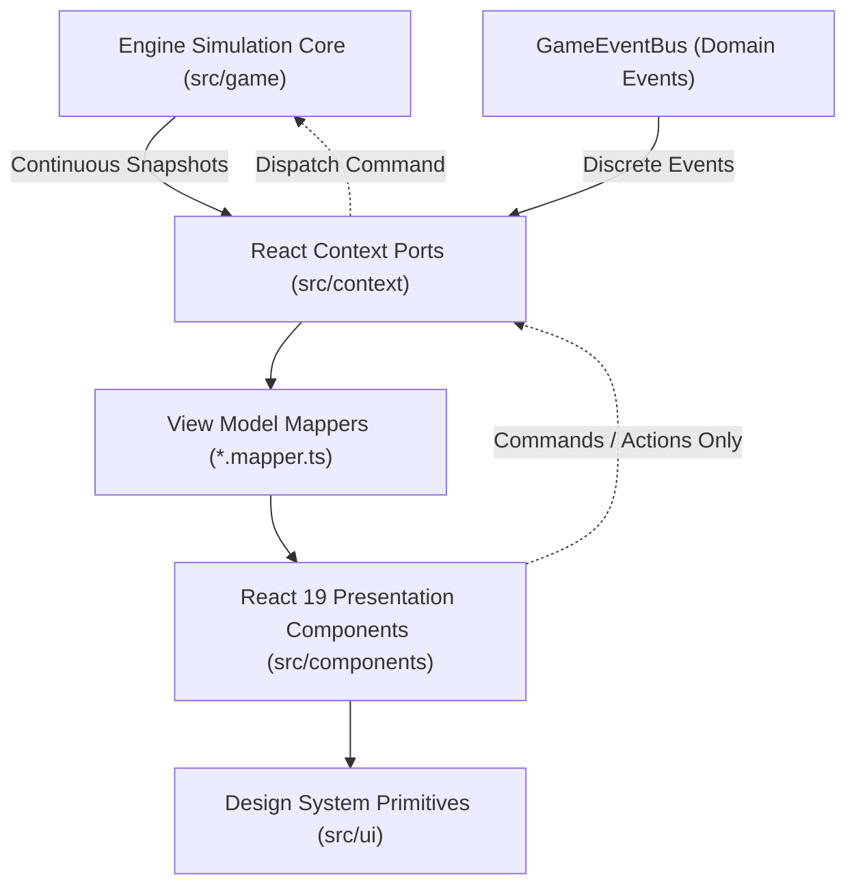

# USERINTERFACE.md — Presentation Layer Architecture & Design System

## 1. Architectural Axiom & Passive UI Model

In *Vibrant Castle*, the user interface is strictly decoupled from game physics and simulation logic. The presentation layer operates as a deterministic, passive projection of the engine's internal state:

$$\text{UI} = f(\text{Snapshot}, \text{Theme}, \text{Locale})$$



### 1.1. Core Presentation Invariants

* ✅ **Read-Only Presentation**: React components never own, simulate, or mutate gameplay state (champion health, velocities, cooldowns, positions). They consume immutable snapshots.
* ✅ **Command-Driven Interactivity**: UI-triggered actions (using a potion, allocating skill points, changing settings, pausing) dispatch typed commands through Context ports into the engine.
* ❌ **FORBIDDEN: Simulation in React**: No physics calculations, tick loops, or collision checks inside React hooks or effects.
* ❌ **FORBIDDEN: Direct Engine Singleton Imports**: UI components (`src/components/`) must never import engine singletons (`gameEngine`, `physicsEngine`). All communication routes through `@context`.
* ❌ **FORBIDDEN: Per-Frame React Re-renders**: The continuous simulation loop runs on Canvas 2D at 60 Hz. The React layer subscribes only to throttled state changes or discrete events.

---

## 2. Dual-Channel Communication Bridge (`src/context/`)

Communication between the pure TypeScript engine and React 19 is brokered through segregated Context providers:

### 2.1. Channel 1: Continuous State Stream

* **Source**: Engine fixed-update tick loop.
* **Mechanism**: `useEngineSubscription` hook bridges immutable state snapshots.
* **Consumption**: HUD gauges (health, mana, stamina), player coordinates for minimap markers, score displays, and boss life bars.

### 2.2. Channel 2: Discrete Domain Event Stream

* **Source**: `GameEventBus` (`src/game/engine/eventBus.ts`).
* **Mechanism**: Strongly typed publish-subscribe bus with error-isolated dispatch.
* **Events**:
  * `PLAYER_DAMAGED` / `PLAYER_HEALED` — floating combat numbers, red screen vignetting.
  * `ITEM_CONSUMED` — audio-visual potion consumption effects.
  * `NARRATION_TRIGGERED` — visual novel dialogue boxes and reactive subtitles.
  * `LOCATION_CHANGED` — location title card overlay (e.g. "Courtyard of Whispers").
  * `LEVEL_RESET` — overlay fade-to-black and reset transitions.

### 2.3. Segregated Context Tree Architecture

Providers are hierarchically composed in `GameProvider` (`src/context/GameContext.tsx`) to isolate state updates and prevent cascade re-renders:

```tsx
<SettingsProvider>
  <ControlsProvider>
    <SaveGameProvider>
      <GameSessionProvider>
        <InventoryProvider engine={gameEngine}>
          <SkillsProvider engine={gameEngine}>
            {children}
          </SkillsProvider>
        </InventoryProvider>
      </GameSessionProvider>
    </SaveGameProvider>
  </ControlsProvider>
</SettingsProvider>
```

---

## 3. View Model Mappers (`*.mapper.ts`)

UI components must not directly manipulate complex domain entities. Pure TypeScript View Model Mappers transform raw engine data into clean presentation models:

| Mapper Module | Input Domain Data | Output View Model | Purpose |
| :--- | :--- | :--- | :--- |
| **`hud.mapper.ts`** | `Player`, `IVitalResources` | `HudPlayerViewModel` | Computes percentage widths for health/mana/stamina bars, formatted score strings, and cooldown overlays. |
| **`inventory.mapper.ts`** | `InventoryState`, `Item` | `InventoryGridSlotViewModel` | Formats item rarity borders, equipment slot locks, tooltip stat comparisons, and stack counters. |
| **`skills.mapper.ts`** | `SkillTreeNode`, `PlayerProgression` | `SkillConstellationViewModel` | Resolves unlock availability, prerequisite node connection coordinates, and skill point costs. |
| **`stats.mapper.ts`** | `GameSessionStats` | `SessionStatsViewModel` | Aggregates weapon kill counts, damage dealt totals, exploration percentages, and elapsed time. |
| **`character.mapper.ts`** | `ICharacterIdentity`, `AnimationState` | `CharacterStageViewModel` | Maps current character identity to portrait frames, theme colors, and animation preview coordinates. |

---

## 4. Design System (`@ui` / `src/ui/`)

All interface components are constructed exclusively using standardized Design System primitives. Raw HTML tags (`<button>`, `<input>`, unstyled `<div>` buttons) are strictly forbidden in feature components.

### 4.1. Core Primitives Hierarchy

* **Buttons & Controls**:
  * `Button`: Primary, secondary, danger, and ghost button variants with integrated focus rings and audio triggers.
  * `IconButton`: Accessible icon-wrapped action button with mandatory tooltip text.
  * `KbdKey` & `KbdGroup`: Semantic keyboard shortcut representations (e.g. `[ESC]`, `[Shift] + [W]`).
* **Display & Data Presentation**:
  * `ProgressBar`: Smooth animated resource gauges (health, mana, stamina, experience).
  * `Badge`: Status tags (rarity tiers, character classes, skill categories).
  * `MetricTile`: Gothic bordered statistic display tiles with labels, values, and trend indicators.
  * `StatRow`: Aligned key-value row for character attributes and equipment comparisons.
  * `ItemIcon`: Grid icon renderer supporting rarity glow frames and quantity badges.
* **Feedback & Layout**:
  * `Alert`: System warnings, save confirmations, and error dialogs.
  * `EmptyState`: Empty backpack, locked skill constellation, or blank save slot placeholders.

---

## 5. Design Tokens & Visual Theming (`src/styles/theme.ts`)

Visual styling embodies an **Autumn-Gothic Bastion** aesthetic: warm amber rifts, ancient dark timber, weathered masonry, and mystical celestial illumination.

### 5.1. Central Theme Tokens

```ts
export const THEME = {
  colors: {
    // Autumnal Bastion Amber Palette
    amberPrimary: "#f59e0b",
    amberLight: "#fbbf24",
    amberLighter: "#fef3c7",
    amberDark: "#b45309",
    amberDarker: "#78350f",
    
    // Castle Stone & Deep Wood Backgrounds
    surfaceDarkest: "#120602",
    surfaceDarker: "#1a0c07",
    surfaceDark: "#26120b",
    surfaceCard: "#2d140a",
    surfaceCardHover: "#3d1b0e",
    
    // Accent Borders
    borderSubtle: "#4a200e",
    borderMedium: "#5c2d18",
    borderStrong: "#8d4325",
    borderAccent: "#d97706",
    
    // Functional Vital Colors
    health: "#ef4444",
    healthDark: "#991b1b",
    mana: "#06b6d4",
    manaDark: "#0e7490",
    stamina: "#eab308",
    staminaDark: "#a16207",
    score: "#f59e0b",
    skillPoints: "#8b5cf6",
    skillPointsDark: "#5b21b6",
  },
  typography: {
    fontSerif: "Cinzel, serif",
    fontSans: "Plus Jakarta Sans, system-ui, sans-serif",
    fontMono: "Fira Code, monospace",
  }
} as const;
```

### 5.2. Champion Color Identities

* **Valen (Crimson Theme)**:
  * Border accent: `border-red-900/60`, name color: `text-red-400`.
  * Vital gradient: `from-red-700 via-red-600 to-red-400`.
  * Solar accents: Warm amber tags and sunburst badge highlights.
* **Aurelia (Cyan Theme)**:
  * Border accent: `border-cyan-900/60`, name color: `text-cyan-400`.
  * Vital gradient: `from-cyan-700 via-cyan-500 to-blue-400`.
  * Astral accents: Ethereal blue and crystalline highlights.

---

## 6. Accessibility (a11y) & Localization (i18n)

### 6.1. Accessibility Standards

* **Keyboard Navigation**: All modal overlays (Settings, Inventory, Skills, Pause Menu) implement keyboard focus trapping (`Tab` cycle) and dismiss on `Escape`.
* **Screen Reader & Live Regions**: Reactive narration dialogues are mirrored to `aria-live="polite"` regions so assistive technologies receive story cues.
* **Contrast Ratios**: All text tokens on dark backgrounds strictly satisfy WCAG AA (minimum 4.5:1 contrast ratio).

### 6.2. Localization Architecture

* **Zero Hardcoded Strings**: No human-facing text exists in component markup. Every string is resolved through `useTranslation()` (`src/i18n/`).
* **Canonical Dictionaries**: English (`en`) serves as canonical source; Polish (`pl`) provides stylistic equivalent matching the gothic fantasy tone.
