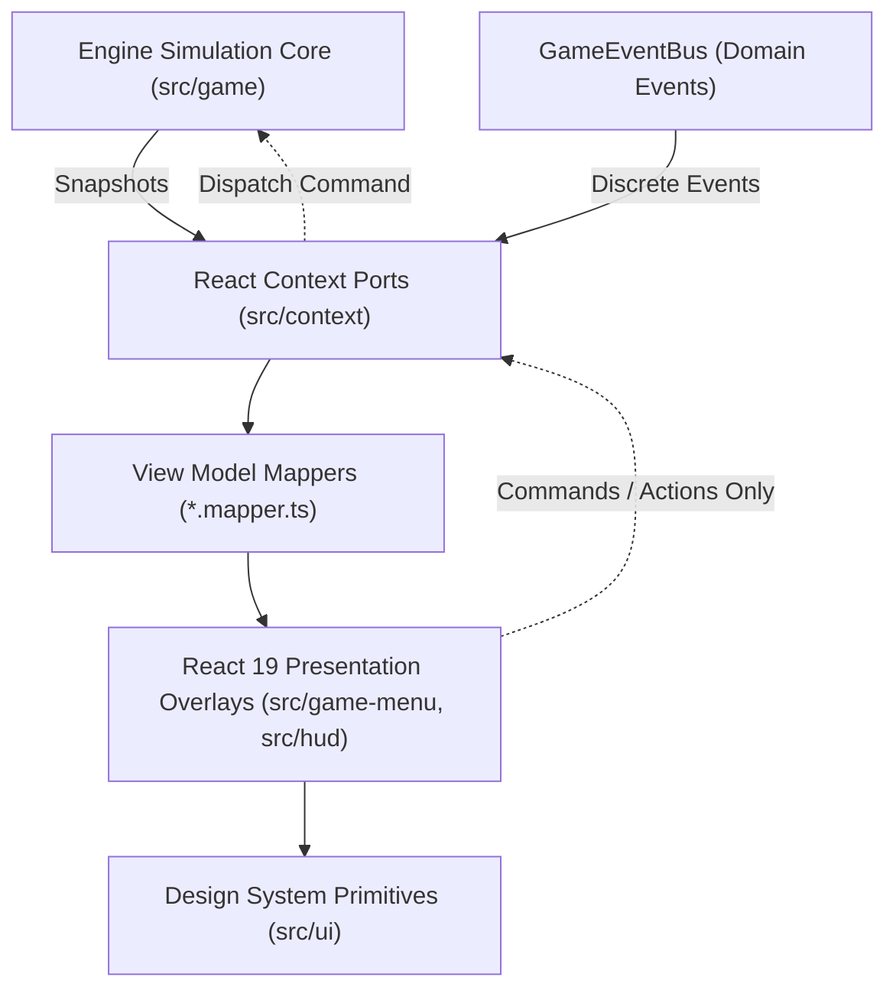

# USERINTERFACE.md — Presentation Layer Architecture & Design System

## 1. Architectural Axiom & Passive UI Model

In *Vibrant Castle*, the React 19 UI is a passive projection of engine state:

$$\text{UI} = f(\text{Snapshot}, \text{Theme}, \text{Locale})$$



### 1.1. Core Presentation Invariants

* ✅ **Read-Only Presentation**: React components consume snapshots and dispatch typed commands through `@context`.
* ❌ **FORBIDDEN: Simulation or Engine Singleton Imports in UI**: Enforced by `src/tests/arch/layerLeakage.test.ts` and `architectureBoundaries.test.ts`.
* ❌ **FORBIDDEN: Raw HTML Elements or Hardcoded Hex in Feature Components**: All UI builds on `@ui` primitives and semantic tokens (`src/tests/arch/designSystemBoundaries.test.ts`).

---

### 1.2. Two-Level Menu Architecture (Current Implementation)

Approved design: [`docs/design/menu-ux-plan.md`](../design/menu-ux-plan.md). The menu is split into one player-facing game dialog and one separate dev-only dialog:

| Dialog | Shell & Width | Tabs & Hotkeys | Source |
| :--- | :--- | :--- | :--- |
| **Game Dialog** | `GameMenuDialog.tsx` (`max-w-5xl`, fixed height `h-[min(85vh,760px)]`, `Wznów [P]` in header) | **L1**: `Gra` (`[M]`) · `Mapa` · `Postać` · `Ekwipunek` (`[I]`) · `Magia` (`[K]`) · `Ustawienia` · `Pomoc` (`[H]`, `[?]`, `[F1]`).<br>**L2 (under `Ustawienia` only)**: `Obraz` · `Dźwięk` · `Sterowanie` · `Interfejs`. | `src/game-menu/layout/GameMenuDialog.tsx`, `modalRegistry.ts`, `menuTabRegistry.ts` |
| **Dev Dialog ("Tworzenie")** | `GameModalHost.tsx` (`ModalId.Creation`, `[C]`, `max-w-7xl`, dev builds only via `isDevToolsEnabled()`) | **Tools**: `Atlas` · `Poziomy 8x8` · `Studio danych` · `Tester` · `Debug` · `Logi`. | `src/app/appConfig.ts`, `src/developer/DeveloperSuite.tsx`, `devToolRegistry.tsx` |

* **Dev Build Gate**: `isDevToolsEnabled()` in `src/app/appConfig.ts` returns `import.meta.env.DEV === true`, hiding the "Tworzenie" header button and disabling `[C]` in release builds.
* **Restricted Pad & Keyboard Menu Navigation (`useMenuGamepad.ts`, `useAppHotkeys.ts`)**:
  * **`LB` / `RB`** (buttons `4` / `5`) or **`Q` / `E`**: cycle L1 tabs.
  * **`LT` / `RT`** (buttons `6` / `7`) or **`[` / `]`**: cycle L2 sub-tabs (`Ustawienia`).
  * **`A` / `B` / `X` / `Y`** (buttons `0` / `1` / `2` / `3`): confirm focused element, back/close top layer, context action, toggle control-legend footer.
  * **D-pad / Left Stick**: move focus (`up`/`down`) and adjust sliders/radios/tabs (`left`/`right` via `ArrowLeft`/`ArrowRight`).
  * **Open / Close**: `Start` (`9`), **`Esc`**, or **holding `LB + RB` for `0.5 s`** (`openChordHoldMs: 500`) opens the game dialog. While open, `input.setMenuCapture(true)` suppresses gameplay actions.
* **UI Backlog**:
  * Confirmations, HUD toggles, and empty states ([`VC-043`](../tasks/task-board.md#vc-043--menu-pr-4-confirmations-hud-toggles-empty-states)), gamepad mapper UI in `Ustawienia > Sterowanie` ([`VC-045`](../tasks/task-board.md#vc-045--menu-pr-6-gamepad-mapping-screen)), inventory paper-doll rebuild ([`VC-035`](../tasks/task-board.md#vc-035--inventory-ux-rebuilt-from-the-baseline)), narrow-screen scrolling ([`VC-055`](../tasks/task-board.md#vc-055--scroll-on-narrow-screens)), HUD dead code cleanup ([`VC-056`](../tasks/task-board.md#vc-056--hud-dead-code-cleanup)).

---

## 2. Dual-Channel Communication Bridge (`src/context/`)

* **Channel 1 (Continuous State Stream)**: Throttled `StateSnapshot` via `GameEngineContext` / `GameSessionContext`.
* **Channel 2 (Discrete Domain Events)**: `GameEventBus` (`PLAYER_DAMAGED`, `PLAYER_HEALED`, `ITEM_CONSUMED`, `NARRATION_TRIGGERED`, `LOCATION_CHANGED`, `LEVEL_RESET`).
* **Provider Tree (`src/context/GameContext.tsx`)**:

```tsx
<SettingsProvider>
  <ControlsProvider>
    <SaveGameProvider>
      <GameSessionProvider engine={engine}>
        <InventoryProvider engine={engine}>
          <SkillsProvider engine={engine}>
            {children}
          </SkillsProvider>
        </InventoryProvider>
      </GameSessionProvider>
    </SaveGameProvider>
  </ControlsProvider>
</SettingsProvider>
```

---

## 3. View Model Mappers (`*.mapper.ts`)

Currently implemented mappers:
* `src/hud/hud.mapper.ts` — HUD vital gauges, cooldowns, score, character status.
* `src/game-menu/skills/skills.mapper.ts` — Constellation skill nodes, unlock checks, coordinates.
* `src/game-menu/menu/stats/stats.mapper.ts` — Session statistics and weapon/enemy breakdowns.

---

## 4. Design System (`@ui` / `src/ui/`)

Primitives live in modular folders under `src/ui/` (`core/`, `layout/`, `rpg/`, `studio/`, `controls/`, `primitives/`, `typography/`, `tokens/`):
* **Core & Layout**: `Button`, `IconButton`, `Badge`, `Dialog`, `Modal`, `ConfirmDialog`, `Tabs`, `Select`, `Slider`, `Switch`, `Input`, `Textarea`, `Toast`, `Tooltip`, `Card`, `Table`, `LoadingOverlay`, `ActionBar`.
* **RPG & Studio**: `ProgressBar`, `ItemIcon`, `ItemSlot`, `KbdKey`, `KbdGroup`, `GameErrorBoundary`, `MetricTile`, `StatRow`, `EmptyState`, `Alert`, `LanguageSelector`, `ColorPickerInput`, `CopyableSnippet`, `SettingOptionCard`, `SettingToggleRow`.

---

## 5. Design Tokens & Visual Theming (`src/styles/theme.ts`)

Visual styling follows the autumn palette (`THEME.colors`: amber primaries `#f59e0b` / `#fbbf24`, dark timber surfaces `#120602`..`#3d1b0e`, borders `#4a200e`..`#d97706`).
* **Valen (`crimson`)**: Amber/crimson cards and red-to-amber vital bar (`PLAYER_THEMES.crimson`).
* **Aurelia (`cyan`)**: Cyan/violet tokens (`PLAYER_THEMES.cyan`). *(Autumn palette review tracked in [`docs/tasks/VISION.md`](../tasks/VISION.md)).*

---

## 6. Accessibility, Settings & Localization

* **Display (`Ustawienia > Obraz`, `DisplayTab.tsx`)**: `assetQuality` (`low` = `hi-8bit`, `mid` = `hi-16bit`, `high` = `high`), `aspectRatio` (`16:10`, `16:9`, `4:3`, `auto`), `scalingFilter` (`pixel` / `smooth`), `targetFps` (`30 | 60 | 90 | 120`), `showFpsCounter`.
* **Interface (`Ustawienia > Interfejs`, `InterfaceTab.tsx`)**: `LanguageSelector`, HUD toggles, settings export/import/reset.
* **Controls (`Ustawienia > Sterowanie`, `ControlsMenuTab.tsx`)**: P1/P2 keyboard rebinding with reserved-key guards (`F1–F12`, `Tab`, `Meta`, `ContextMenu`) and localized `KeyRebindDialog`. Gameplay restricted-pad defaults (bumpers as selectors) are Phase 5 backlog.
* **Localization (`src/i18n/`)**: Zero hardcoded UI text; 100% EN/PL key parity enforced by `src/tests/arch/i18nParity.test.ts`.
