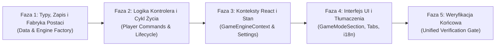

# Plan Implementacji: Wybór Postaci (Wymiana Bohaterów P1 / P2)

> **Zgodność standardów:** [AGENTS.md](file:///C:/Users/Krzysiu/.t3/worktrees/oXyFlow.VibrantCastle/t3-2fd539c3/AGENTS.md), [development_workflow.md](file:///C:/Users/Krzysiu/.t3/worktrees/oXyFlow.VibrantCastle/t3-2fd539c3/.agents/rules/development_workflow.md), [engine_architecture.md](file:///C:/Users/Krzysiu/.t3/worktrees/oXyFlow.VibrantCastle/t3-2fd539c3/.agents/rules/engine_architecture.md), [frontend_ui.md](file:///C:/Users/Krzysiu/.t3/worktrees/oXyFlow.VibrantCastle/t3-2fd539c3/.agents/rules/frontend_ui.md), [code_cleanliness.md](file:///C:/Users/Krzysiu/.t3/worktrees/oXyFlow.VibrantCastle/t3-2fd539c3/.agents/rules/code_cleanliness.md).

---

## 1. Cel i Zakres (Goal & Scope)

### 1.1. Cel biznesowy i gameplayowy
Umożliwienie graczowi wyboru postaci dla Gracza 1 (**Valen** lub **Aurelia**) wraz z automatyczną, komplementarną wymianą postaci dla Gracza 2 (wzajemne wykluczenie). Domyślna konfiguracja pozostaje bez zmian (P1 = Valen, P2 = Aurelia).

### 1.2. W zakresie (In-Scope)
1. **Model Danych i Serializacja (Data)**:
   - Rozszerzenie typu `SaveState` o opcjonalne pola `p1CharacterId` oraz `p2CharacterId` z zachowaniem pełnej wstecznej kompatybilności.
   - Odczyt i zapis wybranego bohatera w podsystemie zapisu gry (`saveCompiler.ts`, `saveApplicator.ts`).
2. **Warstwa Domeny Silnika (Core Engine)**:
   - Sparametryzowana fabryka encji gracza `LevelDesigner.createPlayerEntity(...)` w `levels.ts`.
   - Dynamiczna inicjalizacja Gracza 2 w `LevelLifecycleManager.setTwoPlayerMode(...)` w oparciu o aktualnego Gracza 1.
   - Nowe metody w `PlayerCommandController` oraz fasadzie `GameEngine`: `swapPlayerCharacters()` oraz `setPrimaryCharacter(charId)`.
   - Odsprzęglenie `resetPlayerSkillsToDefaults()` od statycznych ciągów tekstowych.
3. **Warstwa Kontekstów React (Context)**:
   - Udostępnienie metod zmiany postaci w `GameEngineContext` / `GameSessionContext`.
   - Obsługa preferencji `primaryCharacter` w `SettingsContext` i domyślnych ustawieniach.
4. **Warstwa Prezentacji UI (React UI & HUD)**:
   - Selektor postaci w `GameModeSection.tsx` z podglądem portretu i opisem klasy (komponenty wyłącznie z `@ui`).
   - Dynamiczne etykiety i portrety w `InventoryPlayerTabs.tsx` i `InventoryPanel.tsx`.
   - Dynamiczne ikony klas (Miecze vs Różdżka) i etykiety w `SkillPlayerTabs.tsx`.
   - Pełny parytet tłumaczeń PL i EN w `src/i18n/modules/settings/gameplay.ts`.
5. **Weryfikacja i Testy (Verification)**:
   - Testy jednostkowe AAA, testy integracyjne przepływu wyboru postaci, testy architektoniczne AST.

### 1.3. Poza zakresem (Out-of-Scope)
- Tworzenie nowych klas postaci lub dodawanie trzeciego bohatera (zakres ściśle ograniczony do pary Valen / Aurelia).
- Zmiana domyślnego przypisania klawiszy sterowania (sterowanie P1/P2 pozostaje powiązane ze slotem gracza, a nie z tożsamością RPG).

---

## 2. Podsumowanie Stanu Wyjściowego (Baseline Findings Summary)

Na podstawie przeprowadzonej analizy technicznej zidentyfikowano następujące sztywne powiązania:
1. `src/game/locations/levels.ts:21-78`: `LevelDesigner.createDefaultP1` na sztywno przypisuje Valena (`solar_flare`, `aegis_ward`), a `createDefaultP2` Aurelię (`arcane_missiles`, `ice_barrier`).
2. `src/game/locations/levelLifecycleManager.ts:153`: Dołączenie P2 w trakcie gry zawsze wywołuje `createDefaultP2`, co przy grze Aurelią jako P1 powoduje zduplikowanie Aurelii na ekranie.
3. `src/game/controllers/playerCommandController.ts:138-146`: `resetPlayerSkillsToDefaults` na sztywno zakłada `players[0]` = Valen, `players[1]` = Aurelia.
4. `src/game/logic/save/saveCompiler.ts:65-95`: Brak pól `p1CharacterId` / `p2CharacterId` w `SaveState`.
5. `src/game-menu/inventory/InventoryPanel.tsx:223`: Sztywne etykiety `p1Name={t("valen")}` i `p2Name={t("aurelia")}` przekazywane do zakładek ekwipunku.
6. `src/game-menu/skills/SkillPlayerTabs.tsx:28-36`: Sztywne ikony mieczy i różdżki przypisane do numerów indeksów `0` i `1`.

---

## 3. Stan Docelowy (Target State)

### 3.1. Architektura Przepływu Danych

```
[ UI: GameModeSection ] ──(setPrimaryCharacter)──> [ Context: GameEngineContext ]
                                                            │
                                                            ▼ (unidirectional command)
                                                   [ Engine: PlayerCommandController ]
                                                            │
                                             ┌──────────────┴──────────────┐
                                             ▼                             ▼
                                    [ players[0] (P1) ]           [ players[1] (P2) ]
                                    characterId: Aurelia          characterId: Valen
                                    spells: arcane/ice            spells: solar/aegis
                                             │                             │
                                             └──────────────┬──────────────┘
                                                            ▼ (notifyReact)
                                                   [ React Context Snapshots ]
                                                            │
                                             ┌──────────────┴──────────────┐
                                             ▼                             ▼
                                    [ HUDOverlay / Cards ]        [ Inventory & Skills Tabs ]
                                    Dynamiczne portrety i nazwy    Dynamiczne drzewka RPG
```

### 3.2. Reguła Niezmienności (Mutual Exclusion Invariant)
$$(\text{P1}.\text{characterId} = \text{"aurelia"}) \iff (\text{P2}.\text{characterId} = \text{"valen"})$$
$$(\text{P1}.\text{characterId} = \text{"valen"}) \iff (\text{P2}.\text{characterId} = \text{"aurelia"})$$

---

## 4. Decyzje Architektoniczne (Architectural Decisions)

1. **Odsprzęglenie Sterowania od Postaci**: Slot gracza `PlayerId.Player1` reprezentuje urządzenie wejściowe (Klawiatura P1 / Gamepad 0). Zmiana postaci wymienia zasoby RPG, model graficzny i drzewko umiejętności przypisane do tego slotu, nie zmieniając fizycznego mapowania kontrolera.
2. **Kolejność Warstwowa (Change Protocol 1.6)**:
   Ścisłe przestrzeganie kolejności implementacji:
   $$\text{Typy i Zapis (Data)} \longrightarrow \text{Domeny Silnika (Engine)} \longrightarrow \text{Konteksty React} \longrightarrow \text{Komponenty UI}$$
3. **Pasywne UI ($UI = f(\text{Snapshot})$)**: React nie przechowuje stanu wybranej postaci w lokalnym `useState`. Źródłem prawdy (SSOT) jest wyłącznie `players[0].characterId` w silniku gry.
4. **Czystość Kodu i SOLID**:
   - Zero `any`, zero `new Error` (użycie `GameplayError` / `SaveError`).
   - Brak alokacji obiektów w pętli renderowania (`renderPlayer` w `SpriteAnimator` już wykorzystuje `player.characterId`).

---

## 5. Fazy Implementacji (Implementation Phases)



---

## 6. Rejestr Zadań (Task Register)

### Faza 1: Typy, Zapis i Fabryka Postaci (Data & Engine Factory)

#### Zadanie 1.1: Rozszerzenie kontraktu `SaveState` i podsystemu zapisu
* **Pliki**:
  - `src/game/types/common.ts`
  - `src/game/logic/save/saveCompiler.ts`
  - `src/game/logic/save/saveApplicator.ts`
  - `src/game/logic/save/__tests__/saveSubsystem.unit.test.ts`
* **Zakres**:
  - Dodać opcjonalne pola `p1CharacterId?: "valen" | "aurelia"` oraz `p2CharacterId?: "valen" | "aurelia"` do interfejsu `SaveState`.
  - W `SaveCompiler.createSaveState` zapisać `p1.characterId` oraz `p2?.characterId`.
  - W `SaveApplicator.applySaveState` przywrócić tożsamość postaci oraz zaktualizować `characterName`.
* **Kryteria akceptacji**: Test jednostkowy zapisu i odczytu potwierdza zachowanie wybranej tożsamości graczy po wczytaniu.

#### Zadanie 1.2: Generyczna fabryka postaci w `LevelDesigner`
* **Pliki**:
  - `src/game/locations/levels.ts`
  - `src/game/locations/__tests__/levels.unit.test.ts` (lub nowy test dedykowany)
* **Zakres**:
  - Wprowadzić metodę `LevelDesigner.createPlayerEntity(playerId: PlayerId, characterId: "valen" | "aurelia", x: number, y: number): Player`.
  - Zrefaktoryzować `createDefaultP1` i `createDefaultP2` jako nakładki na nową metodę z zachowaniem 100% kompatybilności wstecznej.
  - W `createLocationState` umożliwić przekazanie opcjonalnej tożsamości `p1CharacterId: "valen" | "aurelia" = "valen"`.
* **Kryteria akceptacji**: Utworzenie gracza z `characterId: "aurelia"` generuje prawidłowe początkowe czary (`arcane_missiles`, `ice_barrier`).

#### Subphase 1.Review & Gate:
- Samodzielny audyt czystości typów, brak `any`, uruchomienie `bun test src/game/logic/save/` oraz `bun test src/game/locations/`.
- STOP i oczekiwanie na akceptację Fazy 1.

---

### Faza 2: Logika Kontrolera i Cykl Życia Poziomu (Player Commands & Lifecycle)

#### Zadanie 2.1: Implementacja `swapPlayerCharacters` i `setPlayerCharacter` w kontrolerze
* **Pliki**:
  - `src/game/controllers/playerCommandController.ts`
  - `src/game/controllers/__tests__/playerCommandController.unit.test.ts`
* **Zakres**:
  - Dodać metody `swapPlayerCharacters(): boolean` oraz `setPlayerCharacter(playerIndex: number, characterId: "valen" | "aurelia"): boolean` do interfejsu `IPlayerCommandController`.
  - Wymiana tożsamości: zamiana `characterId`, `characterName`, drzewka umiejętności (`unlockedSkills`, `skillPoints`, `primarySpellId`, `secondarySpellId`) oraz ekwipunku między graczami.
  - Zrefaktoryzować `resetPlayerSkillsToDefaults()`, aby pobierał domyślne umiejętności na podstawie `player.characterId`, a nie indeksu w tablicy.
* **Kryteria akceptacji**: Wywołanie `swapPlayerCharacters()` zamienia tożsamości P1 i P2 oraz emituje `notifyStateChanged()`.

#### Zadanie 2.2: Obsługa komplementarności w `LevelLifecycleManager` i fasadzie `GameEngine`
* **Pliki**:
  - `src/game/locations/levelLifecycleManager.ts`
  - `src/game/loop/engine.ts`
  - `src/game/locations/__tests__/levelLifecycleManager.unit.test.ts`
  - `src/game/loop/__tests__/gameEngineLifecycle.unit.test.ts`
* **Zakres**:
  - W `LevelLifecycleManager.setTwoPlayerMode(...)`: jeśli P1 to Aurelia, nowy P2 to Valen (i odwrotnie).
  - W `GameEngine` wyeksponować delegaty do kontrolera: `swapCharacters()` i `setPlayerCharacter()`.
* **Kryteria akceptacji**: Włączenie trybu 2P przy P1=Aurelia tworzy P2=Valen bez duplikacji postaci.

#### Subphase 2.Review & Gate:
- Samodzielny audyt logiki komplementarności, brak alokacji w pętli gry, testy jednostkowe.
- STOP i oczekiwanie na akceptację Fazy 2.

---

### Faza 3: Warstwa Kontekstów React i Ustawień (GameEngineContext & Settings)

#### Zadanie 3.1: Rozszerzenie `GameEngineContext` i `GameSessionContext`
* **Pliki**:
  - `src/context/GameEngineContext.tsx`
  - `src/context/GameSessionContext.tsx`
  - `src/context/__tests__/GameEngineContext.unit.test.tsx`
* **Zakres**:
  - Dodać akcje `swapCharacters: () => void` oraz `setPlayerCharacter: (playerIndex: number, charId: "valen" | "aurelia") => void` do `GameEngineContextValue`.
  - Zapewnić automatyczną aktualizację snapshotów `p1` i `p2` przez wywołanie `notifyEngineUpdate()`.
* **Kryteria akceptacji**: Wywołanie akcji z poziomu hooka `useGameEngine()` natychmiast odświeża `p1.characterId`.

#### Zadanie 3.2: Konfiguracja preferencji w `SettingsContext`
* **Pliki**:
  - `src/context/settings/settingsTypes.ts`
  - `src/context/SettingsContext.tsx`
  - `src/context/settings/__tests__/settingsStorage.unit.test.ts`
* **Zakres**:
  - Dodać `primaryCharacter: "valen" | "aurelia"` do `GameSettingsState` (domyślnie `"valen"`).
  - Zapewnić poprawną serializację w `settingsStorage.ts`.
* **Kryteria akceptacji**: Zapis i odczyt konfiguracji zachowuje wybraną postać początkową.

#### Subphase 3.Review & Gate:
- Samodzielny audyt czystości kontekstów i braku efektów ubocznych w renderze.
- STOP i oczekiwanie na akceptację Fazy 3.

---

### Faza 4: Interfejs Użytkownika i Tłumaczenia (UI & i18n)

#### Zadanie 4.1: Tłumaczenia i parytet językowy i18n
* **Pliki**:
  - `src/i18n/types.ts`
  - `src/i18n/modules/settings/gameplay.ts`
  - `src/tests/arch/i18nParity.test.ts`
* **Zakres**:
  - Dodać klucze dla wyboru postaci w słownikach PL i EN:
    - `characterSelectTitle`, `characterSelectP1`, `characterValenTitle`, `characterValenDesc`, `characterAureliaTitle`, `characterAureliaDesc`, `characterSwapNotice`.
* **Kryteria akceptacji**: Test `bun test src/tests/arch/i18nParity.test.ts` przechodzi w 100% (zero brakujących kluczy).

#### Zadanie 4.2: Selektor postaci w `GameModeSection.tsx`
* **Pliki**:
  - `src/game-menu/menu/tabs/gameplay/GameModeSection.tsx`
  - `src/game-menu/menu/tabs/gameplay/__tests__/GameModeSection.unit.test.tsx` (lub odpowiedni test jednostkowy)
* **Zakres**:
  - Rozbudować `GameModeSection` o komponent wyboru postaci P1 wykorzystujący `SettingOptionCard` z `@ui` oraz `CharacterPortrait`.
  - Wybór postaci natychmiast wywołuje akcję silnika i aktualizuje stan.
  - Wyświetlanie etykiety informującej o przypisaniu w Co-Op (np. *„P1: Aurelia, P2 (Co-op): Valen”*).
* **Kryteria akceptacji**: Wybór karty Aurelii w menu przełącza tożsamość P1 i P2.

#### Zadanie 4.3: Dynamiczne etykiety w Ekwipunku i Drzewku Umiejętności
* **Pliki**:
  - `src/game-menu/inventory/InventoryPanel.tsx`
  - `src/game-menu/inventory/InventoryPlayerTabs.tsx`
  - `src/game-menu/skills/SkillPlayerTabs.tsx`
  - `src/game-menu/inventory/__tests__/InventoryPlayerTabs.unit.test.tsx`
  - `src/game-menu/skills/__tests__/skillPlayerTabs.unit.test.tsx`
* **Zakres**:
  - W `InventoryPanel.tsx`: wyliczać nazwy graczy dynamicznie na podstawie `p1.characterId`.
  - W `SkillPlayerTabs.tsx`: dynamicznie dobierać ikony (miecze vs różdżka) oraz etykiety klas w zależności od tego, czy Gracz 1 to Valen czy Aurelia.
* **Kryteria akceptacji**: Zakładki w ekwipunku i umiejętnościach poprawnie pokazują portret i nazwę Aurelii na slocie P1, gdy gra ona jako Gracz 1.

#### Subphase 4.Review & Gate:
- Samodzielny audyt reguł architektonicznych: zero tagów HTML spoza `@ui`, zero zakodowanych kolorów hex, test `bun test:arch`.
- STOP i oczekiwanie na akceptację Fazy 4.

---

### Faza 5: Weryfikacja Końcowa (Unified Verification Gate)

#### Zadanie 5.1: Testy integracyjne przepływu wyboru postaci
* **Pliki**:
  - `src/tests/integration/engine/characterSelection.integration.test.ts` (nowy plik testu integracyjnego)
* **Zakres**:
  - Weryfikacja pełnego cyklu: start gry (P1=Valen) $\rightarrow$ zmiana na Aurelię $\rightarrow$ włączenie Co-Op (P2=Valen) $\rightarrow$ użycie czaru $\rightarrow$ zapis i wczytanie stanu $\rightarrow$ potwierdzenie spójności tożsamości.

#### Zadanie 5.2: Uruchomienie pełnego zestawu weryfikacji
* **Polecenia**:
  - `bun run typecheck` (`tsc --noEmit`)
  - `bun run test:arch`
  - `bun test`
* **Kryteria akceptacji**: 100% testów przechodzi, 0 błędów typowania, czyste drzewo gita.

---

## 7. Strategia Testowania (Testing Strategy)

1. **Testy Jednostkowe (AAA Pattern)**:
   - Każdy test podzielony na sekcje `// Arrange`, `// Act`, `// Assert`.
   - Konwencja nazewnictwa: `it('should ... when ...')`.
2. **Testy Architektoniczne (AST Boundaries)**:
   - `src/tests/arch/designSystemBoundaries.test.ts`: brak surowych tagów HTML w nowych komponentach menu.
   - `src/tests/arch/i18nParity.test.ts`: pełny parytet nowych kluczy i18n między językiem polskim i angielskim.
   - `src/tests/arch/layerLeakage.test.ts`: brak bezpośredniego importu singletona silnika w warstwie prezentacji.
3. **Weryfikacja Kompilacji**:
   - `tsc --noEmit` z flagą `strict` bez wyjątków.

---

## 8. Ryzyka i Mitygacja (Risks & Mitigation)

| Ryzyko | Prawdopodobieństwo | Wpływ | Środek Zaradczy |
| :--- | :--- | :--- | :--- |
| Złamanie istniejących testów oczekujących P1=Valen | Średnie | Wysoki | Domyślna wartość `characterId = "valen"` w całej fabryce poziomów i stanie początkowym. |
| Wyciek stanu gry do Reacta (`useState`) | Niskie | Średni | Tożsamość postaci przechowywana wyłącznie w silniku; React czyta ją ze snapshotu. |
| Zduplikowanie postaci w trybie 2P | Niskie | Krytyczny | Twarda reguła komplementarności w `setTwoPlayerMode`: P2 zawsze otrzymuje postać przeciwną do P1. |
| Niezgodność kluczy i18n między PL i EN | Niskie | Średni | Równoległa edycja słowników PL i EN oraz natychmiastowe uruchomienie `bun test src/tests/arch/i18nParity.test.ts`. |

---

## 9. Punkty Decyzyjne (Decision Points)

1. **Domyślna postać Gracza 1**: Potwierdzone – Valen pozostaje wartością domyślną.
2. **Zachowanie w trybie Co-Op**: Potwierdzone – wybór Aurelii przez Gracza 1 automatycznie przydziela Valena Graczowi 2.

---

## 10. Kryteria Ukończenia (Definition of Done)

- [ ] `LevelDesigner.createPlayerEntity` umożliwia tworzenie dowolnej postaci na dowolnym slocie.
- [ ] Gracz 1 może wybrać grę Aurelią w menu rozgrywki.
- [ ] W trybie 2P postacie są zawsze komplementarne (brak duplikatów).
- [ ] Zakładki Ekwipunku i Drzewka Umiejętności dynamicznie odzwierciedlają tożsamość gracza.
- [ ] Zapis gry poprawnie serializuje i przywraca wybranego bohatera.
- [ ] Wszystkie testy jednostkowe, integracyjne i architektoniczne przechodzą (`bun test`, `bun test:arch`).
- [ ] `bun run typecheck` kończy się z kodem 0 (0 błędów).
- [ ] Kod spełnia wszystkie reguły z `.agents/rules` (brak `any`, brak `new Error`, brak wycieków warstw).
