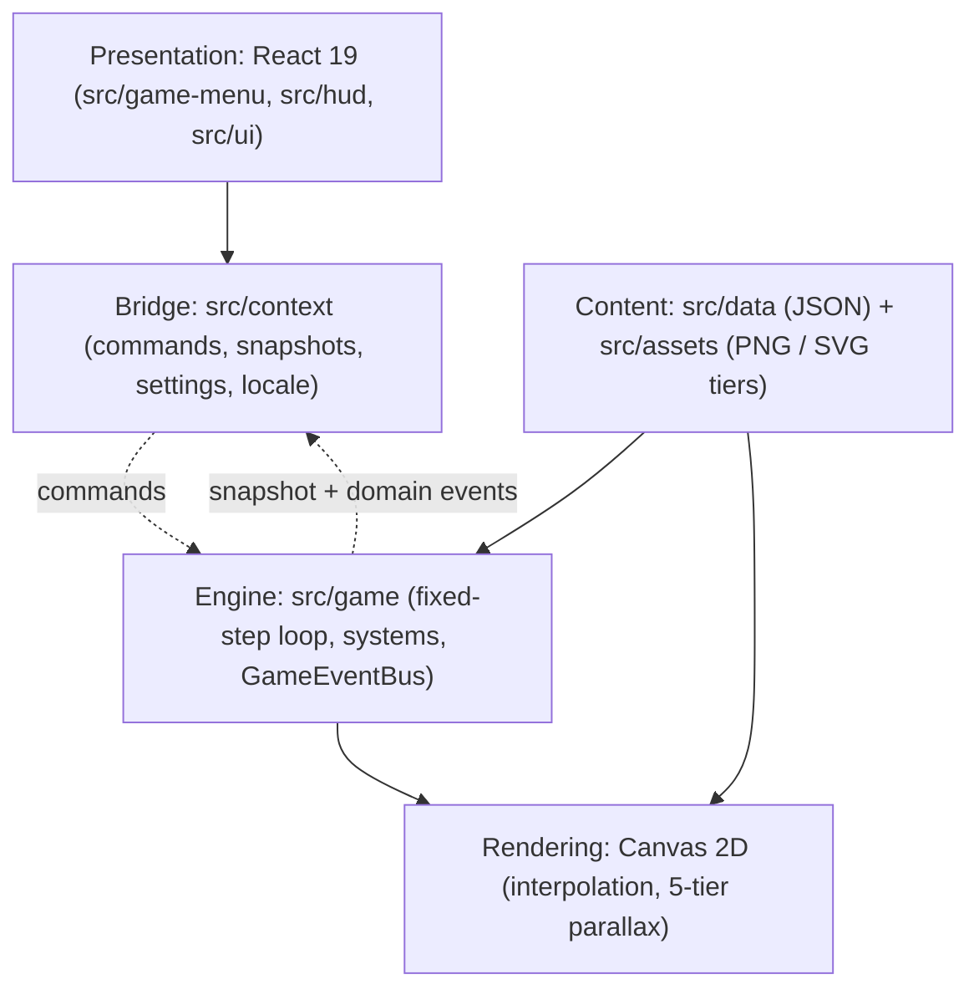

# Vibrant Castle: vision

What we are building. The [roadmap](./ROADMAP.md) says when each part lands, and the [phase files](./README.md#phases) hold the cards.

## Identity

*Vibrant Castle* is a 2D metroidvania in a melancholic gothic fantasy world bathed in an eternal golden autumn. It combines kinetic combat, agile platforming and atmospheric storytelling.

**Setting.** Players explore the ancient **Citadel of Aether**. It was once the seat of horologists, astronomers and fencing scholars, and is now held in temporal stasis after a dimensional fracture. As the **Awakened Duelists** (Valen and Aurelia), players cross ruined spires, restart dormant clockwork and defeat corrupted guardians, while an observant Narrator comments on their path.

## Pillars

1. **Structure closer to 2D Mario.** The campaign has 8 worlds x 8 maps. Each map is a stage with a readable flow. Movement is responsive and forgiving: acceleration, variable jump height, coyote time and jump buffering.
2. **Castlevania: Aria of Sorrow elements.** The style of maps, heroes and enemies, plus exploration, souls and a bestiary, are taken from it. Worlds reward re-exploration.
3. **Autumn palette and mood.** Amber, rust, dark timber and drifting leaves, in both the game and the UI.
4. **Bastion-style narration.** A narrator watches what the player does and comments on it.
5. **Simplified gameplay, keyboard or pad.** Melee, a few spells and a dash, equally good on keyboard or pad. The pad layout is restricted to 2 triggers and 4 face buttons, with the bumpers used as selectors. On pads without Start, holding LB+RB for 0.5 s opens the menu.
6. **Two-level menu.** The game dialog (game, map, character, inventory, magic, settings, help) is separate from the dev dialog "Tworzenie". The dev dialog exists only in dev builds.
7. **Three asset tiers.**
   - `hi8bit`: a simple SVG placeholder that exists for every element.
   - `hi16bit`: SVG source, baked to PNG at build time.
   - `high`: painted PNG.
8. **Six D&D-like attributes** (STR/DEX/CON/INT/WIS/CHA), stored as D20 x10.
   - The level-1 average is 151. Player start values are 110-180; 180 is a starting maximum, not a cap.
   - The player picks priorities 1/2/3, growth is automatic, and monsters use the same scale.
   - Level 1: Valen 151/166/156/136/146/151, Aurelia 131/152/136/176/162/149.

## Where we are and what is missing

Snapshot at end of Phase 4 (`0.3.x`). Every gap is planned in the [roadmap](./ROADMAP.md).

| Pillar | Where we are | What is missing |
| :--- | :--- | :--- |
| Mario structure and movement | 8 maps, one per world (map 1), linked by portals; approved map contract (`docs/design/maps-contract.md`, VC-020). Coyote time, jump buffer, variable jump, asymmetric gravity (`src/game/physics/playerKinematics.ts`). | Hybrid/contract-aligned Map 1 updates (`VC-021`..`VC-028`), maps 2–8 of every world (`VC-161`+), and coyote/buffer/camera tuning (`VC-153`, `VC-159`). |
| Aria of Sorrow | 19 enemy templates with sheets, soul-drop and bestiary data, levers and gates (`src/game/physics/gateState.ts`), rebuilt paper-doll inventory (`VC-035`). | Enemy attacks and contact damage (`VC-037`, `VC-152`), ability gating (portal `isLocked` / `unlockTriggerId` are unused), a map screen, and Phase 5 bestiary/loot (`VC-130`..`133`, `VC-178`..`180`). |
| Autumn palette | Warm location themes, `boss`/`rest` parallax zones (`VC-103`, `VC-109a`), and amber-on-timber UI tokens (`src/styles/theme.ts`). | Review of the blue `aether_sanctuary` theme (`VC-158`), Aurelia's cyan identity, and 3-tier PNG replacements for the 3 legacy JPG worlds (`VC-109b`). |
| Bastion narration | Timed subtitles from i18n keys (`src/game/engine/narrationSystem.ts`) plus Map-1 demo scripts (`docs/design/demo-scenes/`). | Wiring `ReactiveNarratorManager` and `narrator_reactive.json` to `GameEngine` (`VC-155`) and HUD banner placement (`VC-156`). No voice. |
| Restricted pad | Remappable keyboard/gamepad (`src/game/loop/input.ts`) and full menu pad navigation incl. 0.5 s `LB+RB` open chord (`useMenuGamepad.ts`). | Gameplay defaults still bind bumpers and triggers directly (`defaultControls.json`), not as selectors (Phase 5). |
| Two-level menu | Single game dialog shell (`GameMenuDialog`), Settings L2 tabs, confirmations, reserved cards, and dev-only lazy "Tworzenie" (`VC-040`..`047`, `VC-073`, `VC-075`). | Minor playtest UI fixes (`VC-168`, `VC-191`, `VC-192`, `VC-194`) and Tworzenie parity/expansion (`VC-140`..`145`, `VC-169`). |
| Asset tiers | Every hero, enemy, structure, prop, and tileset has `hi8bit` and `hi16bit` (`VC-010`, `VC-012`, `VC-121`..`124`), plus 5 PNG parallax worlds in 3 tiers (`VC-109a`). | Build-time `hi16bit` SVG-to-PNG bake (`VC-011`), remaining `high` PNG enemy/prop/tileset sheets, and 3 JPG parallax worlds (`VC-109b`). |
| Attributes | Central character stats (`src/game/logic/stats/`) and approved D20×10 design doc (`docs/design/character-system.md`, VC-030). | Engine attribute growth (`VC-031`), monster scaling (`VC-032`), skill trees (`VC-033`), equipment model (`VC-034`), and six Aether elements (`VC-038`). |

## Architecture in one picture

The simulation is deterministic and pure TypeScript. React is a passive overlay.

- The loop runs fixed steps at 30/60/90/120 Hz. Rendering interpolates between steps.
- Discrete occurrences go through `GameEventBus`. Continuous state goes through an immutable snapshot.
- The engine rules are in [`.agents/rules/`](../../.agents/rules); the arch tests in `src/tests/arch/` enforce them.
