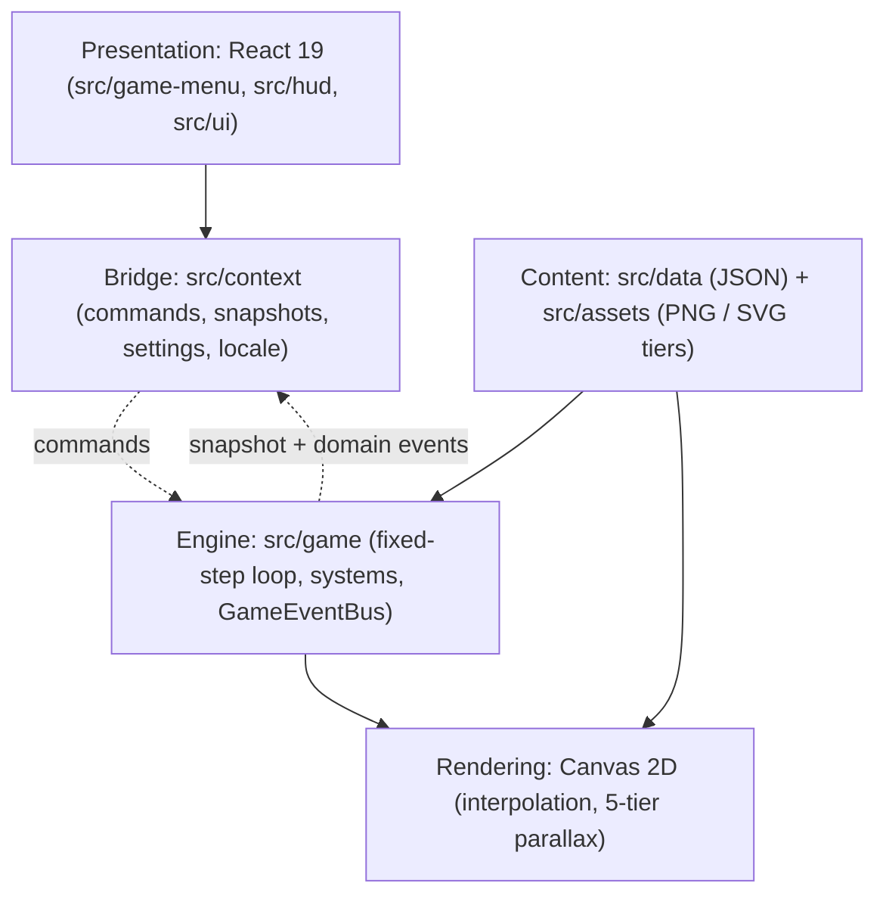

# Vibrant Castle: vision

What we are building. The [roadmap](./ROADMAP.md) says when each part lands, and the [task board](./task-board.md) holds the cards.

## Identity

*Vibrant Castle* is a 2D metroidvania in a melancholic gothic fantasy world bathed in an eternal golden autumn. It combines kinetic combat, agile platforming and atmospheric storytelling.

**Setting.** Players explore the ancient **Citadel of Aether**. It was once the seat of horologists, astronomers and fencing scholars, and is now held in temporal stasis after a dimensional fracture. As the **Awakened Duelists** (Valen and Aurelia), players cross ruined spires, restart dormant clockwork and defeat corrupted guardians, while an observant Narrator comments on their path.

## Pillars

1. **Structure closer to 2D Mario.** The campaign has 8 worlds x 8 maps. Each map is a stage with a readable flow. Movement is responsive and forgiving: acceleration, variable jump height, coyote time and jump buffering.
2. **Castlevania: Aria of Sorrow elements.** The style of maps, heroes and enemies, plus exploration, souls and a bestiary, are taken from it. Worlds reward re-exploration.
3. **Autumn palette and mood.** Amber, rust, dark timber and drifting leaves, in both the game and the UI.
4. **Bastion-style narration.** A narrator watches what the player does and comments on it.
5. **Simplified gameplay, keyboard or pad.** Melee, a few spells and a dash, equally good on keyboard or pad. The pad layout is restricted to 2 triggers and 4 face buttons, with the bumpers used as selectors. On pads without Start, holding LB+RB for 0.5 s opens the menu.
6. **Two-level menu.** The game dialog (game, map, character, inventory, magic, settings, help) is separate from the dev dialog "Tworzenie". The dev dialog exists only in dev builds.
7. **Three asset tiers.**
   - `hi8bit`: a simple SVG placeholder that exists for every element.
   - `hi16bit`: SVG source, baked to PNG at build time.
   - `high`: painted PNG.
8. **Six D&D-like attributes** (STR/DEX/CON/INT/WIS/CHA), stored as D20 x10.
   - The level-1 average is 151. Player start values are 110-180; 180 is a starting maximum, not a cap.
   - The player picks priorities 1/2/3, growth is automatic, and monsters use the same scale.
   - Level 1: Valen 151/166/156/136/146/151, Aurelia 131/152/136/176/162/149.

## Where we are and what is missing

Snapshot at version 0.3.0. Every gap is planned in the [roadmap](./ROADMAP.md).

| Pillar | Where we are | What is missing |
| :--- | :--- | :--- |
| Mario structure and movement | 8 maps, one per world (map 1), linked by portals. Coyote time, jump buffer, variable jump, asymmetric gravity (`src/game/physics/playerKinematics.ts`). | Maps 2-8 of every world, a map contract (VC-020), sprint tier and a tuning pass against a reference. |
| Aria of Sorrow | 14 enemy folders with sheets, soul-drop and bestiary data, levers and gates (`src/game/physics/gateState.ts`). | Enemy attacks and contact damage (enemies only patrol), ability gating (portal `isLocked` / `unlockTriggerId` are unused), a map screen. |
| Autumn palette | Warm location themes and amber-on-timber UI tokens (`src/styles/theme.ts`). | Review of the blue `aether_sanctuary` theme and Aurelia's cyan identity. |
| Bastion narration | Timed subtitles from i18n keys (`src/game/engine/narrationSystem.ts`). | `reactiveNarratorManager.ts` and `narrator_reactive.json` are not wired to the engine. No voice. |
| Restricted pad | Remappable gamepad (`src/game/loop/input.ts`). | Defaults bind bumpers and triggers directly (`defaultControls.json`), not as selectors. Menus have no pad navigation (VC-044). |
| Two-level menu | Separate dev dialog (#63). | A single game dialog shell (VC-041/042), dev dialog hidden in release builds (VC-046). |
| Asset tiers | Heroes have all three tiers (#65). Enemies mostly have `hi16bit` SVG only. | Tier completeness test (VC-010), placeholders (VC-012), restored tilesets/props/pipeline (VC-003), build-time bake (VC-011). |
| Attributes | Central character stats (`src/game/logic/stats/`). | Design doc (VC-030) and the engine model (VC-031/032). |

## Architecture in one picture

The simulation is deterministic and pure TypeScript. React is a passive overlay.

- The loop runs fixed steps at 30/60/90/120 Hz. Rendering interpolates between steps.
- Discrete occurrences go through `GameEventBus`. Continuous state goes through an immutable snapshot.
- The engine rules are in [`.agents/rules/`](../../.agents/rules); the arch tests in `src/tests/arch/` enforce them.
