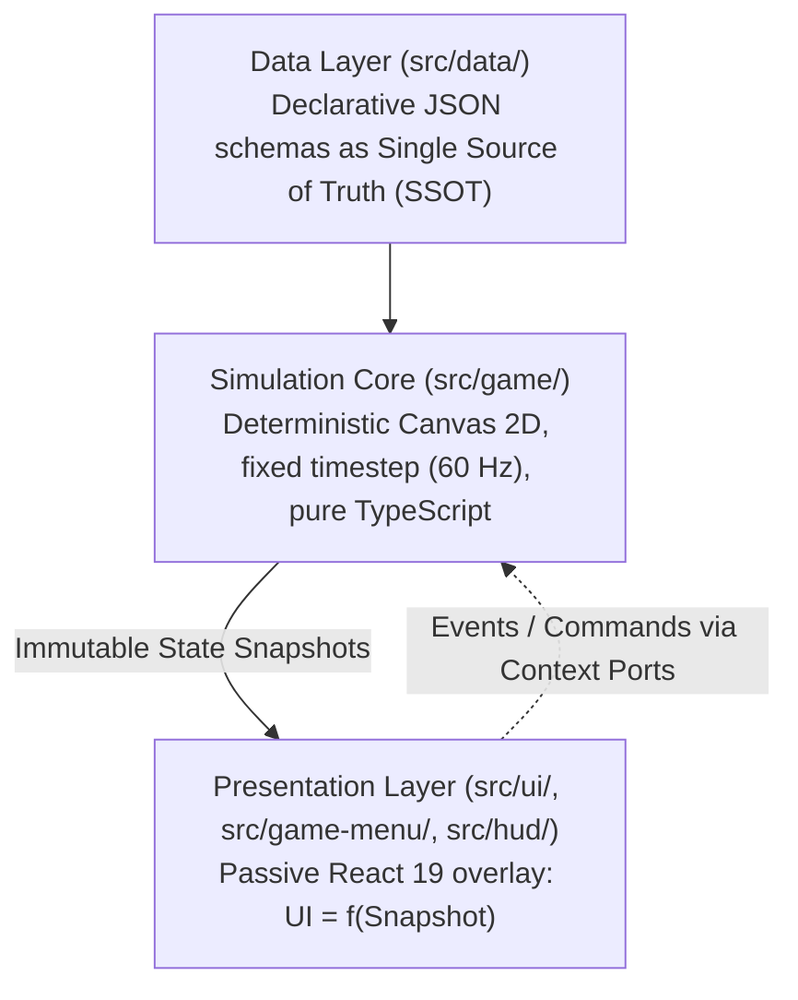

# Technical Architecture & Engine Philosophy

*Vibrant Castle* is built upon an uncompromising engineering architecture, separating deterministic physics simulation from a passive presentation overlay.

---

## 1. The Three Architectural Pillars

### 1.1. Simulation Core (`src/game/`)

- **Deterministic 60 Hz Loop**: The simulation updates in decoupled fixed timesteps, maintaining deterministic physics regardless of monitor refresh rates (you can pick a 30, 60, 90 or 120 Hz tick rate; the default is 60 Hz).
- **Pure TypeScript**: The engine contains zero imports from React, the DOM, or third-party game frameworks.
- **Zero Allocations in Render**: No vectors, arrays, or anonymous closures are instantiated inside `render()` loops, completely preventing Garbage Collection stutter.

### 1.2. Passive Presentation Overlay

- Governing principle: $\text{UI} = f(\text{Snapshot}, \text{Locale}, \text{Theme})$.
- React components never mutate gameplay variables or compute physics. They consume immutable snapshots streamed through typed React Context ports (`src/context/`).
- User actions (consuming potions, toggling settings, pausing) dispatch typed commands back into the engine.

### 1.3. Single Source of Truth (SSOT — `src/data/`)

- Level blueprints, bestiary entries, item stats, and spell constellations are declared in JSON schemas validated by strict AST and integration tests. A level-logic validator (`bun scripts/validate-level.ts <id>`) checks that every map can be finished.

---

## 2. Five-Tier Parallax System

Visual depth in the Citadel of Aether is composed across 5 distinct tiers:

1. **`FAR`**: 100% opaque skybox and eternal autumn sunset. Complete opacity is required to prevent black canvas voids from bleeding through.
2. **`MID_FAR`**: Distant castle architecture and spires.
3. **`MID`**: Ramparts and spires behind the gameplay plane. The champions, beasts, projectiles and platform tiles are drawn between these background layers and the foreground.
4. **`MID_CLOSE`**: Near stonework, arches and columns.
5. **`CLOSE` (Foreground Veil)**: Flora and foreground elements.

Backgrounds scroll at 0 (`FAR`), 0.24, 0.42, 0.65 and 0.85 of the camera speed, and layers that are too small are mirrored to tile without seams. Only the parts in view are drawn.
