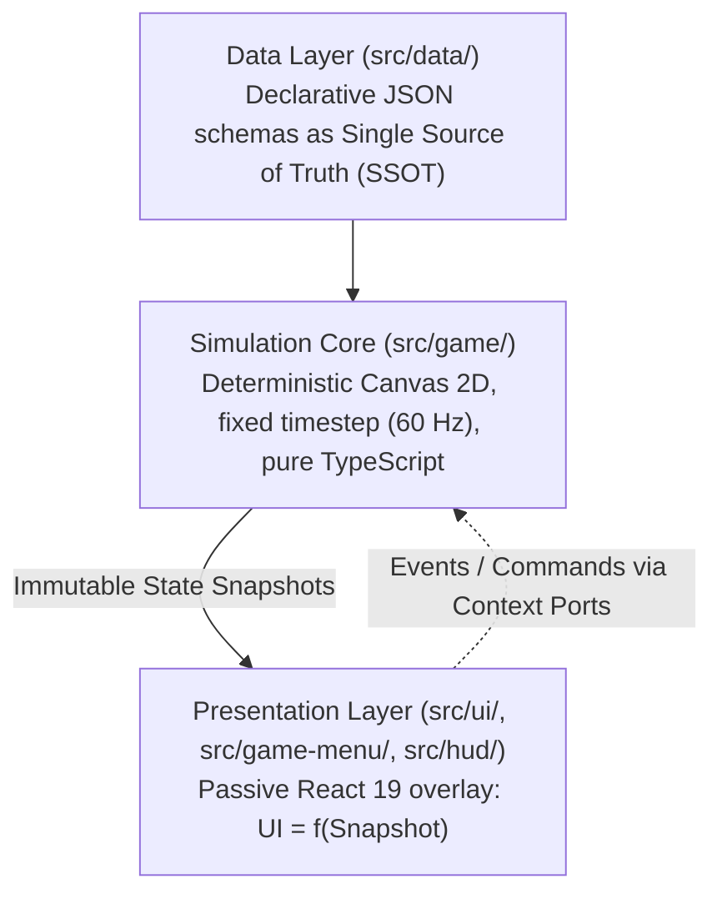

# Technical Architecture & Engine Philosophy

*Vibrant Castle* is built upon an uncompromising engineering architecture, separating deterministic physics simulation from a passive presentation overlay.

---

## 1. The Three Architectural Pillars

### 1.1. Simulation Core (`src/game/`)

- **Deterministic 60 Hz Loop**: The simulation updates in decoupled fixed timesteps, maintaining deterministic physics regardless of monitor refresh rates (30, 60, 120, 144 Hz).
- **Pure TypeScript**: The engine contains zero imports from React, the DOM, or third-party game frameworks.
- **Zero Allocations in Render**: No vectors, arrays, or anonymous closures are instantiated inside `render()` loops, completely preventing Garbage Collection stutter.

### 1.2. Passive Presentation Overlay

- Governing principle: $\text{UI} = f(\text{Snapshot}, \text{Locale}, \text{Theme})$.
- React components never mutate gameplay variables or compute physics. They consume immutable snapshots streamed through typed React Context ports (`src/context/`).
- User actions (consuming potions, toggling settings, pausing) dispatch typed commands back into the engine.

### 1.3. Single Source of Truth (SSOT — `src/data/`)

- Level blueprints, bestiary entries, item stats, and spell constellations are declared in JSON schemas validated by strict AST and integration tests.

---

## 2. Five-Tier Parallax System

Visual depth in the Citadel of Aether is composed across 5 distinct tiers:

1. **`FAR`**: 100% opaque skybox and eternal autumn sunset. Complete opacity is required to prevent black canvas voids from bleeding through.
2. **`MID_FAR`**: Distant spires of the Citadel and slowly turning brass gears.
3. **`MID` (Gameplay Plane)**: Platforms, walkable terrain, champions, beasts, and projectiles.
4. **`MID_CLOSE`**: Near environmental arches, columns, and chandeliers.
5. **`CLOSE` (Foreground Veil)**: Drifting golden leaves, banners, and atmospheric vignetting.
