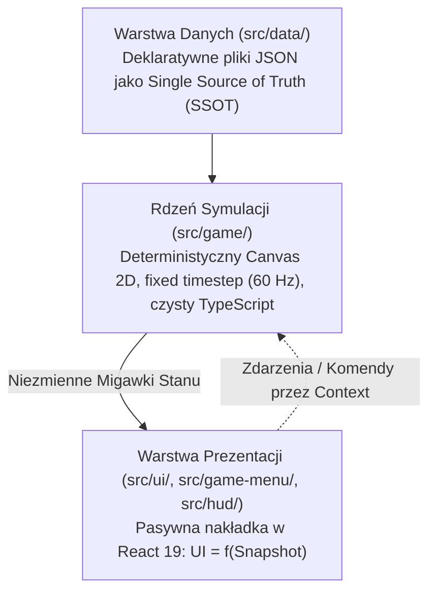

# Architektura Techniczna i Filozofia Silnika

*Vibrant Castle* opiera się na bezkompromisowej architekturze inżynieryjnej, oddzielającej deterministyczną symulację fizyczną od pasywnej warstwy prezentacji.

---

## 1. Trzy Filary Architektury

### 1.1. Rdzeń Symulacji (Simulation Core — `src/game/`)

- **Deterministyczna pętla 60 Hz**: Pętla symulacji działa w stałych krokach czasowych (fixed timestep), niezależnie od częstotliwości odświeżania monitora użytkownika (30, 60, 120, 144 Hz).
- **Czysty TypeScript**: Kod silnika nie zawiera żadnych importów z Reacta, DOM ani zewnętrznych frameworków gier.
- **Zero alokacji w pętli renderowania**: Wewnątrz metod `render()` zabronione jest tworzenie nowych obiektów wektorów, tablic czy funkcji anonimowych, co chroni przed zacięciami Garbage Collectora.

### 1.2. Pasywna Nakładka UI (Passive Presentation Overlay)

- Formuła naczelna: $\text{UI} = f(\text{Snapshot}, \text{Locale}, \text{Theme})$.
- Komponenty React nigdy nie symulują fizyki ani nie modyfikują bezpośrednio stanu gry. Subskrybują one niezmienne migawki stanu przez porty React Context (`src/context/`).
- Wszelkie interakcje użytkownika (użycie mikstury, zmiana ustawień, pauza) są przesyłane jako silnie typowane komendy.

### 1.3. Pojedyncze Źródło Prawdy (SSOT — `src/data/`)

- Lokacje, potwory, przedmioty i czary są definiowane w deklaratywnych plikach JSON podlegających rygorystycznym testom parsowania i integralności.

---

## 2. System Pięciu Warstw Paralaksy

Głębia wizualna Cytadeli Aether tworzona jest z 5 warstw odległości:

1. **`FAR` (Tło odległe)**: 100% nieprzezroczysty skybox i wieczny zachód słońca. Bezwzględny rygor braku przezroczystości chroni przed prześwitywaniem czarnego canvasa.
2. **`MID_FAR`**: Odległe sylwetki iglic Cytadeli i obracające się zębatki horologiczne.
3. **`MID` (Płaszczyzna gry)**: Chodniki, platformy, bohaterowie, potwory i pociski.
4. **`MID_CLOSE`**: Bliskie gotyckie kolumny i wiszące żyrandole.
5. **`CLOSE` (Pierwszy plan)**: Spadające złote liście, powiewające sztandary i winiety.
